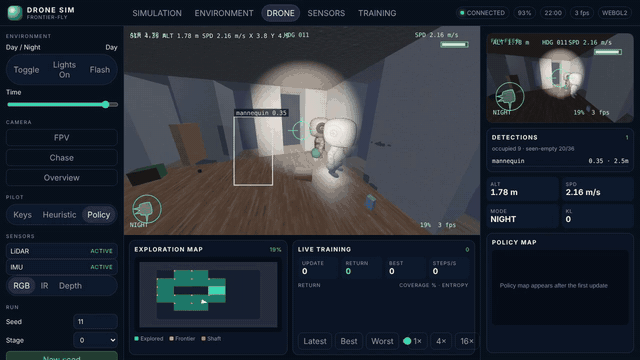
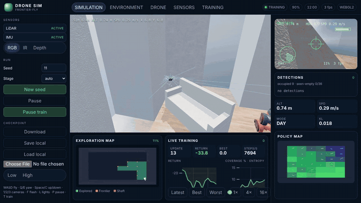
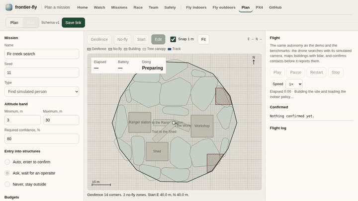
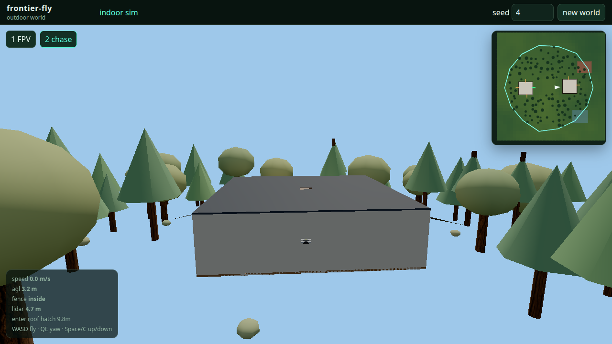
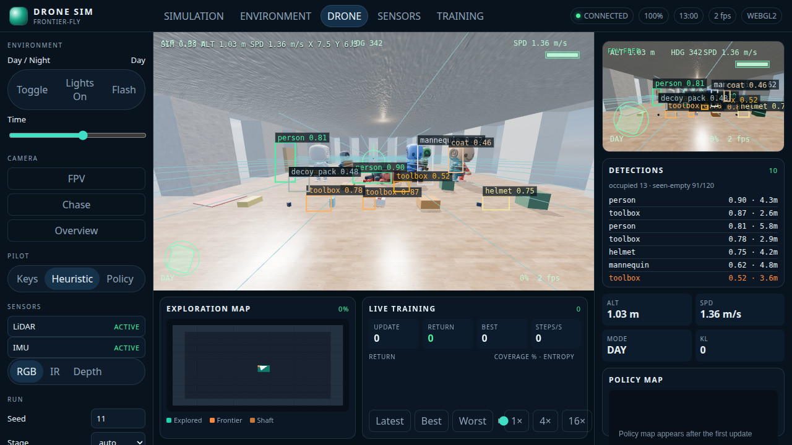
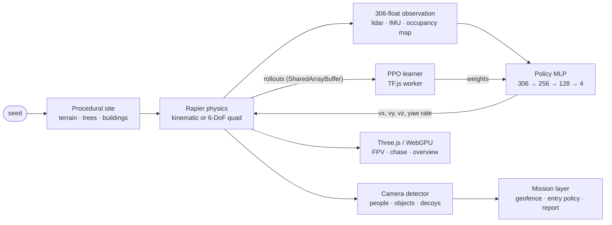

# frontier-fly

**A drone that teaches itself to search buildings, from the treeline to the last room, entirely in your browser.**

[](https://github.com/alexnieves-cs/frontier-fly/actions/workflows/ci.yml)
[](https://github.com/alexnieves-cs/frontier-fly/actions/workflows/pages.yml)
[](LICENSE)

<p align="center">
  <!-- hero: swap to docs/media/mission-cabin-day.gif once the woods-to-building demo is recorded -->
  
</p>

### [▶ Try it live](https://alexnieves-cs.github.io/frontier-fly/) · [Mission editor](https://alexnieves-cs.github.io/frontier-fly/mission.html) · [Outdoor site](https://alexnieves-cs.github.io/frontier-fly/outdoor.html) · [Benchmarks](docs/BENCHMARKS.md) · [Architecture](docs/ARCHITECTURE.md)

frontier-fly is a search-and-rescue drone simulator and autopilot. A quadrotor reads lidar, an IMU, and its own map of where it has been, and a small neural network trained with reinforcement learning decides where to fly next. The mission it is built for: sweep a geofenced patch of woods, find the building, pick an opening it actually fits through, search room by room for a missing person or confirm the place is clear, fly home, and file a report.

Everything runs client-side. Physics (Rapier, 400 Hz), sensors, PPO training (TensorFlow.js in a worker), and rendering (Three.js, WebGPU when available) all happen in the tab. There is no server and no GPU cluster. A seed rebuilds the same world exactly, so every result here can be reproduced.

The project is civilian and defensive only: search, inspection, and confirm-clear. The drone never pursues or engages anyone.

## Features

| | |
| --- | --- |
| <br>**Train it in the tab.** Press Train and up to four worker threads roll out episodes into `SharedArrayBuffer`s while a learner worker runs PPO. Return, coverage, entropy, and a policy heatmap update live. [MP4](docs/media/training.mp4) | <br>**Fly by flashlight.** The policy never sees pixels, only lidar, IMU, and an egocentric occupancy map, so it flies the same with the lights off. FPV adds the HUD and simulated detections. [MP4](docs/media/fpv-night.mp4) |
| <br>**Plan a mission.** Draw a geofence and no-fly zones, set an altitude band, targets, required confidence, an entry policy (auto, ask, never), and budgets. The plan validates against a versioned JSON schema and shares as a link. [MP4](docs/media/mission-editor.mp4) | <br>**A site, not a room.** Seeded terrain, instanced trees with colliders, and one to four building shells with typed openings: open and broken windows, ajar doors, vents, garage gaps, roof hatches. Only openings that clear the airframe are enterable. |
| <br>**Something to find.** Simulated people standing, sitting, lying, walking, and hiding, a library of search objects, and decoys. A geometric camera detector misses with distance, occlusion, darkness, and motion blur, and false-alarms on decoys. | <br>**Procedural buildings.** BSP rooms, doors, hallways, multi-floor shafts, and a reachability check. PBR interiors with CC0 textures, an HDRI sky, SSAO, bloom, and SMAA on the high preset. |

<!-- Woods-to-building mission clips (find target, confirm clear, night entry) go here once demo.html lands. `npm run media` records them. -->

## Benchmarks

These tables are generated by `npm run bench && npm run docs` from [`docs/benchmarks.json`](docs/benchmarks.json). Misses are shown as misses. Method, per-seed results, and render frame rates are in [docs/BENCHMARKS.md](docs/BENCHMARKS.md).

<!-- generated:benchmarks:start -->
<!-- generated:benchmarks:end -->

**Missions.**

<!-- generated:missions:start -->
<!-- generated:missions:end -->

## How it works



**Training.** The shipped checkpoint starts from behavior cloning: a privileged frontier-seeking teacher that can see the explored map flies the curriculum, and the network learns to imitate it from its own sensors. PPO then fine-tunes on the spec reward (new coverage, new rooms and floors, collisions, smoothness, time) plus a distance-to-frontier shaping term. A six-stage curriculum grows the buildings from one 8×8 m room to multi-floor layouts with quadrotor dynamics, and randomizes mass, thrust, drag, motor lag, sensor noise, wind, and lighting so the policy cannot overfit one world. The full loop runs in the browser, and the same code runs headless in Node for `npm run pretrain` and the benchmarks.

**Why it works at night.** The observation has no camera pixels. Lidar and the occupancy map do not care about light, so night coverage is measured against day coverage as a check on that design, not a separate model.

More detail, including the generated module graph and the headless boundary between sim and renderer, is in [docs/ARCHITECTURE.md](docs/ARCHITECTURE.md).

## Tech stack

| Layer | What | Why |
| --- | --- | --- |
| Language and build | TypeScript 5.7, Vite 6 | One codebase for the browser, workers, and Node |
| Physics | [Rapier](https://rapier.rs) 0.14 (WASM) | Deterministic colliders and fast ray casts for lidar |
| Learning | [TensorFlow.js](https://www.tensorflow.org/js) 4.22, hand-written SIMD WASM gemm | PPO updates on WebGL or CPU, cheap batched inference in env workers |
| Rendering | [Three.js](https://threejs.org) 0.170, WebGPU or WebGL2 | PBR, post passes, and a WebGPU path on capable browsers |
| Charts | [uPlot](https://github.com/leeoniya/uPlot) | Lightweight live training curves |
| Concurrency | Web Workers, `SharedArrayBuffer` | Rollouts without copying |
| Tests | Vitest, Playwright, ESLint | Unit, perf, and headless browser checks in CI |
| Hosting | GitHub Pages + [coi-serviceworker](https://github.com/gzuidhof/coi-serviceworker) | Static hosting with cross-origin isolation |

## Run locally

Needs Node 22.

```bash
npm ci
npm run dev        # http://127.0.0.1:3000 with COOP/COEP headers
npm test           # unit and perf tests
npm run build      # typecheck and production bundle in dist/
```

| Script | What it does |
| --- | --- |
| `npm run test:e2e` | Headless Chrome checks and screenshots |
| `npm run bench` | Coverage and throughput, written to `docs/benchmarks.json` |
| `npm run media` | Record the demo clips into `docs/media/` (needs ffmpeg) |
| `npm run docs` | Regenerate `docs/ARCHITECTURE.md`, `docs/BENCHMARKS.md`, and the README tables |
| `npm run check:pages` | Serve `dist/` the way GitHub Pages does and check every page loads |
| `PRETRAIN_UPDATES=20 npm run pretrain` | Retrain and rewrite the shipped checkpoint |

<details>
<summary>Controls and URL parameters</summary>

| Input | Action |
| --- | --- |
| W A S D | Fly forward / left / back / right |
| Q E or arrow left / right | Yaw |
| Space / C | Climb / descend |
| 1 2 3 | FPV, chase, overview |
| F | Flashlight |
| L | Interior lights |
| P | Pause the sim |
| T | Start or pause training |
| Drag in overview | Orbit the cutaway camera |

| Query | Effect |
| --- | --- |
| `seed` | Building and episode seed |
| `shot` | `day`, `dusk`, `night`, `fpv`, `targets`, `targets-room`, or `targets-night` |
| `camera` | `fpv`, `chase`, `overview` |
| `stage` | `0`–`5` or `auto` |
| `train=1` | Start PPO when the page loads |
| `quality` | `low` or `high` |
| `pilot` | `keys`, `heuristic`, or `policy` |
| `tod`, `flash`, `lights` | Time of day (0–24), flashlight `1`, interior lights `0` |

Example: [`?seed=11&stage=0&camera=fpv&tod=22&flash=1&lights=0&pilot=policy`](https://alexnieves-cs.github.io/frontier-fly/?seed=11&stage=0&camera=fpv&tod=22&flash=1&lights=0&pilot=policy). Pilot defaults to the keyboard. Shot URLs fly a lidar heuristic so the camera has something to follow. Choose **Policy** to fly the checkpoint.

</details>

## Honest limits

- The shipped policy does not yet meet the coverage goals. [BENCHMARKS.md](docs/BENCHMARKS.md) has the current numbers, and the gap on large unseen buildings is the main open problem.
- Clips in `docs/media/` were recorded in a cloud container with software WebGL, which renders at a few frames per second. FPV and training clips play one captured frame per 50 ms sim step, so flight runs at true speed and the training charts run faster than real time. On a laptop GPU the page runs in real time.
- Furniture and door leaves are visual. Colliders are the building grid, so a chair does not stop the drone.
- The detector is geometric, not a trained vision model.

## Roadmap

- **Woods-to-building missions end to end**: outdoor sweep, opening selection and entry, room search, confirm-clear, return home, and an operator report.
- **Generalization**: at least 80% coverage on easy buildings and 60% on unseen hard ones, with night at 90% or more of day.
- **Swarm search**: several drones sharing one site, splitting the area, and handing off rooms. Needs a shared world and an agent axis in the rollout layout.
- **Defensive evasion**: the drone moves out of the way of people and moving obstacles. Dodge only. It never pursues, tracks for harm, or strikes.

## Contributing

Issues and pull requests are welcome. See [CONTRIBUTING.md](CONTRIBUTING.md) for setup, checks, and the project's civilian-use scope.

## Credits and license

Code is [MIT](LICENSE). Every third-party asset is CC0 or MIT and listed with its source in [CREDITS.md](CREDITS.md): Poly Haven sky, ambientCG textures, the KayKit mannequin and animations, three.js post passes, and coi-serviceworker.
