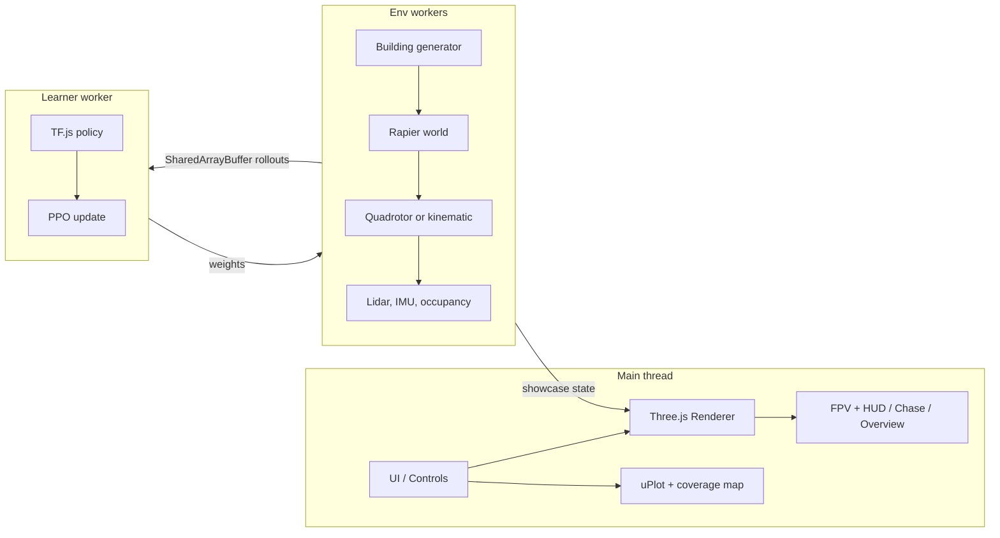

# frontier-fly

**frontier-fly** — Watch a tiny neural network learn to fly. A drone starts out bouncing off walls in a procedurally generated building. Within minutes it is sweeping rooms, threading doorways, and climbing shafts to explore floors it has never seen. Flip to FPV, kill the lights, and watch it keep going by flashlight. Everything runs in your browser: quadrotor physics, lidar, PPO training, WebGPU rendering, and live charts. No servers and no GPU cluster, just a seed and some patience.

The sim is deterministic. A seed rebuilds the same building, and the policy reads lidar, IMU, and an egocentric occupancy crop so it does not depend on the lights.

## Screenshots

Day chase, night with the flashlight, and the FPV feed. Captured headlessly in Chrome from `/?shot=day`, `/?shot=night`, and `/?shot=fpv`.


## Setup

```bash
npm install
npm test
npm run dev
```

`npm run dev` serves the app at `http://127.0.0.1:3000` with COOP/COEP headers so `SharedArrayBuffer` is available. `npm run build && npm run preview` builds the static site the GitHub Pages workflow publishes.

## Controls

| Input | Action |
| --- | --- |
| W A S D | Fly forward / left / back / right |
| Q E or arrow left / right | Yaw |
| Space / C | Climb / descend |
| 1 2 3 | FPV, chase, overview |
| F | Flashlight |
| L | Interior lights |
| P | Pause the sim |
| T | Start or pause training |
| Drag in overview | Orbit the cutaway camera |

The left rail also sets the seed, curriculum stage, time of day, sensor mode (RGB, IR, depth), and checkpoint save/load. A shareable URL looks like `/?seed=11&camera=fpv&tod=22&shot=night`.

| Query | Effect |
| --- | --- |
| `seed` | Building and episode seed |
| `shot` | `day`, `dusk`, `night`, or `fpv` preset |
| `camera` | `fpv`, `chase`, `overview` |
| `stage` | `0`–`5` or `auto` |
| `train=1` | Start PPO when the page loads |
| `quality` | `low` or `high` |
| `pilot` | `keys`, `heuristic`, or `policy` |

Pilot defaults to the keyboard. Shot URLs fly a lidar heuristic so the camera has something to follow before a policy has learned the building. Choose **Policy** to fly the loaded checkpoint.

## Architecture



`src/sim`, `src/gen`, and `src/rl` do not import Three.js. Training can run headless. The renderer only consumes a `BuildingSpec`, a `DroneState`, and a `LightingState`.

## What is implemented

- Seeded buildings: BSP rooms, doors, hallways from stage 3, shafts when there is more than one floor, and a reachability check that retries with `seed + 1`.
- Kinematic flight and a 6-DoF quadrotor with a velocity-to-attitude cascade, motor lag, and drag. Physics steps at 400 Hz in quad mode. Rapier builds the colliders and casts the lidar.
- Observation is 306 floats: 40 lidar ranges, IMU, altitude, a 16×16 egocentric map, floor index, and time remaining. The action is `[vx, vy, vz, yawRate]`.
- PPO in TensorFlow.js, GAE, running observation and reward normalization, and a six-stage curriculum. Up to four env workers write rollouts into `SharedArrayBuffer`s. Inference uses a SIMD WASM gemm when the runtime has it.
- Chase, FPV, and overview cameras, a canvas HUD, day/night lighting, per-room lights, a flashlight, and IR/depth display modes.
- Live return, coverage, and entropy charts, a top-down coverage map, a policy heatmap once training has weights, and a replay scrubber at 1×, 4×, and 16×.
- A checkpoint in `public/checkpoints/pretrained.json`, plus download and IndexedDB save/load.

## Honest limits

The shipped policy is a 306→256→128 network. It was behavior-cloned from a privileged frontier teacher (that teacher can see the visited grid; the network cannot) and then fine-tuned with PPO. The reward is the spec's coverage, room, floor, collision, smoothness, and time terms, plus a distance-to-frontier shaping term. Training episodes on early stages are allowed more than the spec's 3 hard collisions so they do not die on the first doorway.

On four stage-0 seeds the deterministic policy covered **78.5%, 75.7%, 77.1%, and 65.3%** (mean **74.1%**). The spec bar is 80%. Night-dark on those same seeds averaged **69.8%**, which is **94%** of the day mean, so the night-versus-day ratio clears 90% here. On three fresh stage-3 seeds the day coverage was **24.3%, 17.8%, and 22.7%** (mean **21.6%**). That misses the 60% bar. The same teacher, not the network, covers a stage-0 room past 95% and averaged about 66% on three stage-3 buildings. The network does not reproduce that.

A kinematic step measured **0.18 ms** in Node (about 5,600 steps/s), inside the 0.3 ms budget. Four worker threads stepping that env summed to about **24,000** environment steps/s, above the 10k target. The same four workers running an untrained network, and rebuilding the building whenever an episode ends, summed to about **6,500** steps/s, which is under 10k. Batched SIMD inference is about **0.05 ms** per environment at batch 8. The learner tries the TensorFlow.js WebGL backend and falls back to CPU. Node training for this checkpoint used CPU. A separate TensorFlow.js WASM or WebGPU package is not bundled; the SIMD gemm is a small kernel in `src/rl/gemm.ts`.

Furniture, door leaves, and propeller wash are visual. Rapier colliders are still the building grid, so a chair does not stop the drone.

Headless Chrome on this machine, with ANGLE software WebGL2 and no discrete GPU, rendered the high preset at about **7 fps** and the low preset at about **23 fps**. That does not meet 45 / 60 fps, and it was not measured on a laptop GPU. WebGPU is requested when the quality preset is high and an adapter answers within 350 ms; this capture stayed on WebGL2. High quality runs SSAO, bloom, and SMAA. Three's TAA pass accumulates only while the camera is nearly still, because that pass has no motion vectors. FPV adds an afterimage trail and a lens/vignette shader. There is no SSR and no baked global illumination. Numbers from the capture are in `docs/media/capture.json`. Asset licenses are in [CREDITS.md](CREDITS.md). Every shipped texture and the HDRI is under 5 MB, so nothing is in Git LFS.

## Scripts

| Script | What it does |
| --- | --- |
| `npm test` | Unit tests and the kinematic step measurement |
| `npm run build` | Typecheck and production bundle |
| `npm run test:e2e` | Headless Chrome screenshots |
| `PRETRAIN_UPDATES=20 npm run pretrain` | Retrain and rewrite the shipped checkpoint |

## License

MIT. See [LICENSE](LICENSE).
