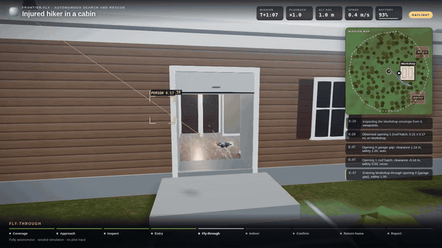

# frontier-fly

**A search-and-rescue drone autopilot that searches buildings from the treeline to the last room, entirely in your browser, and an honest measurement of how often it is wrong. A sensor-only planner maps and flies without ever reading the floor plan, a failure atlas hunts for its rare mistakes, and a learned policy is tested against the planner, where it wins on a simple airframe and loses on a quadrotor.**

[](https://github.com/alexnieves-cs/frontier-fly/actions/workflows/ci.yml)
[](https://github.com/alexnieves-cs/frontier-fly/actions/workflows/pages.yml)
[](https://github.com/alexnieves-cs/frontier-fly/releases/latest)
[](LICENSE)
[](https://doi.org/10.5281/zenodo.23717793)

<p align="center">
  
</p>

### [▶ Try it live](https://alexnieves-cs.github.io/frontier-fly/) · [Mission film](https://alexnieves-cs.github.io/frontier-fly/film.html) · [How it works](https://alexnieves-cs.github.io/frontier-fly/how.html) · [Drone swarm](https://alexnieves-cs.github.io/frontier-fly/swarm.html) · [Safety numbers](https://alexnieves-cs.github.io/frontier-fly/atlas.html) · [Tech report (PDF)](https://alexnieves-cs.github.io/frontier-fly/frontier-fly-report.pdf) · [Project guide](docs/GUIDE.md) · [All docs](docs/README.md)

Built by **Alex Nieves** · [portfolio](https://alexnieves.me) · [GitHub](https://github.com/alexnieves-cs) · [about the project](#about-the-project)

The drone sweeps a geofenced patch of woods, finds the building, picks an opening it fits through, searches room by room for a missing person or confirms the place is clear, flies home and files a report. Physics, sensors, training and rendering all run in the tab, with no server, and a seed rebuilds the same world exactly. Civilian and defensive use only: it searches, inspects and confirms clear, and never pursues anyone.

## Results

<!-- generated:headline:start -->
| Question | Measured | On |
| --- | --- | --- |
| Do staged missions end the right way? | 98.3% (94.1–99.5%) found the target or correctly cleared | 120 missions on the quadrotor: four fixed scenarios, calm air, no faults, any person lying still |
| **And over a realistic mix of conditions?** | **41.2%** (40.0–42.5%) end as expected, 53.4% with no fault injected. Most of the rest end *incomplete* and hand back to a person; an empty site is correctly cleared in 37.7% of sweeps | 6,000 flights drawn from the failure atlas's declared mix of missions, people who walk or hide, wind, and a fault on 40% of flights |
| **How often does it call a building clear with someone inside?** | **0.25% per flight** (0.16–0.35%); a plain draw gives 0.20% (12 of 6,000). It was 4.05% before unconfirmed people blocked a clear (0.30% after, both versions on the same 2,000 seeds) | 2,000 importance-sampled flights over the same mix |
| How often does it hit something? | 1.22% per flight (0.97–1.53%) | 6,000 flights drawn from the same mix |
| Does it end safely when something breaks? | 98.6% (97.7–99.2%) of faulted flights end safely: 395 finished the mission, 495 flew home, 64 landed where they were, 6 crashed | 960 flights with sensor, motor, battery, link, GNSS or wind faults |
| What does the learned policy add? | On the simple airframe, more coverage: 75.1% (70.5–79.4%) behind its lidar guard, 1 of 30 crashed, against 65.5% for the sensor-only planner, which touched nothing; alone it covers 67.5%, 7 of 30 crashed and 16 of 30 touched a wall (contacts slower than 0.5 m/s do not end a flight). On quadrotor dynamics it loses: the planner covers 46.9% with 0 crashes, the policy 11.9% and crashes in 30 of 30 | 30 hard buildings per airframe |
| Does it need light? | No: it flies on lidar. With every room light off and its flashlight on it covers 77.0% (guarded policy; the planner 65.8%). In this simulator darkness only adds 5% lidar dropout, so this checks the design, not a harder condition | the same buildings |
<!-- generated:headline:end -->

Every number comes from report-only seed blocks that no model or setting was tuned on, with 95% intervals, and is regenerated from the study's JSON by `npm run docs`. The blocks are re-flown when the code changes, so they are held out, not unseen. Read the first two rows together: staged scenarios go well, and a realistic mix of conditions does not. The false-clear rate is the next one to read: it is why this is a research simulator and not a product. The learned policy is the one to read second: nine further training runs did not get it past the planner on the quadrotor ([QUAD_POLICY.md](docs/QUAD_POLICY.md)). The [project guide](docs/GUIDE.md#honest-limits) lists the other limits.

## Run it

Everything runs in a browser tab, on desktop or phone. Pick the way that suits you:

| Way | What you get | Needs |
| --- | --- | --- |
| [Live site](https://alexnieves-cs.github.io/frontier-fly/) | Every page: the film, missions, race, drone team, safety numbers, indoor and outdoor flying, the mission planner and PX4 | Nothing, just a browser |
| Your computer | The site, training and benchmarks (`npm run train:ppo`, `npm run study:missions`, ...) | Node 22 |
| Terminal or Docker | The whole mission, FrontierBench and QGroundControl plan export with no browser: `docker run --rm ghcr.io/alexnieves-cs/frontier-fly mission`, see [CLI.md](docs/CLI.md) | Docker, or Node 22 |
| Python | A Gymnasium env (`gym.make("FrontierFly-hard-v0")`) and the FrontierBench scorer, on the same simulator, install from a checkout (not on PyPI yet), see [python/](python/README.md#install) | Python 3.10+ and Node 22 |

Also: [GitHub Codespaces](https://codespaces.new/alexnieves-cs/frontier-fly?quickstart=1), a real autopilot in the loop ([PX4.md](docs/PX4.md)), and a simulated Crazyflie that has not flown for real yet ([CRAZYFLIE.md](docs/CRAZYFLIE.md)).

```bash
npm ci && npm run dev   # Node 22, then open http://127.0.0.1:3000
```

The [project guide](docs/GUIDE.md) covers the pages, every benchmark table, the studies, and how to train the policy, and the [docs index](docs/README.md) lists every write-up. [ARCHITECTURE.md](docs/ARCHITECTURE.md) maps the code, and [CONTRIBUTING.md](CONTRIBUTING.md) explains how to send changes. Code is [MIT](LICENSE). Every asset is CC0, MIT, Apache-2.0 or CC BY 4.0 and listed in [CREDITS.md](CREDITS.md).

## Project status

frontier-fly is at a stable stopping point as of [v1.2.0](CHANGELOG.md): the site, the CLI and Docker image, the Python package and FrontierBench are complete and tested in CI, and no new features or studies are planned. The limits above stay as measured: fewer than half of missions end as expected over a realistic mix of conditions, the false-clear rate is not zero, the learned policy loses to the planner on the quadrotor, and nothing has flown on real hardware. The built-in flight controller also stops the quadrotor in about a quarter of the distance PX4's default gains need on the same physics ([PHYSICS_VALIDATION.md](docs/PHYSICS_VALIDATION.md)), so crash and braking numbers are optimistic for a drone flown by PX4. Bug fixes and dependency updates still land, and [CONTRIBUTING.md](CONTRIBUTING.md) explains how to send changes or a benchmark entry.

## About the project

frontier-fly is built by [Alex Nieves](https://alexnieves.me) ([GitHub](https://github.com/alexnieves-cs)). It started as a browser drone demo and grew into a research-style simulator: a sensor-only planner, a failure atlas, a learned pilot measured against both, PX4 in the loop, a Python package, and a benchmark anyone can enter.

What turned out to be hard, and what the repository does about it:

- **A good average hides rare failures.** The mission bench looked fine, but the failure atlas found the drone calling a building clear with a walking or hiding person inside on about 4% of flights. Tracking people across views and letting an unconfirmed person block a clear took that to 0.3% on the same seeds. The price is that many sweeps now end incomplete instead of clear.
- **Free contacts teach bad habits.** The learned policy covered the most of any pilot, then a crash rule showed it was sliding along walls. Retraining under the rule cut the policy's own crashes from 19 of 30 flights to 7, and the lidar guard takes that to 1. The habit moved below the threshold more than it went away: alone, the retrained policy still touches a wall slowly in 16 of 30 flights, and under the guard in 5.
- **Small fixed evaluations flatter.** The early 86% was partly seed luck. Every headline now comes from held-out seed blocks with 95% intervals, and the generated docs fail CI if a number drifts from its JSON.
- **A learned pilot is not automatically the better pilot.** Behind a guard on a simple airframe the policy covers ten points more than the planner. On quadrotor dynamics it crashes in every flight, and nine training runs (planner imitation, braking labels, memory, quad-only training) closed only part of the gap. Missions keep the planner as the pilot of last resort; the write-up is in [QUAD_POLICY.md](docs/QUAD_POLICY.md).
- **Simulators lie in specific ways.** Kinematic drones stop instantly and quadrotors don't. A braking filter, a quad-aware tracker and PX4 SITL in CI keep the gap visible.

Skills it covers: reinforcement and imitation learning (behavior cloning, DAgger, PPO), quadrotor dynamics and control, lidar mapping and scan-matching localization, PX4 and MAVLink, benchmark design, TypeScript, three.js and WebGL, Python packaging, and CI on GitHub Actions. To cite it, see [CITATION.cff](CITATION.cff).
