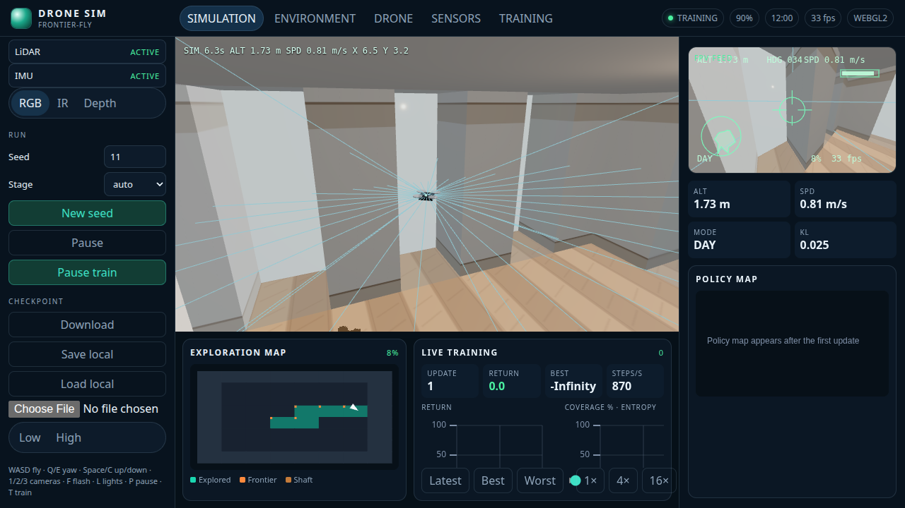
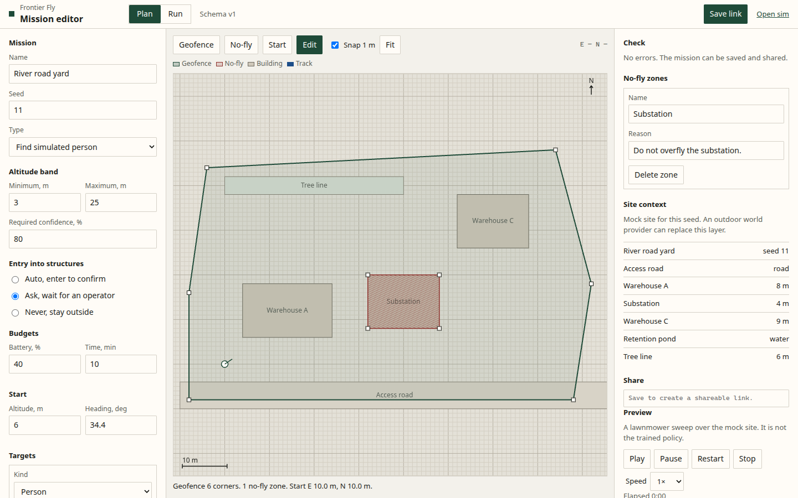
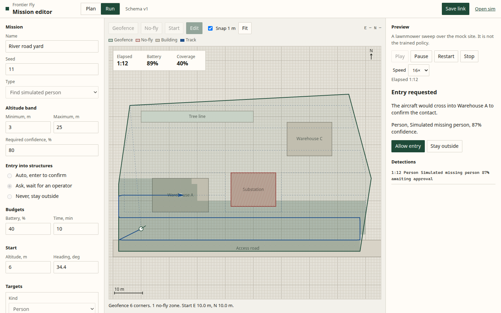
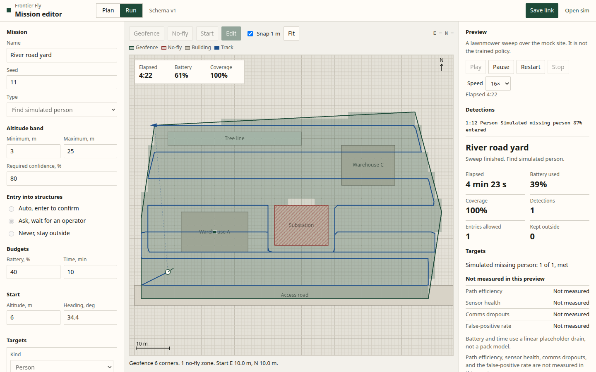
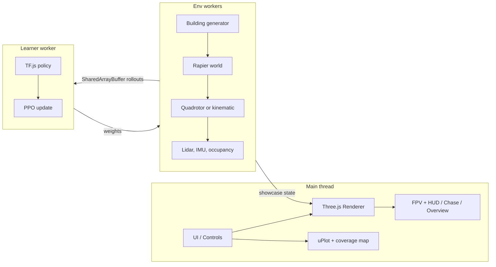
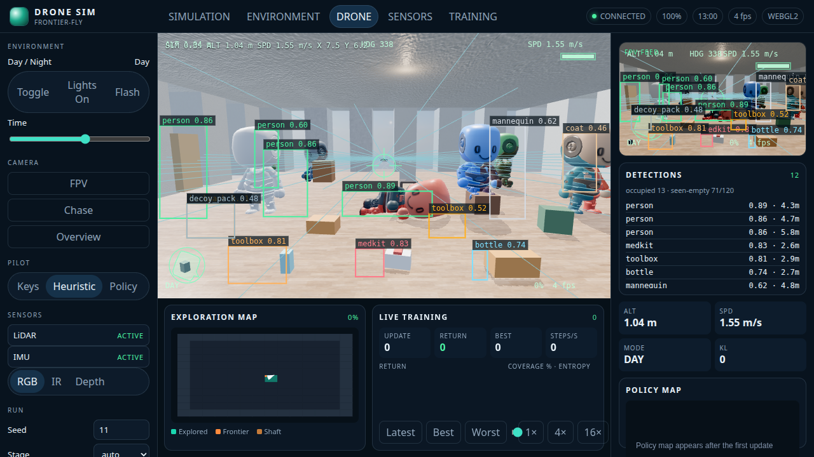
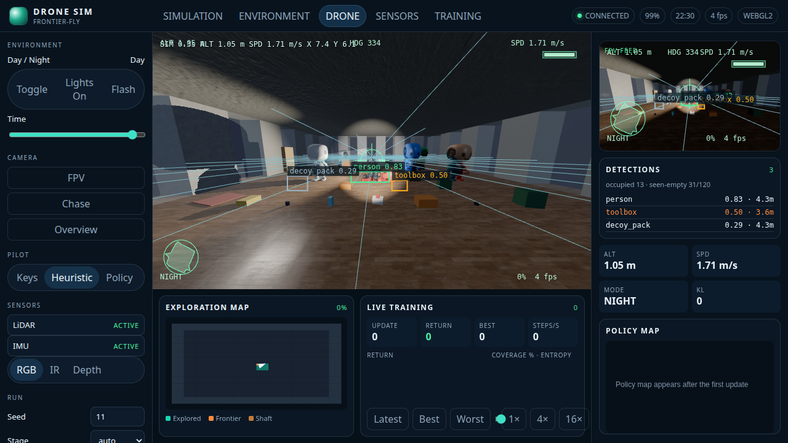

# frontier-fly

**frontier-fly** — Watch a tiny neural network learn to fly. A drone starts out bouncing off walls in a procedurally generated building. Within minutes it is sweeping rooms, threading doorways, and climbing shafts to explore floors it has never seen. Flip to FPV, kill the lights, and watch it keep going by flashlight. Everything runs in your browser: quadrotor physics, lidar, PPO training, WebGPU rendering, and live charts. No servers and no GPU cluster, just a seed and some patience.

The sim is deterministic. A seed rebuilds the same building, and the policy reads lidar, IMU, and an egocentric occupancy crop so it does not depend on the lights.

## Screenshots

Day chase, night with the flashlight, and the FPV feed. Captured headlessly in Chrome from `/?shot=day`, `/?shot=night`, and `/?shot=fpv`.




## Setup

```bash
npm install
npm test
npm run dev
```

`npm run dev` serves the app at `http://127.0.0.1:3000` with COOP/COEP headers so `SharedArrayBuffer` is available. `npm run build && npm run preview` builds the static site the GitHub Pages workflow publishes.

Pushes to `main`, and a manual `workflow_dispatch`, run test, lint, and build in parallel. The Pages deploy job starts only after all three succeed. Pull requests and other branches run the same checks plus e2e in `.github/workflows/ci.yml`. Those runs are informational: they do not publish the site and they are not a merge gate.

## Controls

| Input | Action |
| --- | --- |
| W A S D | Fly forward / left / back / right |
| Q E or arrow left / right | Yaw |
| Space / C | Climb / descend |
| 1 2 3 | FPV, chase, overview |
| F | Flashlight |
| L | Interior lights |
| P | Pause the sim |
| T | Start or pause training |
| Drag in overview | Orbit the cutaway camera |

The left rail also sets the seed, curriculum stage, time of day, sensor mode (RGB, IR, depth), and checkpoint save/load. A shareable URL looks like `/?seed=11&camera=fpv&tod=22&shot=night`.

## Mission editor

`mission.html` is a planner for a civilian search or safety inspection. A mission is a geofence, no-fly zones, an altitude band, a mission type, targets, a required confidence, an entry policy (`auto`, `ask`, or `never`), battery and time budgets, and a start pose.

The plan is checked against mission schema v1 (TypeScript types plus `src/mission/mission.schema.json`) and against polygon rules: a ring cannot cross itself, no-fly zones sit inside the geofence, and the start pose stays in the operating area. Save writes a canonical payload into the URL hash (`#m=`). The same mission always produces the same hash. `?seed=` loads a practice mission on a mock site.

The Run view plays a lawnmower preview: drone track, coverage, a detection log, an operator prompt when entry policy is `ask`, and an end-of-mission report. Battery drain and several report fields are placeholders. The outdoor world and the real detector are behind `WorldProvider` and `DetectionSource` in `src/mission`; this page uses mocks so it does not depend on those workstreams.

Open `/mission.html` from the dev server. The editor does not import the sim renderer.







| Query | Effect |
| --- | --- |
| `seed` | Building and episode seed |
| `shot` | `day`, `dusk`, `night`, `fpv`, `targets`, `targets-room`, or `targets-night` |
| `camera` | `fpv`, `chase`, `overview` |
| `stage` | `0`–`5` or `auto` |
| `train=1` | Start PPO when the page loads |
| `quality` | `low` or `high` |
| `pilot` | `keys`, `heuristic`, or `policy` |

Pilot defaults to the keyboard. Shot URLs fly a lidar heuristic so the camera has something to follow before a policy has learned the building. Choose **Policy** to fly the loaded checkpoint.

## Architecture



`src/sim`, `src/gen`, and `src/rl` do not import Three.js. Training can run headless. The renderer only consumes a `BuildingSpec`, a `DroneState`, and a `LightingState`.

## Outdoor world

`outdoor.html` starts the drone in a seeded forest instead of a room. Terrain is a heightfield with hills, slopes, and flattened clearings. Trees are instanced with trunk and canopy colliders and three LOD buckets. The site places 1–3 building shells (4 if you pass a count), each from the indoor BSP generator, on its own pad. A shell keeps typed openings — open window, broken window, ajar door (with a swing angle), closed door, vent, garage gap, roof hatch — and only the ones that clear the airframe plus a margin are enterable. Smaller holes are decoys. A geofence polygon and no-fly zones are data the outdoor step will not cross. Chase is `2`, FPV is `1`, and the corner map draws the fence, zones, trees, and openings.

The generator is `src/world/outdoor`. It calls `generateBuilding` for interiors and does not change `src/shared`.

## What is implemented

- Seeded buildings: BSP rooms, doors, hallways from stage 3, shafts when there is more than one floor, and a reachability check that retries with `seed + 1`. Tables, chairs, sofas, and shelves are Rapier colliders: lidar sees them and the drone cannot fly through them.
- Kinematic flight and a 6-DoF quadrotor with a velocity-to-attitude cascade, motor lag, and drag. Physics steps at 400 Hz in quad mode. Rapier builds the colliders and casts the lidar.
- Observation v2 is 1088 floats: 40 lidar ranges, IMU, altitude, frontier-direction features from a BFS over what lidar has seen, and four 16×16 egocentric maps (visited and unexplored-free at 8 m and at 32 m). The layout is in `src/sim/OBS_LAYOUT.md`. The action is `[vx, vy, vz, yawRate]`.
- PPO in TensorFlow.js, GAE, running observation and reward normalization, and a six-stage curriculum. Up to four env workers write rollouts into `SharedArrayBuffer`s. Inference uses a SIMD WASM gemm when the runtime has it.
- Chase, FPV, and overview cameras, a canvas HUD, day/night lighting, per-room lights, a flashlight, and IR/depth display modes.
- Live return, coverage, and entropy charts, a top-down coverage map, a policy heatmap once training has weights, and a replay scrubber at 1×, 4×, and 16×.
- A checkpoint in `public/checkpoints/pretrained.json`, plus download and IndexedDB save/load.
- Simulated people and search objects (`src/targets`) and a geometric camera detector (`src/perception`). Placement is seeded for indoor rooms and outdoor areas. The detector returns class, confidence, and a bounding box, with misses from distance, occlusion, lighting, and motion blur, and false positives that sit on decoys. A seen-empty tracker supports confirm-clear from ground truth. FPV draws the boxes and lists detections. Joint velocities are stubbed for a later dodge-only response. Credits are in [CREDITS.md](CREDITS.md).

## Simulated people and targets

`/?shot=targets`, `/?shot=targets-room`, and `/?shot=targets-night` frame a single room with people standing, sitting, lying, walking, and hiding, plus the object library and decoys. The detection list is the simulated camera, not a trained model.






## Honest limits

The shipped policy is a 1088→512→256 network. It was behavior-cloned from a privileged frontier teacher and then trained with DAgger: the network flies, the teacher labels every state it visits, and the aggregated data is retrained each round. The teacher sees the true visited grid; the network sees only lidar, its own visited map, and what its lidar has marked free. `npm run train:indoor` reproduces it in about 16 minutes on 4 cores. The round kept is the one that scores best on 30 held-out validation episodes (seeds the eval never uses), never the eval seeds. Anchored PPO (KL to the cloned policy plus a BC loss, `src/rl/finetune.ts`) and the stuck, loiter, and back-and-forth penalties are implemented, but no PPO fine-tune beat DAgger on validation, so the shipped file has none.

`npm run eval:coverage` prints this table for `public/checkpoints/pretrained.json` (kinematic flight, 1000 steps on stage 0, 2400 on stage 3):

| Metric | Per seed | Mean | Target | Status |
| --- | --- | --- | --- | --- |
| Stage 0 day (101/202/303/404) | 95.1%, 95.1%, 82.6%, 95.1% | **92.0%** | ≥ 80% | met |
| Stage 3 day (4242/5150/6160) | 68.6%, 61.1%, 41.1% | **56.9%** | ≥ 60% | missed |
| Stage 0 night-dark | 95.1% on all four | 95.1% | | |
| Stage 3 night-dark | 69.3%, 61.0%, 67.2% | 65.8% | | |
| Night / day, stage 0 | | 1.03 | ≥ 0.90 | met |
| Night / day, stage 3 | | 1.16 | ≥ 0.90 | met |

The previous checkpoint scored 74.1% on stage 0 and 21.6% on stage 3. Stage 3 still misses 60%. Coverage on one large building swings by 20 points or more between training rounds, and on the 22 stage-3 validation episodes this checkpoint averaged 62.5%. Another candidate scored 61.9% on the three eval seeds but lower on validation, so it was not shipped. The teacher itself reaches only about 73% on stage 3 inside 2400 steps (it needs about 3000 to reach 95%), so the step budget caps what imitation can reach. There is no recurrent memory (GRU); the 32 m coarse map and the frontier features stand in for it. The seen-free map marks only voxels the generator counts as reachable at flight height, so that mask is privileged information.

Training reuses pre-built worlds (`src/sim/worldPool.ts`, 48 per stage, 15% replaced per reset) instead of rebuilding Rapier on every episode. A kinematic step is about 0.18–0.24 ms with observation v2. On 4 shared cores, worker threads running the 512×256 network on pooled worlds summed to about 9,000 environment steps/s, under the 10k target; the lidar heuristic on the same pool reached about 13,000. The learner uses `@tensorflow/tfjs-node` when it is installed (`npm install --no-save @tensorflow/tfjs-node@4.22.0`, roughly 27,000 samples/s at minibatch 512) and the CPU backend otherwise, which is about 50 times slower. Batched SIMD inference is a small kernel in `src/rl/gemm.ts`. The checkpoint is 17 MB of JSON because the network is wider.

Door leaves and propeller wash are visual only.

Headless Chrome on this machine, with ANGLE software WebGL2 and no discrete GPU, rendered the high preset at about **7 fps** and the low preset at about **23 fps**. That does not meet 45 / 60 fps, and it was not measured on a laptop GPU. WebGPU is requested when the quality preset is high and an adapter answers within 350 ms; this capture stayed on WebGL2. High quality runs SSAO, bloom, and SMAA. Three's TAA pass accumulates only while the camera is nearly still, because that pass has no motion vectors. FPV adds an afterimage trail and a lens/vignette shader. There is no SSR and no baked global illumination. Numbers from the capture are in `docs/media/capture.json`. Asset licenses are in [CREDITS.md](CREDITS.md). Every shipped texture and the HDRI is under 5 MB, so nothing is in Git LFS.

## Later: outdoor search

The long-term mission is outdoor plus indoor search: start outside a geofence, find buildings, use an opening, search rooms for a target or confirm the area clear, and eventually fly more than one drone in the same site. `outdoor.html` is the flyable site. The indoor explorer still cannot train that mission, because a few assumptions would have to change first.

Already reusable: `generateBuilding` is a pure function of seed, size, and stage, so a site generator can place several buildings. Lidar is a raycast against the colliders `PhysicsWorld` was given, and glass is already its own surface class. The action stays `[vx, vy, vz, yawRate]` on one `Dynamics` implementation per drone. The renderer only subscribes to state, so terrain and exteriors can be drawn without the sim importing Three.js. The worker pool runs many independent episodes, which is the right shape for training a single-agent policy.

These choices block the outdoor mission if they stay as they are:

- **The world is one indoor grid.** `BuildingSpec` is the only world type. Its origin is the footprint corner. Visited voxels are indexed from that corner, and every floor is assumed to share floor 0's width and depth. There is no terrain, no geofence, and no list of buildings on a site.
- **Leaving the footprint ends the episode.** `ExplorerEnv` treats a position outside the ground-floor rectangle as out of bounds. Spawn is the center of the largest ground-floor room, so an outdoor start terminates immediately.
- **Openings are not enterable in the indoor grid.** Door cells are always walkable. There is no closed or ajar door. Glass is painted onto solid border walls, and those boxes stay colliders (`buildingAabbs` marks them `window` and still blocks). A broken window is not representable. Outdoor shells cut real apertures next to a copy of that grid; `ExplorerEnv` does not load them.
- **The mission is indoor coverage.** Success is 95% of reachable voxels. The reward and the privileged teacher both chase that grid. There is no target object, no "confirm clear", and no detection channel.
- **The observation is versioned (v2, 1088 floats).** The shipped checkpoint, the SharedArrayBuffer stride, and the SIMD gemm scratch all assume `src/sim/OBS_LAYOUT.md`. The maps are indoor voxels. Altitude is distance to this building's floor and ceiling. A search policy needs observation v3; the app refuses a checkpoint whose version does not match.
- **One drone per world.** Each env holds one `DroneState`. Workers do not share a site. Drones are not physics bodies, so they cannot see or collide with each other. A swarm needs a shared world and a rollout layout with an agent axis.

## Scripts

| Script | What it does |
| --- | --- |
| `npm test` | Unit tests and the kinematic step measurement |
| `npm run build` | Typecheck and production bundle |
| `npm run test:e2e` | Headless Chrome screenshots |
| `npm run eval:coverage [-- ckpt.json]` | Coverage table vs targets for the shipped (or given) checkpoint; `--teacher` scores the frontier teacher |
| `npm run train:indoor -- --out ckpt.json` | BC + DAgger on every core, kept by held-out validation; copy the result to `public/checkpoints/` to ship it |
| `PRETRAIN_UPDATES=20 npm run pretrain` | The older single-thread distill + PPO path |

## License

MIT. See [LICENSE](LICENSE).
