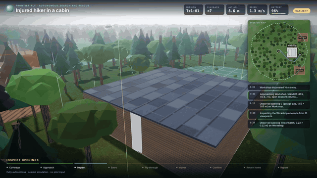

# frontier-fly

**A search-and-rescue drone autopilot that searches buildings from the treeline to the last room, entirely in your browser. A small network, learned by imitation and fine-tuned with PPO, flies it on lidar alone, with a sensor-only planner as backup.**

[](https://github.com/alexnieves-cs/frontier-fly/actions/workflows/ci.yml)
[](https://github.com/alexnieves-cs/frontier-fly/actions/workflows/pages.yml)
[](LICENSE)

<p align="center">
  
</p>

### [▶ Try it live](https://alexnieves-cs.github.io/frontier-fly/) · [Mission film](https://alexnieves-cs.github.io/frontier-fly/film.html) · [How it works](https://alexnieves-cs.github.io/frontier-fly/how.html) · [Safety numbers](https://alexnieves-cs.github.io/frontier-fly/atlas.html) · [Tech report (PDF)](https://alexnieves-cs.github.io/frontier-fly/frontier-fly-report.pdf) · [Project guide](docs/GUIDE.md)

The drone sweeps a geofenced patch of woods, finds the building, picks an opening it fits through, searches room by room for a missing person or confirms the place is clear, flies home and files a report. Physics, sensors, training and rendering all run in the tab, with no server, and a seed rebuilds the same world exactly. Civilian and defensive use only: it searches, inspects and confirms clear, and never pursues anyone.

## Results

<!-- generated:headline:start -->
| Question | Measured | On |
| --- | --- | --- |
| How much of a new building does the trained policy search? | 80.0% (76.3–83.6%) at 3.4 wall contacts per flight; its teacher 67.3%, the sensor-only planner 65.5% with none | 30 fresh hard buildings |
| Does it work in the dark? | 80.0% at night with the lights off, 100.0% of day | the same buildings |
| Do whole missions end the right way? | 96.7% (91.7–98.7%) found the target or correctly cleared | 120 fixed-scenario missions on the quadrotor |
| **How often does it call a building clear with someone inside?** | **3.55% per flight** (3.21–3.88%); 13.2% on sweeps of an occupied site | 2,000 importance-sampled flights, checked by 6,000 plain ones |
| How often does it hit something? | 2.70% per flight (1.99–3.41%) | 2,000 importance-sampled flights |
| Does it get home when something breaks? | 97.8% (96.7–98.6%) of faulted flights end safely | 960 flights with sensor, motor, battery, link, GNSS or wind faults |
<!-- generated:headline:end -->

Every number comes from seeds no model or setting was tuned on, with 95% intervals, and is regenerated from the study's JSON by `npm run docs`. The false-clear rate is the one to read first: it is why this is a research simulator and not a product. The [project guide](docs/GUIDE.md#honest-limits) lists the other limits.

## Run it

```bash
npm ci && npm run dev   # Node 22, then open http://127.0.0.1:3000
```

The [project guide](docs/GUIDE.md) covers the pages, every benchmark table, the studies, and how to train the policy. [ARCHITECTURE.md](docs/ARCHITECTURE.md) maps the code, and [CONTRIBUTING.md](CONTRIBUTING.md) explains how to send changes. Code is [MIT](LICENSE). Every asset is CC0, MIT, Apache-2.0 or CC BY 4.0 and listed in [CREDITS.md](CREDITS.md).
