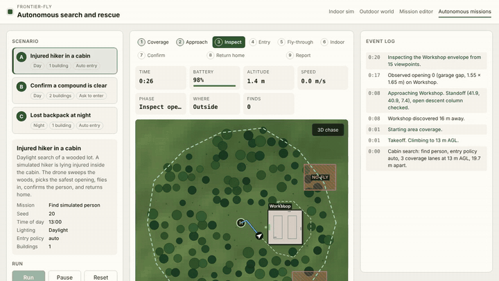
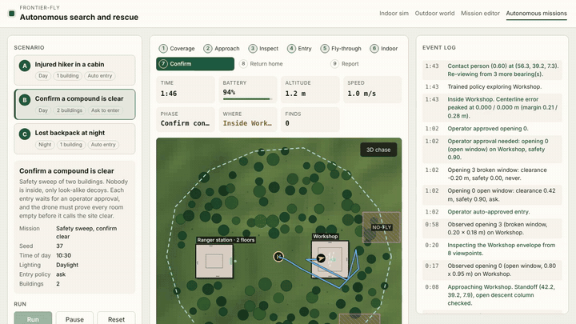
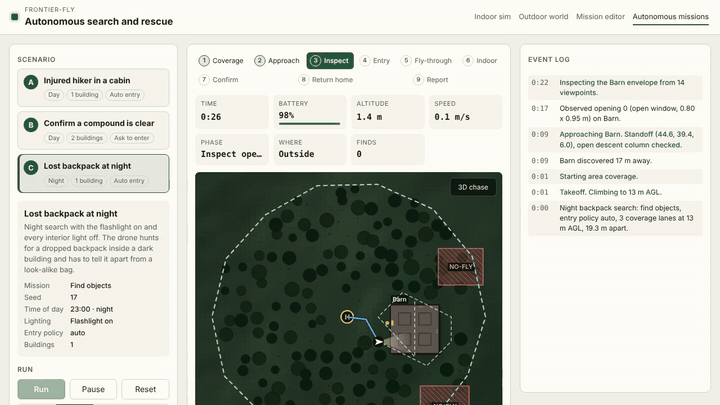
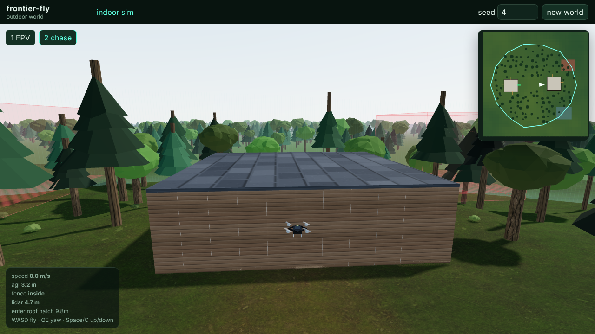
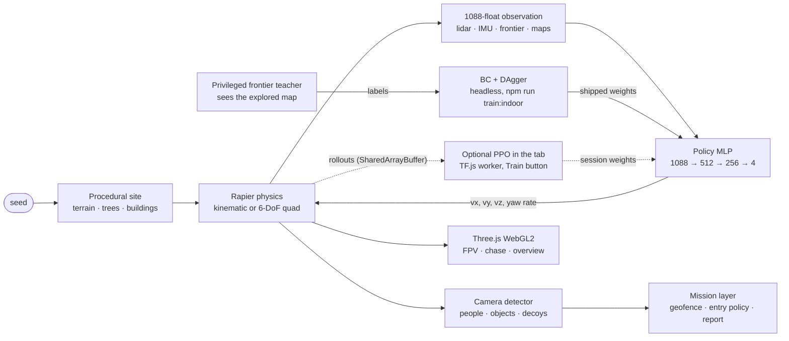

# frontier-fly

**A drone autopilot that searches buildings, from the treeline to the last room, entirely in your browser. Its policy is learned by imitation (behavior cloning + DAgger) from a privileged teacher, with PPO you can run in the tab.**

[](https://github.com/alexnieves-cs/frontier-fly/actions/workflows/ci.yml)
[](https://github.com/alexnieves-cs/frontier-fly/actions/workflows/pages.yml)
[](LICENSE)

<p align="center">
  
</p>

### [▶ Try it live](https://alexnieves-cs.github.io/frontier-fly/) · [Mission film](https://alexnieves-cs.github.io/frontier-fly/film.html) · [Mission console](https://alexnieves-cs.github.io/frontier-fly/demo.html) · [Drone team](https://alexnieves-cs.github.io/frontier-fly/team.html) · [Indoor sim](https://alexnieves-cs.github.io/frontier-fly/sim.html) · [Mission editor](https://alexnieves-cs.github.io/frontier-fly/mission.html) · [Outdoor site](https://alexnieves-cs.github.io/frontier-fly/outdoor.html) · [Benchmarks](docs/BENCHMARKS.md) · [Report](docs/REPORT.md) · [Safety case](docs/SAFETY_CASE.md) · [Architecture](docs/ARCHITECTURE.md)

frontier-fly is a search-and-rescue drone simulator and autopilot. A quadrotor reads lidar, an IMU, and its own map of where it has been. Indoors, two pilots can fly it from those sensors alone: a small neural network trained by imitation learning (behavior cloning and DAgger from a privileged frontier-exploration teacher), and a classical sensor-only frontier planner. The network flies first and hands a building to the planner when it stalls or touches something; on fresh buildings the planner is currently the stronger of the two, and the [report](docs/REPORT.md) says so. PPO fine-tuning is implemented and runs in the tab, but the shipped weights come from DAgger. The mission it is built for: sweep a geofenced patch of woods, find the building, pick an opening it actually fits through, search room by room for a missing person or confirm the place is clear, fly home, and file a report.

Everything runs client-side. Physics (Rapier, 400 Hz), sensors, optional PPO training (TensorFlow.js in a worker), and rendering (Three.js on WebGL2; WebGPU opt-in with `?renderer=webgpu`) all happen in the tab. There is no server and no GPU cluster. A seed rebuilds the same world exactly, so every result here can be reproduced.

The project is civilian and defensive only: search, inspection, and confirm-clear. The drone never pursues or engages anyone.

## Missions

### Mission films

Each film replays a real seeded mission, flown headless by the same autopilot, in 3D: chase, aerial, orbit, roof-cutaway and landing shots, with the planner's log, a minimap and the end report on screen. [`film.html`](https://alexnieves-cs.github.io/frontier-fly/film.html) renders them live in the browser at full quality; the MP4s below are 960 px previews recorded with `npm run media:film`.

| Film | Mission |
| --- | --- |
| [Woods to cabin (MP4, 74 s)](docs/media/film-cabin-day.mp4) · [watch live](https://alexnieves-cs.github.io/frontier-fly/film.html?scenario=cabin-day) | Find an injured hiker inside a cabin by day. |
| [Compound search (MP4, 79 s)](docs/media/film-compound-clear.mp4) · [watch live](https://alexnieves-cs.github.io/frontier-fly/film.html?scenario=compound-clear) | Prove two buildings are empty, with an operator approving each entry. |
| [Night search (MP4, 70 s)](docs/media/film-backpack-night.mp4) · [watch live](https://alexnieves-cs.github.io/frontier-fly/film.html?scenario=backpack-night) | Find a lost backpack in a dark building by flashlight. |

### Mission console clips

Three seeded scenarios, each flown autonomously from takeoff to landing. For the recordings, "ask to enter" prompts were auto-approved. The drone sweeps a geofenced forest in coverage lanes, discovers the building, inspects its openings and picks one it clears with margin, searches room by room, confirms a find or declares the building clear, flies home, and writes a report. The clips play at 4× (16× for the compound) and come from [`demo.html`](https://alexnieves-cs.github.io/frontier-fly/demo.html?scenario=cabin-day&autorun=1); results are in the [mission table](#benchmarks). Indoors the shipped policy flies first under a lidar guard, and after 8 s without new coverage or on a contact the run hands the visit to the sensor-only planner. The report says which explorer ran. These clips are single recorded runs from an earlier build; the table under [Benchmarks](#benchmarks) is the 270-flight bench on fresh worlds.

| <br>**Find a person.** Daylight, one cabin, auto entry. [MP4](docs/media/mission-cabin-day.mp4) | <br>**Confirm clear.** Two buildings, nobody inside. [MP4](docs/media/mission-compound-clear.mp4) | <br>**Night search.** Find a backpack in the dark. [MP4](docs/media/mission-backpack-night.mp4) |
| --- | --- | --- |

<details>
<summary>demo.html options</summary>

| Query | Effect |
| --- | --- |
| `scenario` | `cabin-day`, `compound-clear`, or `backpack-night` (seeded in `src/mission/autonomy/scenarios.ts`) |
| `speed` | `1`, `4`, `16`, or `max` |
| `autorun=1` | Start when the page loads |
| `operator=approve` | Approve entry prompts automatically |
| `indoor=frontier` | Skip the shipped policy and use frontier exploration indoors |

</details>

## Features

| | |
| --- | --- |
| <br>**Train it in the tab.** Press Train and up to four worker threads roll out episodes into `SharedArrayBuffer`s while a learner worker runs PPO. Return, coverage, entropy, and a policy heatmap update live. [MP4](docs/media/training.mp4) | <br>**Fly by flashlight.** The policy never sees pixels, only lidar, IMU, and an egocentric occupancy map, so it flies the same with the lights off. FPV adds the HUD and simulated detections. [MP4](docs/media/fpv-night.mp4) |
| <br>**Plan a mission.** Draw a geofence and no-fly zones, set an altitude band, targets, required confidence, an entry policy (auto, ask, never), and budgets. The plan validates against a versioned JSON schema, shares as a link, and [exports to QGroundControl](docs/QGC_EXPORT.md) as a `.plan`, a QGC WPL 110 waypoint file, or MAVLink mission items for PX4 and ArduPilot. [MP4](docs/media/mission-editor.mp4) | <br>**A site, not a room.** Seeded terrain, instanced trees with colliders, and one to four building shells with typed openings: open and broken windows, ajar doors, vents, garage gaps, roof hatches. Only openings that clear the airframe are enterable. |
| <br>**Something to find.** Simulated people standing, sitting, lying, walking, and hiding, a library of search objects, and decoys. A geometric camera detector misses with distance, occlusion, darkness, and motion blur, and false-alarms on decoys. | <br>**Procedural buildings.** BSP rooms, doors, hallways, multi-floor shafts, and a reachability check. PBR interiors with CC0 textures, an HDRI sky, SSAO, bloom, and SMAA on the high preset. |

## Benchmarks

These tables are generated by `npm run docs` from [`docs/study.json`](docs/study.json), [`docs/benchmarks.json`](docs/benchmarks.json) and [`docs/mission-bench.json`](docs/mission-bench.json), and CI fails if they drift from the JSON. Misses are shown as misses. Method, per-seed results, and render frame rates are in [docs/BENCHMARKS.md](docs/BENCHMARKS.md).

<!-- generated:benchmarks:start -->
**Coverage on 30 fresh buildings per condition**, every pilot on the same seeds, bootstrap 95% intervals ([REPORT.md](docs/REPORT.md)):

| Pilot | Hard, day | Hard, night (no lights) | Hard collisions per episode | Two floors | Quadrotor + noise | Quad collisions per episode |
| --- | --- | --- | --- | --- | --- | --- |
| Oracle teacher (floor plan) | 67.3% (61.2–72.2) | 67.3% (61.2–72.2) | 0.13 | 38.1% (34.2–41.8) | 22.7% (20.7–25.0) | 17.0 |
| Sensor-only planner | 65.5% (62.2–68.7) | 65.8% (62.4–69.1) | 0.00 | 37.7% (34.9–40.4) | 43.6% (40.9–46.3) | 6.7 |
| Policy | 60.7% (56.1–65.0) | 59.6% (53.6–64.9) | 6.37 | 34.3% (31.2–37.6) | 27.0% (23.1–30.4) | 15.3 |
| Policy + lidar guard | 60.8% (56.4–65.3) | 60.9% (57.5–64.1) | 0.03 | 34.9% (31.0–38.8) | 31.5% (29.3–33.7) | 14.5 |

**Targets.** Fixed protocol (4 easy and 3 hard seeds) unless the row says otherwise:

| Goal | Target | Measured (browser pilot) | Status |
| --- | --- | --- | --- |
| Coverage, easy buildings | ≥ 80.0% | 95.1% mean of 4 | ✅ meets |
| Coverage, new hard buildings | ≥ 60.0% | 67.3% mean of 3 | ✅ meets |
| Coverage, new hard buildings, 30 fresh seeds (policy) | ≥ 60.0% | 60.7% (56.1–65.0) | ⚠️ meets on the mean; interval spans the target |
| Coverage, new hard buildings, 30 fresh seeds (policy + lidar guard) | ≥ 60.0% | 60.8% (56.4–65.3) | ⚠️ meets on the mean; interval spans the target |
| Night coverage vs day | ≥ 90.0% | 100.0% | ✅ meets |
| Kinematic env step | ≤ 0.3 ms | 0.133 ms | ✅ meets |
| Env steps/s, 4 workers, physics + sensors | ≥ 10,000 | 16,305 | ✅ meets |
| Env steps/s, 4 workers, with inference and resets | ≥ 10,000 | 13,040 | ✅ meets |

| Measurement | Value |
| --- | --- |
| Kinematic env step (1 thread) | 0.133 ms · 7,497 steps/s |
| Quadrotor env step, 400 Hz physics (1 thread) | 0.239 ms · 4,191 steps/s |
| Policy inference, SIMD gemm, batch 8 | 0.076 ms per env |
| 4 workers, physics + sensors (lidar heuristic pilot) | 16,305 env steps/s |
| 4 workers × 8 envs, browser rollout loop: batched policy inference, resets on pooled worlds | 13,040 env steps/s |
<!-- generated:benchmarks:end -->

**Missions on 30 fresh worlds per scenario.**

<!-- generated:missions:start -->
| Scenario | Policy, planner fallback | Sensor-only planner | Oracle planner (floor plan, reference) |
| --- | --- | --- | --- |
| Woods to cabin: find the missing person | 100.0% (89–100%) | 100.0% (89–100%) | 100.0% (89–100%) |
| Compound search: confirm two buildings clear | 90.0% (74–97%) | 90.0% (74–97%) | 90.0% (74–97%) |
| Night search: find the lost backpack | 83.3% (66–93%) | 90.0% (74–97%) | 76.7% (59–88%) |
| **All** | 91.1% (83–95%) | 93.3% (86–97%) | 88.9% (81–94%) |

Share of 30 fresh mission worlds per scenario (seeds 9600–9629) where the mission ends with the expected outcome: found, or correctly cleared. Brackets are Wilson 95% intervals.
Across all 270 flights: 1 with a collision, 0 false clears, 0 false alarms. The policy hands 46.7% of the buildings it enters to the planner.
From `npm run study:missions` at `4d601db`; per-scenario detail is in [BENCHMARKS.md](docs/BENCHMARKS.md).
<!-- generated:missions:end -->

## How it works



**Training.** The shipped checkpoint starts from behavior cloning: a privileged frontier-seeking teacher that can see the explored map flies the curriculum, and the network learns to imitate it from its own sensors. DAgger then lets the network fly while the teacher labels every state it reaches, and the round kept is the one that scores best on held-out validation seeds. PPO with a KL anchor to the cloned policy is implemented, but no PPO fine-tune beat DAgger on validation, so the shipped file has none. In the browser, **Train** runs PPO on the spec reward (new coverage, new rooms and floors, collisions, smoothness, time). A six-stage curriculum grows the buildings from one 8×8 m room to multi-floor layouts with quadrotor dynamics, and randomizes mass, thrust, drag, motor lag, sensor noise, wind, and lighting so the policy cannot overfit one world. The full loop runs in the browser, and the same code runs headless in Node for `npm run train:indoor` and the benchmarks.

**Why it works at night.** The observation has no camera pixels. Lidar and the occupancy map do not care about light, so night coverage is measured against day coverage as a check on that design, not a separate model.

More detail, including the generated module graph and the headless boundary between sim and renderer, is in [docs/ARCHITECTURE.md](docs/ARCHITECTURE.md).

## Tech stack

| Layer | What | Why |
| --- | --- | --- |
| Language and build | TypeScript 5.7, Vite 6 | One codebase for the browser, workers, and Node |
| Physics | [Rapier](https://rapier.rs) 0.14 (WASM) | Deterministic colliders and fast ray casts for lidar |
| Learning | [TensorFlow.js](https://www.tensorflow.org/js) 4.22, hand-written SIMD WASM gemm | PPO updates on WebGL or CPU, cheap batched inference in env workers |
| Rendering | [Three.js](https://threejs.org) 0.170, WebGL2 (WebGPU opt-in) | PBR, HDRI, shadows, and post passes; `?renderer=webgpu` tries the lighter WebGPU path |
| Charts | [uPlot](https://github.com/leeoniya/uPlot) | Lightweight live training curves |
| Concurrency | Web Workers, `SharedArrayBuffer` | Rollouts without copying |
| Tests | Vitest, Playwright, ESLint | Unit, perf, and headless browser checks in CI |
| Hosting | GitHub Pages + [coi-serviceworker](https://github.com/gzuidhof/coi-serviceworker) | Static hosting with cross-origin isolation |

## Run locally

Needs Node 22.

```bash
npm ci
npm run dev        # http://127.0.0.1:3000 with COOP/COEP headers
npm test           # unit and perf tests
npm run build      # typecheck and production bundle in dist/
```

| Script | What it does |
| --- | --- |
| `npm run test:e2e` | Headless Chrome checks and screenshots |
| `npm run bench` | Coverage and throughput, written to `docs/benchmarks.json` |
| `npm run media` | Record the demo clips into `docs/media/` (needs ffmpeg) |
| `npm run study:coverage` / `npm run study:missions` | Every pilot on fresh buildings, and three indoor explorers on fresh mission worlds, with 95% intervals |
| `npm run study:faults` | Fly 17 fault scenarios (sensor, motor, battery, link, GNSS, wind) on fresh mission worlds, written to `docs/fault-bench.json` |
| `npm run docs` | Regenerate `docs/ARCHITECTURE.md`, `docs/BENCHMARKS.md`, `docs/REPORT.md`, `docs/SAFETY_CASE.md`, and the README tables |
| `npm run check:pages` | Serve `dist/` the way GitHub Pages does and check every page loads |
| `npm run eval:coverage` | Coverage table vs targets for the shipped checkpoint |
| `npm run train:indoor -- --out ckpt.json` | BC + DAgger on every core, kept by held-out validation |

<details>
<summary>Controls and URL parameters</summary>

| Input | Action |
| --- | --- |
| W A S D | Fly forward / left / back / right |
| Q E or arrow left / right | Yaw |
| Space / C | Climb / descend |
| 1 2 3 | FPV, chase, overview |
| F | Flashlight |
| L | Interior lights |
| P | Pause the sim |
| T | Start or pause training |
| Drag in overview | Orbit the cutaway camera |

| Query | Effect |
| --- | --- |
| `seed` | Building and episode seed |
| `shot` | `day`, `dusk`, `night`, `fpv`, `targets`, `targets-room`, or `targets-night` |
| `camera` | `fpv`, `chase`, `overview` |
| `stage` | `0`–`5` or `auto` |
| `train=1` | Start PPO when the page loads |
| `quality` | `low` or `high` |
| `pilot` | `keys`, `heuristic`, or `policy` |
| `tod`, `flash`, `lights` | Time of day (0–24), flashlight `1`, interior lights `0` |

These apply to the indoor sim, [`sim.html`](https://alexnieves-cs.github.io/frontier-fly/sim.html). Old links that put them on the site root are forwarded there. Example: [`sim.html?seed=11&stage=0&camera=fpv&tod=22&flash=1&lights=0&pilot=policy`](https://alexnieves-cs.github.io/frontier-fly/sim.html?seed=11&stage=0&camera=fpv&tod=22&flash=1&lights=0&pilot=policy). Pilot defaults to the keyboard. Shot URLs fly a lidar heuristic so the camera has something to follow. Choose **Policy** to fly the checkpoint.

</details>

## Honest limits

- The fixed eval is small (4 easy and 3 hard seeds), and the policy's 67.3% on it is partly seed luck. On 30 fresh hard buildings it covers 60.7% (95% interval 56.1–65.0%), so it meets the 60% goal on the mean, not with confidence. The sensor-only planner covers 65.5% on the same buildings with no collisions. [BENCHMARKS.md](docs/BENCHMARKS.md) has the per-seed numbers.
- Indoors, missions no longer read the floor plan: a sensor-only planner maps from the drone's own lidar and range finders, and the policy flies under a lidar guard with that planner as its fallback. On 90 fresh mission worlds per explorer the sensor-only explorer reaches the expected outcome 93.3% of the time, the policy-first explorer 91.1%, and the old floor-plan planner (kept as a reference) 88.9%, with one collision across the 270 flights. The policy still hands 46% of the buildings it enters to the planner after a stall, and on fresh coverage buildings a classical sensor-only planner covers more than the policy. [REPORT.md](docs/REPORT.md) has the study, the ablations and the failure cases.
- On quadrotor dynamics with sensor noise every pilot covers less than on the kinematic airframe (the planner 43.6% against 65.5%), because the quad cannot change speed instantly. A safety filter built on the quad's measured stopping distance cuts the planner's collisions per episode from 6.7 to 1.2 and the guarded policy's from 14.5 to 2.1, and missions flown entirely on the quad reach the expected outcome 88.9% of the time with the planner and 90.0% with the policy. The policy has never been trained on the quad.
- On multi-floor buildings only the sensor-only planner takes shafts; it reaches another floor in every one of 30 fresh buildings, which lifts its coverage by about 4 points. The policy and the teacher stay on the ground floor. A learned predictor of what lies behind each frontier is accurate but does not raise coverage, and neither does the true answer: coverage here is limited by flight time. [REPORT.md](docs/REPORT.md) has both.
- Mission clips show the 2D mission map. Clips in `docs/media/` were recorded in a cloud container with software WebGL, which renders at a few frames per second. FPV and training clips play one captured frame per 50 ms sim step, so flight runs at true speed and the training charts run faster than real time. On a laptop GPU the page runs in real time.
- Door leaves are visual. Furniture collides, but doors are always open in the indoor grid.
- The detector is geometric, not a trained vision model.
- Drone teams: on 30 fresh 40 m buildings one drone searches 29.5% in four minutes and three drones 79.1%, sharing maps over a radio that walls weaken ([live](https://alexnieves-cs.github.io/frontier-fly/team.html), [REPORT.md](docs/REPORT.md#drone-teams)). Team drones cannot physically collide in the sim (they keep apart with a velocity filter), the radio has no channel contention, and the team bench flies the kinematic airframe without a battery model.
- Faults are injected and handled in simulation only. A symptom-based failsafe returns home or lands on sensor, motor, battery, link, GNSS and wind faults; across 960 faulted flights on fresh worlds 88.8% end safely, and strong wind (8 m/s) is the clear weak spot at 48%. [SAFETY_CASE.md](docs/SAFETY_CASE.md) has the hazard log, the per-fault results and what the drone can't detect.

## Roadmap

Being built now, each in its own track:

- **Indoor localization**: maps and planners on an estimated pose (scan matching plus inertial odometry) instead of the true one.
- **Search by probability**: outdoor search planned on a lost-person probability map, updated by what the camera saw.
- **Faults and a safety case**: missions under lidar dropout, weak motors, battery sag, wind and lost links, with a hazard-to-test table.
- **Live pilot race and policy inspector**, and **QGroundControl plan export** from the mission editor.

Out of scope: anything that pursues, tracks for harm, or strikes. The drone searches, inspects and confirms clear, and nothing else.

## Contributing

Issues and pull requests are welcome. See [CONTRIBUTING.md](CONTRIBUTING.md) for setup, checks, and the project's civilian-use scope.

## Credits and license

Code is [MIT](LICENSE). Every third-party asset is CC0 or MIT and listed with its source in [CREDITS.md](CREDITS.md): Poly Haven sky, ambientCG textures, the KayKit mannequin and animations, three.js post passes, and coi-serviceworker.
