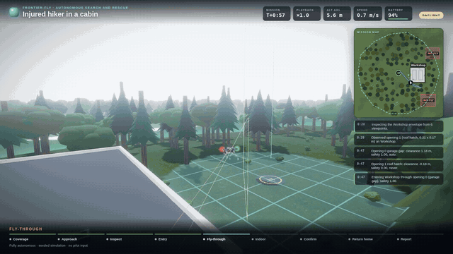

# frontier-fly

**A search-and-rescue drone autopilot that searches buildings from the treeline to the last room, entirely in your browser. A small network, learned by imitation and fine-tuned with PPO, flies it on lidar alone, with a sensor-only planner as backup.**

[](https://github.com/alexnieves-cs/frontier-fly/actions/workflows/ci.yml)
[](https://github.com/alexnieves-cs/frontier-fly/actions/workflows/pages.yml)
[](LICENSE)
[](https://doi.org/10.5281/zenodo.23717793)

<p align="center">
  
</p>

### [▶ Try it live](https://alexnieves-cs.github.io/frontier-fly/) · [Mission film](https://alexnieves-cs.github.io/frontier-fly/film.html) · [How it works](https://alexnieves-cs.github.io/frontier-fly/how.html) · [Safety numbers](https://alexnieves-cs.github.io/frontier-fly/atlas.html) · [Tech report (PDF)](https://alexnieves-cs.github.io/frontier-fly/frontier-fly-report.pdf) · [Project guide](docs/GUIDE.md)

Built by **Alex Nieves** · [portfolio](https://alexnieves.me) · [GitHub](https://github.com/alexnieves-cs) · [about the project](#about-the-project)

The drone sweeps a geofenced patch of woods, finds the building, picks an opening it fits through, searches room by room for a missing person or confirms the place is clear, flies home and files a report. Physics, sensors, training and rendering all run in the tab, with no server, and a seed rebuilds the same world exactly. Civilian and defensive use only: it searches, inspects and confirms clear, and never pursues anyone.

## Results

<!-- generated:headline:start -->
| Question | Measured | On |
| --- | --- | --- |
| How much of a new building does the trained policy search? | 75.1% (70.5–79.4%) under its lidar guard, 1 of 30 flights ended by a crash; alone 67.5%, 7 of 30 flights ended by a crash; its teacher 64.5%, the sensor-only planner 65.5% with none | 30 fresh hard buildings |
| Does it work in the dark? | 77.0% at night with the lights off, 102.5% of day | the same buildings |
| Do whole missions end the right way? | 98.3% (94.1–99.5%) found the target or correctly cleared | 120 fixed-scenario missions on the quadrotor |
| **How often does it call a building clear with someone inside?** | **0.30% per flight** (0.14–0.65%), down from 4.05% before unconfirmed people blocked a clear | 2,000 fresh flights from the failure atlas's mix, both versions on the same seeds (importance-sampled atlas on the current code: 0.25%; 3.55% at v1.0.0) |
| How often does it hit something? | 1.15% per flight (0.77–1.72%) | 2,000 importance-sampled flights |
| Does it get home when something breaks? | 98.6% (97.7–99.2%) of faulted flights end safely | 960 flights with sensor, motor, battery, link, GNSS or wind faults |
<!-- generated:headline:end -->

Every number comes from seeds no model or setting was tuned on, with 95% intervals, and is regenerated from the study's JSON by `npm run docs`. The false-clear rate is the one to read first: it is why this is a research simulator and not a product. The [project guide](docs/GUIDE.md#honest-limits) lists the other limits.

## Run it

Everything runs in a browser tab, on desktop or phone. Pick the way that suits you:

| Way | What you get | Needs |
| --- | --- | --- |
| [Live site](https://alexnieves-cs.github.io/frontier-fly/) | Every page: the film, missions, race, drone team, safety numbers, indoor and outdoor flying, the mission planner and PX4 | Nothing, just a browser |
| [](https://codespaces.new/alexnieves-cs/frontier-fly?quickstart=1) | Your own copy in a cloud dev box. Run `npm run dev` and the forwarded port 3000 opens the site | A GitHub account |
| [Actions](https://github.com/alexnieves-cs/frontier-fly/actions) | CI, the PX4 flight check on every push, and the `study` workflow, which reruns any benchmark from **Run workflow** | Repo access to start a run |
| Your computer | The site, training and benchmarks (`npm run train:ppo`, `npm run study:missions`, ...) | Node 22 |
| Terminal or Docker | The whole mission, FrontierBench and QGroundControl plan export with no browser: `docker run --rm ghcr.io/alexnieves-cs/frontier-fly mission`, see [CLI.md](docs/CLI.md) | Docker, or Node 22 |
| Python | A Gymnasium env (`gym.make("FrontierFly-hard-v0")`) and the FrontierBench scorer, on the same simulator, see [python/](python/README.md) | Python 3.10+ and Node 22 |
| PX4 + QGroundControl | A real autopilot flying the simulator, with QGroundControl loading plans from the planner page | A local PX4 SITL build, see [PX4.md](docs/PX4.md) |
| A real Crazyflie | The sensor-only explorer on a 33 g quadrotor with four range beams, behind a safety guard. Simulated and tested in CI; not flown yet | A Crazyflie with Flow and Multi-ranger decks, see [CRAZYFLIE.md](docs/CRAZYFLIE.md) |

```bash
npm ci && npm run dev   # Node 22, then open http://127.0.0.1:3000
```

The [project guide](docs/GUIDE.md) covers the pages, every benchmark table, the studies, and how to train the policy. [ARCHITECTURE.md](docs/ARCHITECTURE.md) maps the code, and [CONTRIBUTING.md](CONTRIBUTING.md) explains how to send changes. Code is [MIT](LICENSE). Every asset is CC0, MIT, Apache-2.0 or CC BY 4.0 and listed in [CREDITS.md](CREDITS.md).

## About the project

frontier-fly is built by [Alex Nieves](https://alexnieves.me) ([GitHub](https://github.com/alexnieves-cs)). It started as a browser drone demo and grew into a research-style simulator: a learned pilot, a sensor-only planner, PX4 in the loop, a Python package, and a benchmark anyone can enter.

What turned out to be hard, and what the repository does about it:

- **A good average hides rare failures.** The mission bench looked fine, but the failure atlas found the drone calling a building clear with a walking person inside on 3.5% of flights. Tracking people across views took that to 0.3%.
- **Free contacts teach bad habits.** The learned policy covered the most of any pilot, then a crash rule showed it was sliding along walls. Retraining under the rule cut the policy's own crashes from 19 of 30 flights to 7, and the lidar guard takes that to 1.
- **Small fixed evaluations flatter.** The early 86% was partly seed luck. Every headline now comes from fresh seeds with 95% intervals, and the generated docs fail CI if a number drifts from its JSON.
- **Simulators lie in specific ways.** Kinematic drones stop instantly and quadrotors don't. A braking filter, a quad-aware tracker and PX4 SITL in CI keep the gap visible.

Skills it covers: reinforcement and imitation learning (behavior cloning, DAgger, PPO), quadrotor dynamics and control, lidar mapping and scan-matching localization, PX4 and MAVLink, benchmark design, TypeScript, three.js and WebGL, Python packaging, and CI on GitHub Actions. To cite it, see [CITATION.cff](CITATION.cff).
