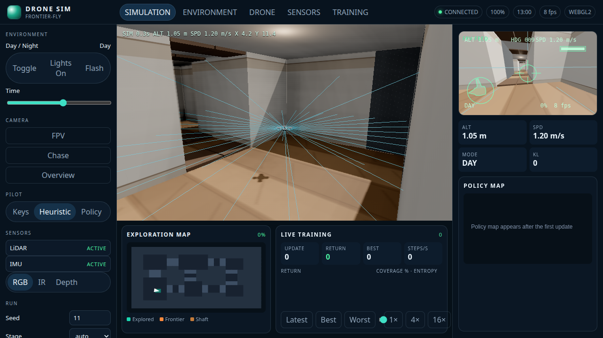
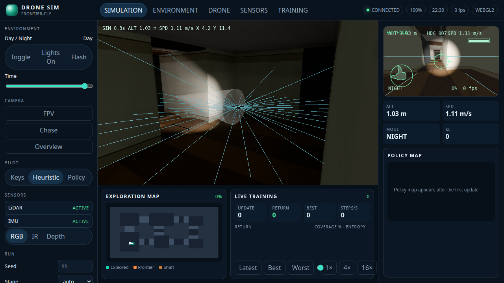
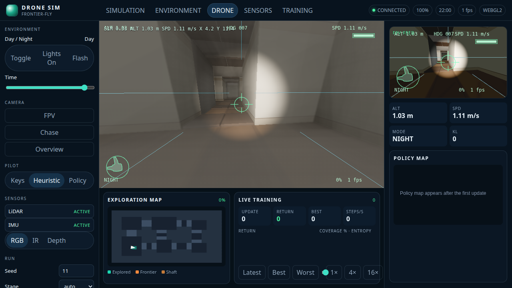
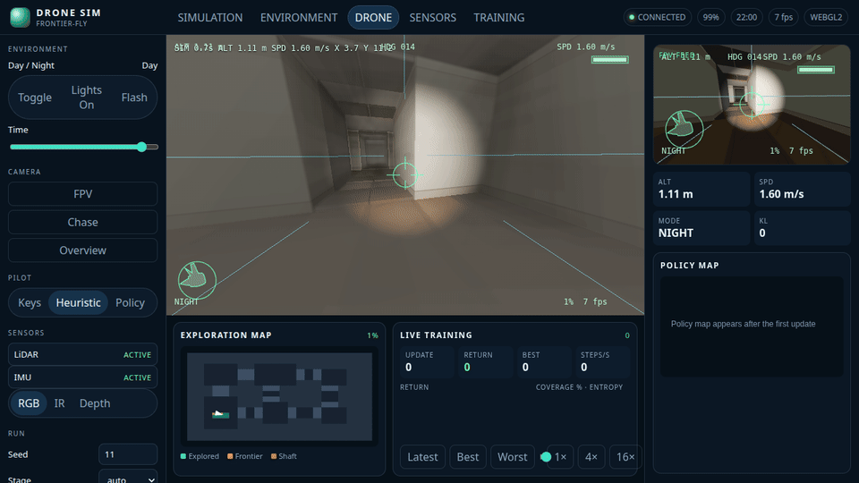
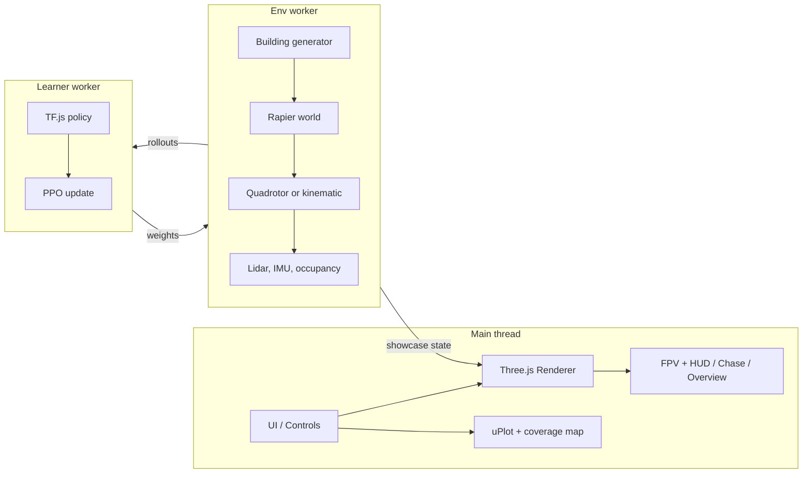

# frontier-fly

**frontier-fly** — Watch a tiny neural network learn to fly. A drone starts out bouncing off walls in a procedurally generated building. Within minutes it is sweeping rooms, threading doorways, and climbing shafts to explore floors it has never seen. Flip to FPV, kill the lights, and watch it keep going by flashlight. Everything runs in your browser: quadrotor physics, lidar, PPO training, WebGPU rendering, and live charts. No servers and no GPU cluster, just a seed and some patience.

The sim is deterministic. A seed rebuilds the same building, and the policy reads lidar, IMU, and an egocentric occupancy crop so it does not depend on the lights.

## Screenshots

Day chase, night with the flashlight, and the FPV feed. Captured headlessly in Chrome from `/?shot=day`, `/?shot=night`, and `/?shot=fpv`.









## Setup

```bash
npm install
npm test
npm run dev
```

`npm run dev` serves the app at `http://127.0.0.1:3000` with COOP/COEP headers so `SharedArrayBuffer` is available. `npm run build && npm run preview` builds the static site the GitHub Pages workflow publishes.

## Controls

| Input | Action |
| --- | --- |
| W A S D | Fly forward / left / back / right |
| Q E or arrow left / right | Yaw |
| Space / C | Climb / descend |
| 1 2 3 | FPV, chase, overview |
| F | Flashlight |
| L | Interior lights |
| P | Pause the sim |
| T | Start or pause training |
| Drag in overview | Orbit the cutaway camera |

The left rail also sets the seed, curriculum stage, time of day, sensor mode (RGB, IR, depth), and checkpoint save/load. A shareable URL looks like `/?seed=11&camera=fpv&tod=22&shot=night`.

| Query | Effect |
| --- | --- |
| `seed` | Building and episode seed |
| `shot` | `day`, `dusk`, `night`, or `fpv` preset |
| `camera` | `fpv`, `chase`, `overview` |
| `stage` | `0`–`5` or `auto` |
| `train=1` | Start PPO when the page loads |
| `quality` | `low` or `high` |
| `pilot` | `keys`, `heuristic`, or `policy` |

Pilot defaults to the keyboard. Shot URLs fly a lidar heuristic so the camera has something to follow before a policy has learned the building. Choose **Policy** to fly the loaded checkpoint.

## Architecture



`src/sim`, `src/gen`, and `src/rl` do not import Three.js. Training can run headless. The renderer only consumes a `BuildingSpec`, a `DroneState`, and a `LightingState`.

## What is implemented

- Seeded buildings: BSP rooms, doors, hallways from stage 3, shafts when there is more than one floor, and a reachability check that retries with `seed + 1`.
- Kinematic flight and a 6-DoF quadrotor with a velocity-to-attitude cascade, motor lag, and drag. Physics steps at 400 Hz in quad mode. Rapier builds the colliders and casts the lidar.
- Observation is 306 floats: 40 lidar ranges, IMU, altitude, a 16×16 egocentric map, floor index, and time remaining. The action is `[vx, vy, vz, yawRate]`.
- PPO in TensorFlow.js, GAE, running observation and reward normalization, and a six-stage curriculum. Rollouts and updates run in Web Workers.
- Chase, FPV, and overview cameras, a canvas HUD, day/night lighting, per-room lights, a flashlight, and IR/depth display modes.
- Live return, coverage, and entropy charts, a top-down coverage map, a policy heatmap once training has weights, and a replay scrubber at 1×, 4×, and 16×.
- A checkpoint in `public/checkpoints/pretrained.json`, plus download and IndexedDB save/load.

## Honest limits

The shipped checkpoint is an early stage-0 PPO run, not a policy that sweeps buildings. Fifty updates (one environment, 256 steps each, about 86 seconds of wall clock on this machine) moved finished-episode coverage from about 5% to **35%**. Rollouts during that run were about **2,100** environment steps/s before the TensorFlow.js update. It does **not** meet the spec bar of 80% stage-0 coverage, 60% on a fresh stage-3 seed, or night coverage within 90% of day coverage.

A kinematic env step measured **0.16 ms** in Node (about 6,000 steps/s), inside the 0.3 ms budget. The quad hover, step-response, and million-step tests pass. Headless Chrome on this machine, with ANGLE software WebGL2 and no discrete GPU, rendered the high preset at about **5 fps** and the low preset at about **16 fps**. That does not meet the 45 fps bar, and it was not measured on a mid-range laptop GPU. WebGPU is requested when the quality preset is high and an adapter answers within 350 ms; this capture stayed on WebGL2. There is no TAA, SSR, or baked global illumination. Worker messages use transferable buffers. The COOP/COEP headers are set so a `SharedArrayBuffer` path can be added later. Numbers from the capture are in `docs/media/capture.json`.

## Scripts

| Script | What it does |
| --- | --- |
| `npm test` | Unit tests and the kinematic step measurement |
| `npm run build` | Typecheck and production bundle |
| `npm run test:e2e` | Headless Chrome screenshots |
| `PRETRAIN_UPDATES=20 npm run pretrain` | Retrain and rewrite the shipped checkpoint |

## License

MIT. See [LICENSE](LICENSE).
