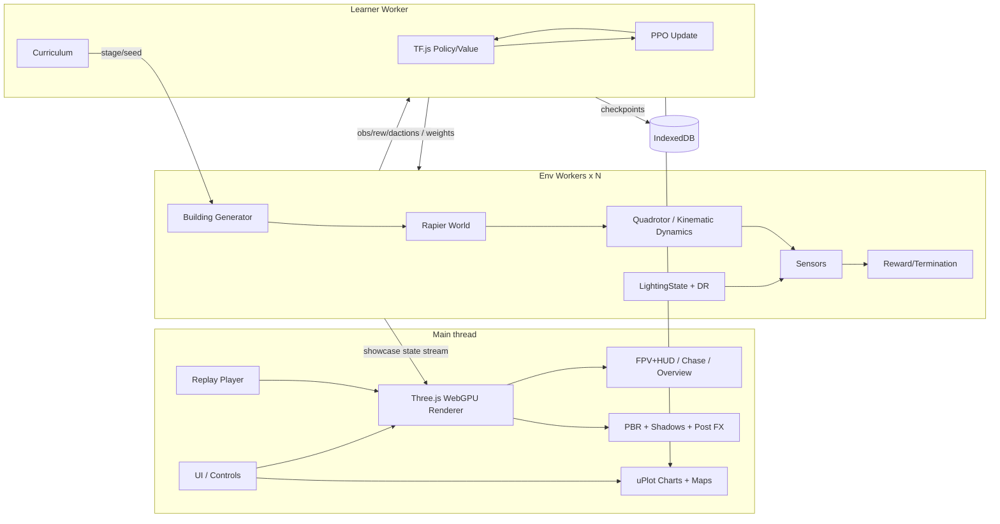

# Drone Explorer — Spec

Personal project (Alex Nieves). Browser drone sim where a small neural-net policy learns to explore procedurally generated buildings, with training watchable live.

---

## 1. Spec

### Goals
- Train an exploration policy fully in-browser (no server) and watch it learn live.
- Procedural, seeded buildings: rooms, doors, hallways, multiple floors, stairwells/shafts.
- Deterministic, reproducible runs (seed → building + training init).
- Shareable demo: URL with seed + checkpoint loads instantly.
- Highly realistic look and flight feel: quadrotor dynamics (thrust, drag, motor lag, IMU noise), PBR materials, GI-ish lighting, shadows, post-processing.
- Switchable cameras: FPV feed with HUD, chase cam, overview cam.
- Day/night: dynamic time of day, interior lights on/off, and a flashlight/IR mode at night. The policy works in both.
- Sim is strictly decoupled from rendering, so training runs headless at full speed.

### Non-goals
- Real flight-controller fidelity (aero, motor models, PX4/ArduPilot).
- Path-traced photorealism, or RL from high-res camera pixels. Realism is visual and dynamic only; the policy reads cheap sensors.
- Multiplayer, backend, accounts.
- Sim-to-real transfer.

### Demo moments
1. Untrained drone bumps around a room → minutes later it sweeps the room cleanly.
2. Coverage map fills in live next to the 3D view while the reward curve climbs.
3. Drone finds a door, crosses a hallway, and enters an unseen room.
4. Drone finds a shaft and climbs to a new floor on its own.
5. "New seed" button: trained policy generalizes to a never-seen building.
6. Switch to FPV at night: flashlight cone sweeps a dark hallway, HUD shows altitude/speed/battery, and the drone still explores cleanly.
7. Time-of-day slider runs from noon to dusk to lights-off while training continues uninterrupted.

### Tech stack (recommended in **bold**)
| Area | Options | Pick & tradeoff |
|---|---|---|
| Render | **Three.js (r16x+, WebGPURenderer with WebGL2 fallback)** vs Babylon.js (WebGPU) vs Godot/Unity WebGL export | See "Rendering realism decision" below. |
| Physics | **Rapier (WASM)** plus a custom quadrotor integrator | Rapier handles colliders, raycasts and contacts. Flight dynamics are our own code, so they're deterministic and run headless. |
| NN | **TF.js (WebGL/WASM backend)** vs ONNX Runtime Web | TF.js trains in the browser. ORT Web is inference-only (fast); use it only to serve exported checkpoints (stretch). |
| Training loop | **PPO in Web Worker(s)** | Stable with continuous actions and simple to implement. Rollouts run headless in N env workers; the learner runs in 1 worker. The main thread only renders. |
| Lang/build | **TypeScript + Vite**, Vitest, Playwright | Fast HMR, good worker support. |
| Charts | **uPlot** | Tiny and fast for streaming curves. |
| Messaging | Comlink + transferable Float32Array / SharedArrayBuffer (needs COOP/COEP) | SAB gives zero-copy; falls back to transferables. |

### Rendering realism decision
- **Three.js WebGPU (recommended):** TSL node materials, PBR, cascaded/VSM shadows, a post-processing node pipeline (SSAO/GTAO, SSR, bloom, tone mapping, TAA), and baked light probes + lightmaps for GI-ish interiors. Weights stay in the same JS/TS world as TF.js, so there's no bridge, the bundle is small, and it's easy to hack.
- **Babylon.js WebGPU:** more batteries included (IBL, SSAO2, SSR, volumetric light, inspector), roughly on par in quality. It's heavier and more opinionated. A reasonable alternative if Three's WebGPU post stack is too rough.
- **Godot 4 / Unity WebGL:** best-in-class editor, lighting and baking. But the build is 20–60 MB+, you need a JS↔engine bridge for training, WebGPU export is immature, startup is slow, and the procedural, seeded runtime meshing story is weaker.
- **Recommendation:** Three.js WebGPU. Fallback trigger: if by the end of M5 we can't hit "realistic interior at night with flashlight + soft shadows at ≥45 fps", switch only the **renderer** to Babylon. That costs about a week because the renderer only consumes `BuildingSpec` + `DroneState` + `LightingState`. Godot/Unity stays a last resort, used purely as a viewer; training never moves into it.
- **Decoupling rule:** `sim/`, `gen/` and `rl/` never import `three`, `babylon` or the DOM. The renderer is a pure subscriber to state streams. Headless training = no renderer instantiated.

### Graphics
- PBR materials per surface class (painted drywall, concrete, wood floor, glass, metal shaft). Texture variants are chosen by seed, with trim/baseboards and door frames.
- Lighting: sun (directional) + sky (physical sky model, time-driven) through windows. Interior point/rect area lights per room, toggleable. Per-room baked irradiance probes (precomputed at generation time with a cheap CPU light-bounce pass) plus SSAO/GTAO.
- Shadows: CSM for the sun, shadow-casting spotlight for the flashlight, budgeted shadows for the nearest 4 interior lights.
- Post: ACES/AgX tone mapping, auto-exposure (essential for day/night), bloom, TAA, optional SSR, vignette and a noise/grain shader for FPV.
- Quality presets: Low (WebGL2, no SSR/GI probes) / High (WebGPU, all effects). Auto-pick by adapter.

### Cameras
- **FPV:** mounted on the drone, 110° FOV, camera tilt 15–30°, slight rolling-shutter/motion blur, lens distortion. HUD overlay (HTML/canvas): altitude, speed, heading tape, battery/time, coverage %, lidar mini-ring, collision flash, mode (DAY/NIGHT/IR).
- **Chase:** spring-damped follow behind/above, with a collision-aware boom (raycast to avoid clipping walls).
- **Overview:** orbit cam or top-down cutaway with per-floor clipping planes (hides floors above the drone).
- Hotkeys 1/2/3. Picture-in-picture FPV in the corner when on chase/overview. Cameras exist only in the renderer and never affect the sim.

### Day / night & lighting state
- `LightingState { timeOfDay: 0..24, interiorLightsOn: boolean[] per room, flashlightOn, sensorMode: 'rgb'|'ir'|'depth' }`, owned by the sim (so it's seedable) and streamed to the renderer.
- Dynamic time of day: sun angle, sky color and intensity curves; window light falls to zero at night.
- Night: interior lights randomly on/off per room. The drone has a flashlight (spot, 40° cone) plus IR mode (renderer shows a grayscale/greenish false-color with an emissive IR illuminator) and a depth view.
- **The policy stays light-invariant.** Lidar/depth/IMU obs don't depend on lighting, so the policy works at night by construction. The optional camera-based obs (stretch) gets lighting randomization and an IR/depth channel.
- Lighting-dependent sensor effects that *are* modeled (so day/night matters in training): lidar dropout rises on glass/dark-absorbing surfaces, and at night with the optional camera obs, plus visual-odometry-style IMU drift noise ×1.5 in "low light" (stretch flag).

### Procedural building generator
- Input: `seed`, `floors`, `footprint (W×D cells)`, `difficulty`. Seeded PRNG (mulberry32/sfc32) only; no `Math.random`.
- Per floor: BSP-split the footprint into rooms (min room size, split ratio 0.3–0.7).
- Connectivity: MST over adjacent rooms plus a few extra edges (loops ∝ difficulty) → doors (width 1–2 cells) on shared walls.
- Hallways: optional corridor carving between BSP siblings (1–2 cells wide).
- Vertical: 1–2 shafts/stairwells per floor pair, placed in cells that are valid on both floors; a hole cut in the ceiling/floor slab.
- Output: `BuildingSpec` (cell grid per floor: wall/floor/door/shaft) → mesher builds merged wall boxes (Three) and cuboid colliders (Rapier).
- Validation: BFS confirms every room on every floor is reachable from the spawn. Otherwise regenerate with seed+1.
- Floor height ~3 m, cell 1 m, drone ~0.3 m diameter.

### Drone dynamics
Two modes behind one `Dynamics` interface. Both are deterministic and DOM-free.
- **Kinematic (MVP, curriculum warm-up):** velocity commands with first-order lag (τ≈0.15 s); |v|≤2 m/s horizontal, ≤1 m/s vertical, yaw rate ≤90°/s.
- **Quadrotor (realistic, default after M5):**
  - Rigid body 6-DoF: mass 0.25–0.6 kg, inertia diag, arm 0.08–0.12 m, X config.
  - Motors: first-order lag τ_m 20–40 ms, thrust = k_f·ω², yaw torque = k_m·ω², saturation and min idle.
  - Drag: linear + quadratic body drag, rotor induced drag ∝ v·Σω. Optional ground/ceiling effect near surfaces.
  - Inner loop: a built-in rate/attitude PID (like a flight controller in angle mode). The policy commands **[vx, vy, vz, yawRate]** setpoints, and a velocity→attitude→rate cascade converts them to motor commands. The action space stays unchanged, so it can swap with kinematic mode.
  - Integration: semi-implicit Euler at 400 Hz physics, 50 Hz control (policy at 20 Hz, action hold). Rapier only does collision response (dynamic body with custom forces, or a swept sphere + impulse).
  - Battery sag (stretch): max thrust decays over the episode.
- **Sensor/actuator noise:** IMU gyro/accel white noise + bias random walk (MEMS-grade), baro altitude noise σ 0.1 m, lidar range noise σ 1–2 cm + 1% dropout, action latency 1–2 control ticks.
- **Validation:** hover-stability test, step-response test (rise time and overshoot within bounds), energy sanity check (no NaN or explosions over 1e6 steps across random seeds).

### Sensors
- Lidar: 32 horizontal rays (360°) plus 8 up/down-tilted rays, max range 8 m, normalized to [0,1].
- IMU: body-frame velocity estimate (3), yaw rate (1), sin/cos yaw (2). In quad mode also roll/pitch (2, replaces 2 map cells), all noisy per the noise model.
- Altitude above floor and distance to ceiling (2 rays).
- Optional: 16×12 depth image from a raycast grid (CNN branch, stretch).
- Local occupancy egocentric map: 16×16 crop of visited/known cells (helps exploration).

### Observation / action
- Obs (MVP): 40 lidar + 6 IMU + 2 alt + 256 local map + 1 floor-index-norm + 1 time-left ≈ 306 floats.
- Action: continuous 4-D [vx, vy, vz, yawRate] ∈ [-1,1] (tanh-squashed Gaussian), scaled to limits.
- Policy: MLP 306→256→128 (tanh) → mean(4) + learned logStd. Value head shares the trunk or is separate (separate is the default).

### Reward
- +1.0 per newly visited voxel (0.5 m cells), i.e. coverage gain. Stretch: frontier-distance shaping.
- +5 for entering a new room, +10 for reaching a new floor.
- −5 on collision (−0.1/step while in contact).
- −0.01·‖a_t − a_{t−1}‖² for smoothness, −0.001·‖a‖² for effort.
- −0.005 per step as a time penalty.
- Normalize the reward with running std.

### Termination
- Max steps (1000 MVP; scales with building size).
- Coverage ≥ 95% of reachable voxels (success bonus +20).
- More than N=3 hard collisions, or leaving bounds.
- No new coverage for 200 steps (truncate, bootstrap value).

### Domain randomization (train + eval)
- Per episode: time of day U(0,24), interior lights on-prob 0–1, flashlight on/off, sensorMode, dynamics params ±20% (mass, k_f, drag, motor τ), noise scales ×[0.5, 2], latency 0–2 ticks, materials/texture seeds (affects lidar dropout on glass).
- Eval suites are fixed seeds × {day, dusk, night-lights-on, night-dark-flashlight, night-IR} × {kinematic, quad}. Report coverage/collision per cell of that matrix. Target: night-dark coverage ≥ 90% of day coverage.

### Curriculum
| Stage | World | Promote when |
|---|---|---|
| 0 | Single empty room | mean coverage > 80% |
| 1 | Room + obstacles (pillars/furniture boxes) | > 75% |
| 2 | 2–4 rooms + doors | > 70% |
| 3 | Rooms + hallways, loops | > 65% |
| 4 | 2–3 floors + shafts | > 60% and floor-reach rate > 50% |
| 5 | Quadrotor dynamics + full noise + full day/night DR | > 55% on the eval matrix |
- Dynamics/noise realism is also curriculum'd: kinematic for stages 0–2, then the quad blends in (DR noise scales ramp from 0 to 1 over stages 3–5).
- Auto-advance with a rolling 50-episode window. Mix in 20% earlier-stage episodes to avoid forgetting.

### Live training viz
- 3D view (FPV/chase/overview switchable, time-of-day slider, lights toggle): the drone from one "showcase" env, lidar rays toggle, trail, visited voxels as tint.
- Reward curve, episode length, coverage %, entropy, KL, value loss (uPlot).
- Coverage/occupancy map: top-down per floor, with frontier cells highlighted.
- Policy/value heatmap: sample V(s) and mean action over a grid of positions in the current building, shown as top-down color plus arrow field.
- Episode replay: ring buffer of the best/worst/latest episodes with a scrub slider and 1×/4×/16× speed.
- Controls: pause, resume, seed, stage override, speed (render-throttle vs max-train), save/load checkpoint (IndexedDB + file download).

### Architecture


### Perf budget (mid laptop, Chrome)
- Render: High preset ≥45 fps (WebGPU), Low ≥60 fps; < 16 ms/frame on the GPU. Headless training renders nothing. During training the render only shows the showcase env, and it can be paused.
- Quad env step (8 physics substeps + 40 rays) < 0.6 ms → ≥ 1.5k steps/s per worker.
- Render (legacy target): 60 fps main thread, < 8 ms/frame on the CPU. The showcase env streams at 20 Hz and is interpolated.
- Env step (physics + 40 rays + reward): < 0.3 ms → ≥ 3k steps/s per worker.
- N = min(4, cores−2) env workers × 8 envs each → target ≥ 10k env-steps/s total.
- PPO: rollout 2048×N steps, 4 epochs, minibatch 512, under 3 s per update on WebGL.
- Memory < 500 MB. Building gen < 50 ms for a 3-floor 40×40.
- Stage 0 learns visibly in < 2 min; stage 2 in < 15 min.

---

## 2. MVP vs Stretch

### MVP (M0–M4)
- **M0 Scaffold:** Vite+TS, workers wired up, deterministic RNG, CI tests. (Day 1)
- **M1 World:** generator (single floor, BSP rooms + doors), mesher, Rapier colliders, kinematic drone, lidar, keyboard fly mode. (Days 2–4)
- **M2 RL:** env API, PPO in a learner worker, 1 env worker, stage 0–2 curriculum, reward curve. (Days 5–8)
- **M3 Viz:** coverage map, live showcase view, metrics panel, checkpoint save/load. (Days 9–11)
- **M4 Polish:** hallways, multi-worker scaling, seed URL, pretrained checkpoint shipped. (Days 12–14)

- **M5 Realism core:** quadrotor dynamics + noise model, WebGPU PBR renderer, shadows, post FX, quality presets; stage 5 curriculum. (Days 15–20)
- **M6 Cameras + day/night:** FPV+HUD/chase/overview, time of day, interior lights, flashlight/IR/depth views, DR in training, eval matrix. (Days 21–25)
- Note: M5–M6 are "MVP+". The core RL MVP (M0–M4) must ship independently on kinematic dynamics with the basic renderer.

### Stretch
- Multi-floor + shafts (stage 4). The first stretch item; promote it into MVP if M2 lands early.
- Policy/value heatmap + episode replay scrubber.
- Quad dynamics mode; depth-image CNN branch.
- Baked lightmaps via an offline (in-browser, worker) path-trace pass per seed; volumetric light shafts; dust particles in the flashlight beam.
- Camera-based policy (low-res RGB/IR + depth CNN) trained with full lighting DR.
- Babylon renderer backend behind the same `Renderer` interface (if the Three bar isn't met).
- ONNX Runtime Web inference for a "play trained model" mode.
- Recurrent policy (GRU) for memory; frontier-based shaping; dynamic obstacles (opening doors).
- Comparison mode: random vs frontier-heuristic vs learned policy, side by side.

---

## 3. Claude Code Implementation Guide (parallel subagents)

### Repo layout
```
src/
  shared/        types.ts, rng.ts, constants.ts, messages.ts   # CONTRACTS (owned by lead, frozen after P0)
  gen/           building.ts, bsp.ts, connect.ts, shafts.ts, validate.ts
  sim/           world.ts (Rapier), drone.ts, sensors.ts, reward.ts, env.ts
  rl/            model.ts, ppo.ts, buffer.ts, normalize.ts, curriculum.ts, checkpoint.ts
  workers/       env.worker.ts, learner.worker.ts, pool.ts
  sim/dynamics/  kinematic.ts, quad.ts, controller.ts, noise.ts, dr.ts
  sim/lighting.ts  # LightingState + time-of-day, no rendering
  viz/           renderer.ts (interface), three/{scene,materials,lights,shadows,post,sky}.ts, meshBuilding.ts, droneMesh.ts, rays.ts, interp.ts
  viz/cameras/   fpv.ts, chase.ts, overview.ts, hud.ts
  eval/          matrix.ts (seed × lighting × dynamics suites)
  ui/            app.ts, controls.ts, charts.ts, coverageMap.ts, heatmap.ts, replay.ts
  main.ts
tests/           unit (vitest) per module, e2e (playwright)
```

### Interface contracts (`src/shared/types.ts`)
```ts
export type Cell = 0|1|2|3; // 0 empty,1 wall,2 door,3 shaft
export interface FloorGrid { w: number; d: number; cells: Uint8Array; rooms: Room[] }
export interface Room { id: number; x: number; z: number; w: number; d: number }
export interface BuildingSpec { seed: number; cellSize: number; floorHeight: number;
  floors: FloorGrid[]; spawn: [number,number,number]; reachableVoxels: number }
export interface GenParams { seed: number; floors: number; w: number; d: number; stage: number }
export function generateBuilding(p: GenParams): BuildingSpec; // gen/building.ts, pure, deterministic

export const OBS_DIM = 306, ACT_DIM = 4;
export interface StepResult { obs: Float32Array; reward: number; done: boolean; truncated: boolean;
  info: { coverage: number; collisions: number; floor: number; newRoom: boolean } }
export interface Env { reset(spec: BuildingSpec, seed: number): Float32Array;
  step(action: Float32Array): StepResult; snapshot(): DroneState }
export interface DroneState { pos: [number,number,number]; vel: [number,number,number]; yaw: number; t: number }

export interface DynParams { mass: number; inertia: [number,number,number]; arm: number; kf: number; km: number;
  motorTau: number; dragLin: [number,number,number]; dragQuad: [number,number,number] }
export interface NoiseParams { gyroSigma: number; accelSigma: number; biasRW: number; baroSigma: number;
  lidarSigma: number; lidarDropout: number; latencyTicks: number }
export interface Dynamics { reset(s: DroneState, p: DynParams): void;
  step(cmd: Float32Array, dt: number): DroneState }   // cmd = [vx,vy,vz,yawRate] setpoints
export interface LightingState { timeOfDay: number; interiorLightsOn: Uint8Array; flashlightOn: boolean;
  sensorMode: 'rgb'|'ir'|'depth' }
export interface EpisodeConfig { stage: number; dynamics: 'kinematic'|'quad'; dyn: DynParams; noise: NoiseParams; lighting: LightingState }
export interface Renderer { load(spec: BuildingSpec): void; update(s: DroneState & { quat: [number,number,number,number]; motors: Float32Array },
  l: LightingState): void; setCamera(m: 'fpv'|'chase'|'overview'): void; setQuality(q: 'low'|'high'): void; dispose(): void }

export interface Policy { act(obs: Float32Array, n: number): { action: Float32Array; logp: Float32Array; value: Float32Array };
  getWeights(): ArrayBuffer[]; setWeights(w: ArrayBuffer[]): void }
```
`src/shared/messages.ts` holds the discriminated unions for worker messages: `{type:'reset'|'step'|'weights'|'metrics'|'showcase'|'checkpoint', ...}`.
`Env.reset` takes an `EpisodeConfig` too: `reset(spec, seed, cfg)`. DroneState gains `quat` and `motors` in quad mode.
Lint rule (eslint `no-restricted-imports`): `three`, `babylonjs` and DOM globals are banned in `gen/`, `sim/`, `rl/`, `workers/env*`.
Rule: only the lead edits `shared/`. Agents propose changes in `CONTRACT_REQUESTS.md`.

### Phases & parallelism
| Phase | Parallel streams | Gate |
|---|---|---|
| P0 Contracts (lead, serial) | — | `shared/*` compile; `npm test` green; Vite dev runs |
| P1 Foundations | A: gen · B: sim (uses a stub BuildingSpec fixture) · C: rl (fake env) · D: viz/ui shell | All unit tests per stream |
| P2 Integration | E: workers/pool wiring · F: viz binds to real gen + showcase stream · C cont.: curriculum | Stage 0 learns in < 2 min (e2e) |
| P3 Features | A: hallways + shafts · G: heatmap + replay · H: perf/multi-worker | Perf budget tests |
| P3b Realism (parallel) | I: quad dynamics + noise + DR · J: WebGPU renderer (PBR, lights, shadows, post, sky) · K: cameras + HUD · L: lighting/day-night state + eval matrix | Gates below |
| P4 Polish | lead: checkpoint shipping, README, seed URLs | Demo moments 1–5 manually verified |

Use git worktrees (one per agent) and have the lead merge. Run 4 agents concurrently in P1.

### Ready-to-paste subagent prompts

**Lead (P0)**
> Scaffold a Vite + TypeScript + Vitest + Playwright project. Create `src/shared/{types,rng,constants,messages}.ts` exactly per SPEC.md §3 contracts. Implement `rng.ts` (sfc32, seeded, `fork(label)`). Add `tests/fixtures/simpleRoom.json` (a valid BuildingSpec of a 10×10 single room). Configure COOP/COEP headers in vite config. Commit. Do not implement other modules.

**Agent A — Generator**
> Own `src/gen/` only. Implement `generateBuilding(p: GenParams): BuildingSpec` per SPEC.md "Procedural building generator": BSP rooms, MST+loop doors, corridors for stage≥3, shafts for floors>1, and BFS validation with seed+1 retry. Pure and deterministic, using `shared/rng`. Tests: same seed → byte-identical output; 1000 random seeds all valid and reachable; generation < 50 ms for 3×40×40. Do not edit `shared/`.

**Agent B — Sim**
> Own `src/sim/` only. Implement `Env` from `shared/types.ts` with Rapier (`@dimforge/rapier3d-compat`): colliders from BuildingSpec cells, a kinematic drone per SPEC "Drone dynamics", sensors per "Sensors" producing exactly OBS_DIM floats in the documented order (write the order in `sim/OBS_LAYOUT.md`), and reward/termination per spec. Test against `tests/fixtures/simpleRoom.json`: determinism given seed+actions; flying into a wall yields a collision penalty; hovering gives no coverage gain after step 1; env step < 0.3 ms average over 10k steps.

**Agent C — RL**
> Own `src/rl/` only. Implement the TF.js PPO per SPEC: MLP policy/value, tanh-Gaussian, GAE(λ=0.95, γ=0.99), clip 0.2, entropy 0.01, Adam 3e-4, obs/reward running normalization, `curriculum.ts` (stage promotion rules), and `checkpoint.ts` (IndexedDB + file). Implement the `Policy` interface. Tests: solves a 1-D point-to-target toy env within 200 updates; weights round-trip; curriculum promotes and mixes 20% prior stages.

**Agent D — Viz/UI shell**
> Own `src/viz/` and `src/ui/` only. Three.js scene that renders any BuildingSpec (merged instanced wall boxes, per-floor transparency toggle) and a drone mesh driven by a `DroneState` stream with interpolation. uPlot charts fed by a `metrics` message (mock generator for now), a top-down coverage canvas, and controls (pause/seed/stage/speed). Render the fixture. Test: Playwright screenshot is non-blank, with 60 fps in an idle scene.

**Agent E — Workers (P2)**
> Own `src/workers/`. Build `env.worker.ts` (K envs, vectorized step, SAB obs buffers), `learner.worker.ts` (PPO rollout/update loop, weight broadcast, metrics every update, showcase env state at 20 Hz), and `pool.ts` (spawn min(4,cores−2) workers, transferable fallback). Use `shared/messages.ts` types only. Acceptance: e2e where stage 0 mean coverage > 80% within 2 min headless Chrome; ≥ 10k env-steps/s logged.

**Agent G — Heatmap & Replay (P3)**
> Own `src/ui/heatmap.ts` and `src/ui/replay.ts`. Heatmap: the learner samples V(s) and mean action on a grid (request/response message `heatmapReq`/`heatmapRes`); draw a color map plus an arrow field per floor. Replay: ring buffer of best/worst/latest episodes (DroneState[] + coverage deltas), with a scrub slider and 1/4/16× playback in the 3D view. Acceptance: a recorded episode replays deterministically, and the heatmap updates in < 200 ms.

**Agent I — Quadrotor dynamics (P3b)**
> Own `src/sim/dynamics/`. Implement the `Dynamics` interface from `shared/types.ts`: `kinematic.ts` (port the existing one) and `quad.ts` (6-DoF rigid body, ω² thrust/torque, motor lag, linear+quadratic drag, 400 Hz semi-implicit Euler), `controller.ts` (velocity→attitude→rate PID cascade producing motor commands), `noise.ts` (IMU white noise + bias random walk, baro, lidar noise/dropout, latency), and `dr.ts` (sample DynParams/NoiseParams per seed). No DOM or render imports. Tests: hover holds ±5 cm for 10 s with noise off; step response for 1 m/s has rise <0.6 s and overshoot <20%; 1e6 random steps produce no NaN; same seed gives an identical trajectory; step <0.6 ms incl. rays.

**Agent J — Realistic renderer (P3b)**
> Own `src/viz/three/` and `src/viz/renderer.ts`. Implement `Renderer` with Three.js WebGPURenderer (WebGL2 fallback): PBR materials per surface class with seeded variants, a physical sky driven by `LightingState.timeOfDay`, sun CSM shadows, per-room interior lights obeying `interiorLightsOn`, a drone flashlight spot with shadows, GTAO, bloom, AgX tone mapping with auto-exposure, TAA, and IR/depth display modes. Low/High presets. Consume only `BuildingSpec`, `DroneState` and `LightingState`. Never import from `sim/`. Tests: Playwright screenshots at noon/dusk/night-dark-flashlight are non-blank and histogram-distinct; High ≥45 fps on the reference scene (log adapter info); disposing frees GPU resources (no leak over 20 seed loads).

**Agent K — Cameras + HUD (P3b)**
> Own `src/viz/cameras/`. FPV (drone-mounted, 110° FOV, tilt, mild distortion/motion blur), chase (spring-damped, raycast boom against the BuildingSpec grid, no clipping), overview (orbit + per-floor cutaway clipping). HUD canvas overlay: altitude, speed, heading tape, time/battery, coverage %, lidar ring, collision flash, mode label. Hotkeys 1/2/3, PiP FPV. Tests: camera switch < 1 frame; the chase cam never ends inside a wall over a 60 s scripted flight; HUD values match DroneState.

**Agent L — Day/night + eval (P3b)**
> Own `src/sim/lighting.ts` and `src/eval/`. Seeded LightingState sampling (time of day, per-room lights, flashlight, sensorMode) and its DR hooks into `EpisodeConfig`. Lighting-dependent sensor effects (lidar dropout on glass/dark surfaces, optional low-light IMU drift flag). `eval/matrix.ts` runs a policy over fixed seeds × {day, dusk, night-lit, night-dark, IR} × {kinematic, quad} headless and outputs a JSON + UI table. Tests: the lighting sample is deterministic per seed; the eval matrix runs headless with no renderer; the report contains all cells.

**Agent H — Perf (P3)**
> Profile env step, raycasts, PPO update, and render. Hit the SPEC perf budget. Add `tests/perf/*.bench.ts` with thresholds and fail CI on regression >20%. Edit only hot paths, documented in a PR note.

### Acceptance tests per phase
- **P0:** `tsc --noEmit` clean; RNG determinism test; dev server serves with COOP/COEP.
- **P1:** gen 1000-seed validity; sim determinism and collision; PPO toy env solved; viz renders the fixture.
- **P2:** e2e stage-0 learning < 2 min; no main-thread long tasks > 50 ms during training.
- **P3:** stage 2 > 70% coverage < 15 min; multi-floor generation valid; perf benches pass.
- **P3b:** quad dynamics tests pass; renderer screenshots at 3 lighting conditions; High ≥45 fps; cameras switch and HUD is correct; a training run with full DR reaches stage 5; eval matrix night-dark ≥ 90% of day coverage; headless training throughput drops < 30% vs kinematic.
- **P4:** a fresh seed loads the shipped checkpoint with > 60% coverage on stage 3; all 5 demo moments reproducible from URLs.

---

## 4. Repo name & README hook

Options: `drone-explorer`, `skyhallway`, `frontier-fly`, `ppo-in-the-walls`, `dronemaze-rl`.
**Pick: `frontier-fly`.**

> **frontier-fly** — Watch a tiny neural network learn to fly. A drone starts out bouncing off walls in a procedurally generated building. Within minutes it is sweeping rooms, threading doorways, and climbing shafts to explore floors it has never seen. Flip to FPV, kill the lights, and watch it keep going by flashlight. Everything runs in your browser: quadrotor physics, lidar, PPO training, WebGPU rendering, and live charts. No servers and no GPU cluster, just a seed and some patience.
