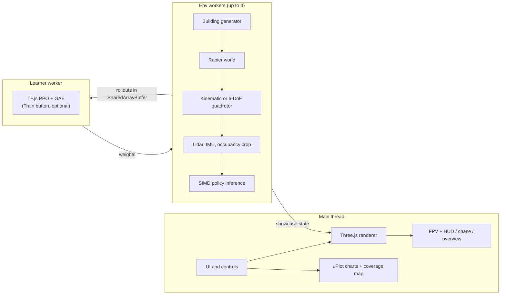
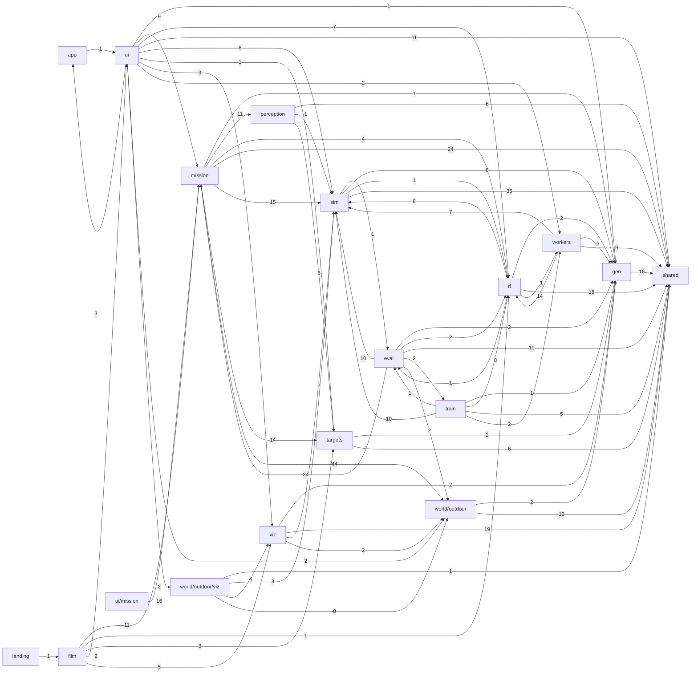

<!-- Generated by scripts/docs/generate.mjs. Edit the template in scripts/docs/, not this file. -->

# Architecture

frontier-fly is a static site. Physics, sensors, training, and rendering all run in the browser tab, and the same simulator code runs headless in Node for tests, pretraining, and benchmarks. There is no server.

The tables and the module graph below are generated from the import graph under `src/` (197 files, 38,556 lines) by `npm run docs`. The prose is the template in `scripts/docs/ARCHITECTURE.template.md`.

## Runtime data flow

1. **Generate.** `src/gen` builds a building from a seed with BSP rooms, doors, hallways, and shafts, then checks every room is reachable. The outdoor site (`src/world/outdoor`) places one to four of those buildings on terrain with trees, a geofence, and typed openings.
2. **Simulate.** `src/sim` wraps a Rapier world. Kinematic flight steps once per action. Quadrotor mode runs a velocity-to-attitude cascade with motor lag and drag at 400 Hz.
3. **Sense.** Each step produces a 1088-float observation (v2): 40 lidar ranges, IMU, altitude, frontier-direction features, and four 16×16 egocentric maps (visited and unexplored-free at 8 m and 32 m). The layout is versioned in [`src/sim/OBS_LAYOUT.md`](../src/sim/OBS_LAYOUT.md) because the checkpoint, the rollout stride, and the gemm scratch depend on it.
4. **Act.** The policy outputs `[vx, vy, vz, yawRate]` in `[-1, 1]`. Inference in the env workers is a small SIMD WASM gemm (`src/rl/gemm.ts`), not TF.js.
5. **Learn (optional, in the tab).** The shipped weights come from offline imitation learning (see Training below). When you press **Train**, env workers write rollouts into `SharedArrayBuffer`s. The learner worker runs PPO in TF.js (WebGL backend, CPU fallback) and posts new weights back. A six-stage curriculum promotes when rolling coverage clears a gate.
6. **Render.** The main thread interpolates the showcase env's state and draws it with Three.js (WebGL2 with the full post stack by default; WebGPU only when the URL opts in with `?renderer=webgpu`). The renderer consumes a `BuildingSpec`, a `DroneState`, and a `LightingState`. It never drives the sim.

## Training

The shipped checkpoint (`public/checkpoints/pretrained.bin`) is produced headlessly by `npm run train:indoor`. Training writes JSON; `npm run pack:checkpoint` packs it into the binary form the site loads (a JSON header, then the weights as float32, which decodes to exactly the same numbers at a third of the size):

- **Behavior cloning.** A privileged frontier teacher (`src/sim/frontier.ts`) that can see the visited grid flies the curriculum, and the network learns to copy it from the observation alone.
- **DAgger.** The network flies, the teacher labels every state it visits, and the aggregated data is retrained each round. The round kept scores best on held-out validation seeds, never the eval seeds.
- **PPO.** Clipped surrogate, GAE, running observation and reward normalization, and the spec reward, with a KL anchor and BC loss to the cloned policy (`src/rl/finetune.ts`). It is what the browser **Train** button runs. No PPO fine-tune beat DAgger on validation, so the shipped checkpoint has none.
- **Curriculum.** Stage 0 is an 8×8 m single floor. Stage 3 is 20×20 m with hallways. Stages 4 and 5 add floors, shafts, and quadrotor dynamics. Domain randomization covers dynamics, sensor noise, wind, and lighting.

The same loop runs in the browser when you press **Train**, so a visitor can watch return, coverage, and entropy move in real time. [BENCHMARKS.md](BENCHMARKS.md) reports what the shipped checkpoint actually achieves.

## Mission layer

`src/mission` holds the versioned mission schema (geofence, no-fly zones, altitude band, targets, entry policy, budgets), its validator, the canonical share-link encoding, and a run session. It talks to the world and the detector only through `WorldProvider` and `DetectionSource`, so the planner page does not import the renderer. `src/targets` places simulated people, objects, and decoys. `src/perception` is a geometric camera detector with distance, occlusion, lighting, and motion-blur misses, plus a seen-empty tracker for confirm-clear.

## Limits of the indoor stack

These notes were written before the outdoor mission work. They list the indoor assumptions that a woods-to-building mission has to replace, and stay here as the record of why the mission layer is separate.

The long-term mission is outdoor plus indoor search: start outside a geofence, find buildings, use an opening, search rooms for a target or confirm the area clear, and eventually fly more than one drone in the same site. `outdoor.html` is the flyable site. The indoor explorer still cannot train that mission, because a few assumptions would have to change first.

Already reusable: `generateBuilding` is a pure function of seed, size, and stage, so a site generator can place several buildings. Lidar is a raycast against the colliders `PhysicsWorld` was given, and glass is already its own surface class. The action stays `[vx, vy, vz, yawRate]` on one `Dynamics` implementation per drone. The renderer only subscribes to state, so terrain and exteriors can be drawn without the sim importing Three.js. The worker pool runs many independent episodes, which is the right shape for training a single-agent policy.

These choices block the outdoor mission if they stay as they are:

- **The world is one indoor grid.** `BuildingSpec` is the only world type. Its origin is the footprint corner. Visited voxels are indexed from that corner, and every floor is assumed to share floor 0's width and depth. There is no terrain, no geofence, and no list of buildings on a site.
- **Leaving the footprint ends the episode.** `ExplorerEnv` treats a position outside the ground-floor rectangle as out of bounds. Spawn is the center of the largest ground-floor room, so an outdoor start terminates immediately.
- **Openings are not enterable in the indoor grid.** Door cells are always walkable. There is no closed or ajar door. Glass is painted onto solid border walls, and those boxes stay colliders (`buildingAabbs` marks them `window` and still blocks). A broken window is not representable. Outdoor shells cut real apertures next to a copy of that grid; `ExplorerEnv` does not load them.
- **The mission is indoor coverage.** Success is 95% of reachable voxels. The reward and the privileged teacher both chase that grid. There is no target object, no "confirm clear", and no detection channel.
- **The observation is versioned (v2, 1088 floats).** The shipped checkpoint, the SharedArrayBuffer stride, and the SIMD gemm scratch all assume `src/sim/OBS_LAYOUT.md`. The maps are indoor voxels. Altitude is distance to this building's floor and ceiling. A search policy needs observation v3; the app refuses a checkpoint whose version does not match.
- **One drone per world.** Each env holds one `DroneState`. Workers do not share a site. Drones are not physics bodies, so they cannot see or collide with each other. A swarm needs a shared world and a rollout layout with an agent axis.

## Module graph

Edges are relative imports between modules. The label is the number of import statements.

| Module | Files | Lines | Imports from | Libraries | Workers |
| --- | --- | --- | --- | --- | --- |
| `src/` | 1 | 7 | `ui` | — | — |
| `src/eval` | 10 | 1,446 | `gen`, `mission`, `rl`, `shared`, `sim`, `train`, `world/outdoor` | — | — |
| `src/film` | 6 | 1,694 | `mission`, `rl`, `targets`, `ui`, `viz` | Three.js | — |
| `src/gen` | 7 | 1,350 | `shared` | — | — |
| `src/landing` | 1 | 150 | `film` | — | — |
| `src/mission` | 50 | 12,393 | `gen`, `perception`, `rl`, `shared`, `sim`, `targets`, `world/outdoor` | — | — |
| `src/perception` | 8 | 813 | `shared`, `sim`, `targets` | — | — |
| `src/rl` | 12 | 2,938 | `eval`, `gen`, `shared`, `sim`, `workers` | TF.js | — |
| `src/shared` | 5 | 570 | — | — | — |
| `src/sim` | 23 | 4,820 | `eval`, `gen`, `rl`, `shared` | Rapier | — |
| `src/targets` | 10 | 1,270 | `gen`, `shared` | Three.js | — |
| `src/train` | 4 | 1,053 | `eval`, `gen`, `rl`, `shared`, `sim`, `workers` | — | — |
| `src/ui` | 15 | 2,517 | `app`, `gen`, `mission`, `rl`, `shared`, `sim`, `targets`, `viz`, `workers`, `world/outdoor/viz`, `world/outdoor` | uPlot | — |
| `src/ui/mission` | 4 | 1,743 | `mission` | — | — |
| `src/viz` | 19 | 2,332 | `gen`, `shared`, `sim`, `world/outdoor` | Three.js | — |
| `src/workers` | 5 | 873 | `gen`, `rl`, `shared`, `sim` | TF.js | `src/workers/env.worker.ts`, `src/workers/learner.worker.ts` |
| `src/world/outdoor` | 14 | 1,999 | `gen`, `shared` | Rapier | — |
| `src/world/outdoor/viz` | 3 | 588 | `shared`, `sim`, `viz`, `world/outdoor` | Three.js | — |

## Headless boundary

Simulation, generation, and learning must run in Node and in workers without a DOM. ESLint enforces this with `no-restricted-imports` for `three` and `no-restricted-globals` for `window` and `document`. The generated check:

| Module | Rendering imports |
| --- | --- |
| `src/gen` | ✅ no Three.js |
| `src/sim` | ✅ no Three.js |
| `src/rl` | ✅ no Three.js |
| `src/shared` | ✅ no Three.js |
| `src/world/outdoor` | ✅ no Three.js |
| `src/eval` | ✅ no Three.js |
| `src/mission` | ✅ no Three.js |
| `src/perception` | ✅ no Three.js |

## Pages

Each page is its own Vite entry. The production build also loads `coi-serviceworker.js` first, because GitHub Pages cannot send the COOP/COEP headers that `SharedArrayBuffer` needs.

| Page | Entry | Module |
| --- | --- | --- |
| `demo.html` | `src/ui/demo/main.ts` | `ui` |
| `film.html` | `src/film/main.ts` | `film` |
| `index.html` | `src/landing/main.ts` | `landing` |
| `mission.html` | `src/ui/mission/main.ts` | `ui/mission` |
| `outdoor.html` | `src/world/outdoor/viz/page.ts` | `world/outdoor/viz` |
| `sim.html` | `src/main.ts` | `app` |
