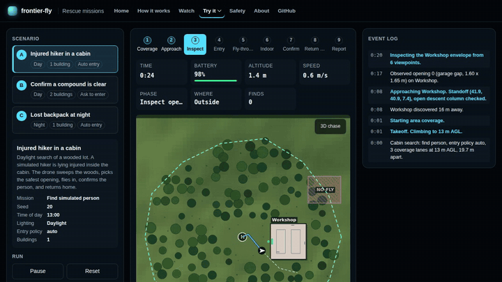
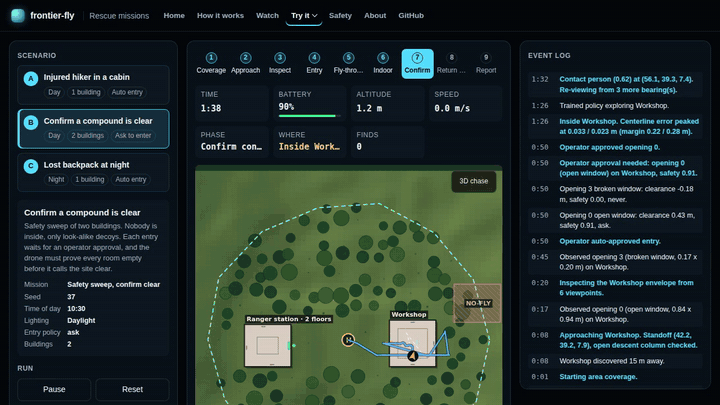
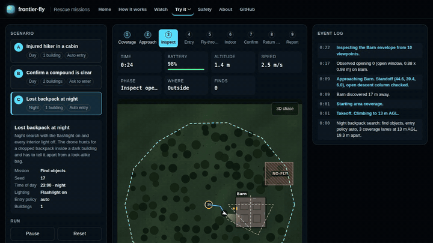
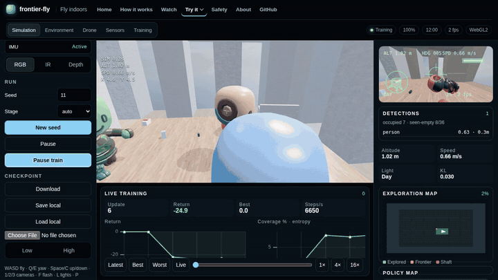
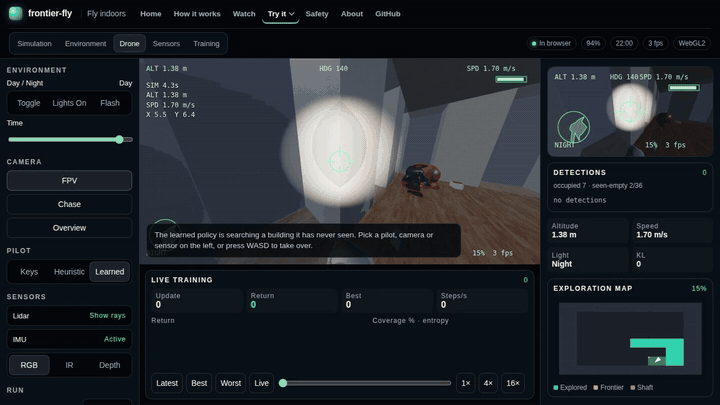
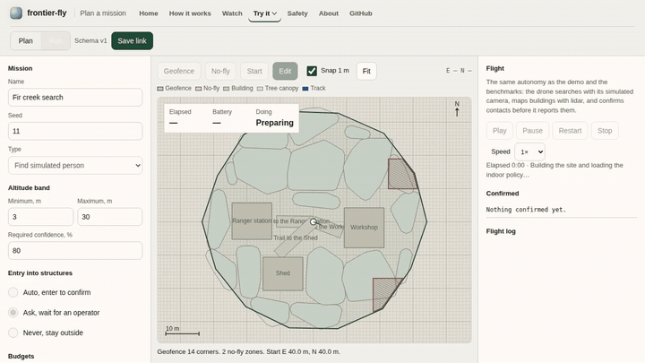
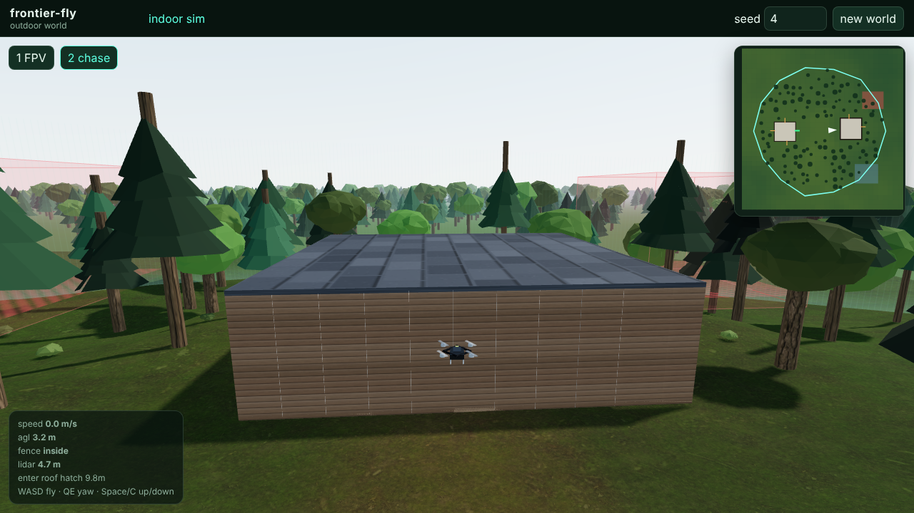
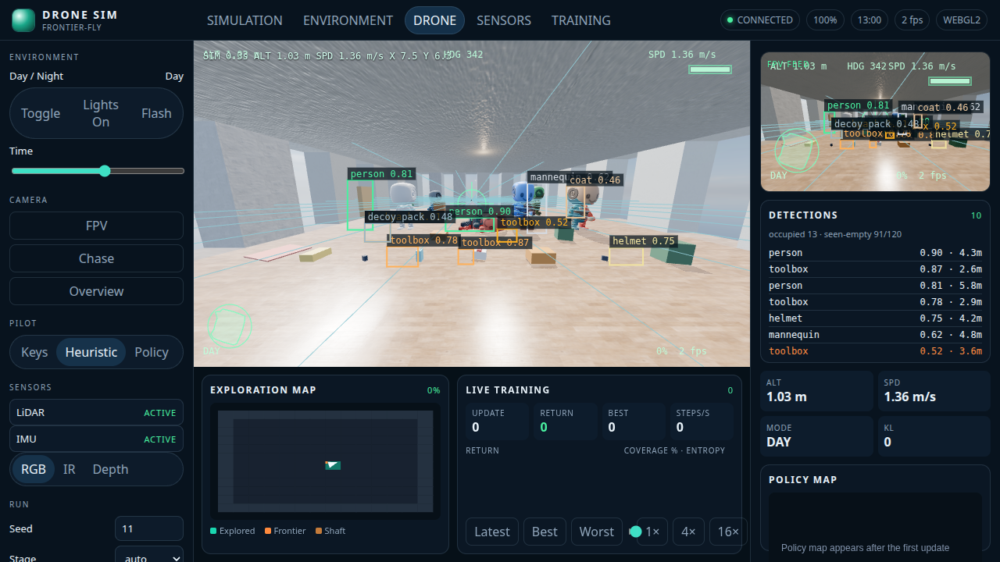
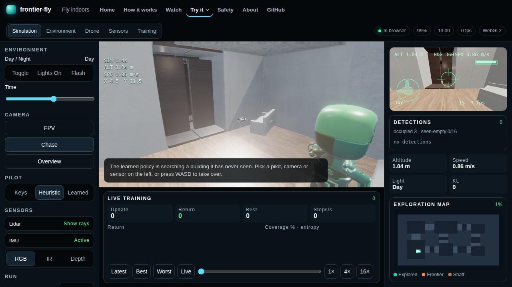
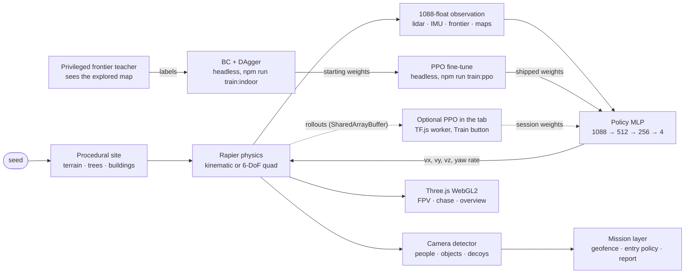

# Project guide

Everything the [README](../README.md) leaves out: the missions and their recordings, what each page does, the full benchmark tables, how the autopilot is trained, how to run it, and its limits. The [tech report](REPORT.md) has the methods and every study.

## Missions

### Mission films

Each film replays a real seeded mission, flown headless by the same autopilot, in 3D: chase, aerial, orbit, roof-cutaway and landing shots, with the planner's log, a minimap and the end report on screen. [`film.html`](https://alexnieves-cs.github.io/frontier-fly/film.html) renders them live in the browser at full quality; the MP4s below are 960 px previews recorded with `npm run media:film`.

| Film | Mission |
| --- | --- |
| [Woods to cabin (MP4, 74 s)](media/film-cabin-day.mp4) · [watch live](https://alexnieves-cs.github.io/frontier-fly/film.html?scenario=cabin-day) | Find an injured hiker inside a cabin by day. |
| [Compound search (MP4, 79 s)](media/film-compound-clear.mp4) · [watch live](https://alexnieves-cs.github.io/frontier-fly/film.html?scenario=compound-clear) | Prove two buildings are empty, with an operator approving each entry. |
| [Night search (MP4, 70 s)](media/film-backpack-night.mp4) · [watch live](https://alexnieves-cs.github.io/frontier-fly/film.html?scenario=backpack-night) | Find a lost backpack in a dark building by flashlight. |

### Mission console clips

Three seeded scenarios, each flown autonomously from takeoff to landing. For the recordings, "ask to enter" prompts were auto-approved. The drone sweeps a geofenced forest in coverage lanes, discovers the building, inspects its openings and picks one it clears with margin, searches room by room, confirms a find or declares the building clear, flies home, and writes a report. The clips play at 4× (16× for the compound) and come from [`demo.html`](https://alexnieves-cs.github.io/frontier-fly/demo.html?scenario=cabin-day&autorun=1); results are in the [mission table](#benchmarks). Indoors the shipped policy flies first under a lidar guard, and after 8 s without new coverage or on a contact the run hands the visit to the sensor-only planner. The report says which explorer ran. These clips are single runs recorded on 19 October, before the sensor-only planner, the PPO fine-tune and the move off ground truth, and they have not been re-rendered; the table under [Benchmarks](#benchmarks) is the bench on fresh worlds with the current code.

| <br>**Find a person.** Daylight, one cabin, auto entry. [MP4](media/mission-cabin-day.mp4) | <br>**Confirm clear.** Two buildings, nobody inside. [MP4](media/mission-compound-clear.mp4) | <br>**Night search.** Find a backpack in the dark. [MP4](media/mission-backpack-night.mp4) |
| --- | --- | --- |

<details>
<summary>demo.html options</summary>

| Query | Effect |
| --- | --- |
| `scenario` | `cabin-day`, `compound-clear`, or `backpack-night` (seeded in `src/mission/autonomy/scenarios.ts`) |
| `speed` | `1`, `4`, `16`, or `max` |
| `autorun=1` | Start when the page loads |
| `operator=approve` | Approve entry prompts automatically |
| `indoor=frontier` | Skip the shipped policy and use frontier exploration indoors |

</details>

## Features

| | |
| --- | --- |
| <br>**Train it in the tab.** Press Train and up to four worker threads roll out episodes into `SharedArrayBuffer`s while a learner worker runs PPO. Return, coverage, entropy, and a policy heatmap update live. [MP4](media/training.mp4) | <br>**Fly by flashlight.** The policy never sees pixels, only lidar, IMU, and an egocentric occupancy map, so it flies the same with the lights off. FPV adds the HUD and simulated detections. [MP4](media/fpv-night.mp4) |
| <br>**Plan a mission.** Draw a geofence and no-fly zones, set an altitude band, targets, required confidence, an entry policy (auto, ask, never), and budgets. **Run** flies the plan with the same autonomy as the demo and the benchmarks, asks you before each entry, and ends with the scored report. The plan validates against a versioned JSON schema, shares as a link, and [exports to QGroundControl](QGC_EXPORT.md) as a `.plan`, a QGC WPL 110 waypoint file, or MAVLink mission items for PX4 and ArduPilot. In CI, [PX4 SITL flies every exported plan](PX4.md) and a script checks the route, the fence and the landing. PX4 can also fly the browser sim itself. [MP4](media/mission-editor.mp4) | <br>**A site, not a room.** Seeded terrain, instanced trees with colliders, and one to four building shells with typed openings: open and broken windows, ajar doors, vents, garage gaps, roof hatches. Only openings that clear the airframe are enterable. |
| <br>**Something to find.** Simulated people standing, sitting, lying, walking, and hiding, a library of search objects, and decoys. A geometric camera detector misses with distance, occlusion, darkness, and motion blur, and false-alarms on decoys. Or switch the demo to camera mode: the drone renders its own 160×120 view and a small detector trained on CC0 people finds targets in the pixels. | <br>**Procedural buildings.** BSP rooms, doors, hallways, multi-floor shafts, and a reachability check. PBR interiors with CC0 textures, an HDRI sky, SSAO, bloom, and SMAA on the high preset. |

## Benchmarks

These tables are generated by `npm run docs` from [`docs/study.json`](study.json), [`docs/benchmarks.json`](benchmarks.json) and [`docs/mission-bench.json`](mission-bench.json), and CI fails if they drift from the JSON. Misses are shown as misses. Method, per-seed results, and render frame rates are in [docs/BENCHMARKS.md](BENCHMARKS.md).

<!-- generated:benchmarks:start -->
**Coverage on 30 fresh buildings per condition**, every pilot on the same seeds, bootstrap 95% intervals ([REPORT.md](REPORT.md)):

| Pilot | Hard, day | Hard, night (no lights) | Hard collisions per episode | Hard, flights ended by a crash (> 0.5 m/s) | Two floors | Quadrotor + noise | Quad collisions per episode |
| --- | --- | --- | --- | --- | --- | --- | --- |
| Oracle teacher (floor plan) | 64.5% (58.4–70.3) | 64.5% (57.6–70.1) | 0.13 | 3/30 | 37.6% (33.6–41.2) | 2.2% (1.9–2.5) | 1.0 |
| Sensor-only planner | 65.5% (62.2–68.7) | 65.8% (62.4–69.1) | 0.00 | 0/30 | 37.7% (34.9–40.4) | 23.1% (19.1–27.3) | 1.1 |
| Policy | 67.5% (59.5–75.1) | 76.3% (70.3–81.6) | 4.90 | 7/30 | 37.5% (34.3–40.5) | 11.9% (9.9–13.8) | 3.3 |
| Policy + lidar guard | 75.1% (70.5–79.4) | 77.0% (72.9–80.8) | 0.17 | 1/30 | 38.8% (35.7–41.8) | 13.1% (10.5–16.0) | 1.2 |

**Targets.** Coverage goals on the same 30 fresh buildings per condition; the small fixed protocol (4 easy and 3 hard seeds) is a smoke check in [BENCHMARKS.md](BENCHMARKS.md):

| Goal | Target | Measured | Status |
| --- | --- | --- | --- |
| Coverage, easy buildings (policy) | ≥ 80.0% | 95.1% (95.1–95.1), 30 fresh | ✅ meets |
| Coverage, new hard buildings (policy) | ≥ 60.0% | 67.5% (59.5–75.1), 30 fresh, 4.9 wall contacts per flight, 7 of 30 flights ended by a crash | ⚠️ meets on the mean; interval spans the target |
| Coverage, new hard buildings (policy + lidar guard) | ≥ 60.0% | 75.1% (70.5–79.4), 30 fresh, 0.2 wall contacts per flight, 1 of 30 flights ended by a crash | ✅ meets |
| Night coverage vs day, hard buildings (policy) | ≥ 90.0% | 113.1%, 30 fresh | ✅ meets |
| Kinematic env step | ≤ 0.3 ms | 0.160 ms | ✅ meets |
| Env steps/s, 4 workers, physics + sensors | ≥ 10,000 | 10,524 | ✅ meets |
| Env steps/s, 4 workers, with inference and resets | ≥ 10,000 | 10,502 | ✅ meets |

| Measurement | Value |
| --- | --- |
| Kinematic env step (1 thread) | 0.160 ms · 6,238 steps/s |
| Quadrotor env step, 400 Hz physics (1 thread) | 0.242 ms · 4,130 steps/s |
| Policy inference, SIMD gemm, batch 8 | 0.073 ms per env |
| 4 workers, physics + sensors (lidar heuristic pilot) | 10,524 env steps/s |
| 4 workers × 8 envs, browser rollout loop: batched policy inference, resets on pooled worlds | 10,502 env steps/s |
<!-- generated:benchmarks:end -->

**Missions on 30 fresh worlds per scenario.**

<!-- generated:missions:start -->
| Scenario | Policy, planner fallback | Sensor-only planner | Oracle planner (floor plan, reference) |
| --- | --- | --- | --- |
| Woods to cabin: find the missing person | 100.0% (89–100%) | 100.0% (89–100%) | 100.0% (89–100%) |
| Compound search: confirm two buildings clear | 96.7% (83–99%) | 96.7% (83–99%) | 93.3% (79–98%) |
| Night search: find the lost backpack | 100.0% (89–100%) | 100.0% (89–100%) | 93.3% (79–98%) |
| Compound search, a person inside one building | 100.0% (89–100%) | 100.0% (89–100%) | 96.7% (83–99%) |
| **All** | 99.2% (95–100%) | 99.2% (95–100%) | 95.8% (91–98%) |

Share of 30 fresh mission worlds per scenario (seeds 79201–79230) where the mission ends with the expected outcome: found, or correctly cleared. Brackets are Wilson 95% intervals.
Across all 360 flights: 1 with a collision, 0 false clears, 0 false alarms. The policy hands 51.0% of the buildings it enters to the planner.
From `npm run study:missions` at `0944176`; per-scenario detail is in [BENCHMARKS.md](BENCHMARKS.md).
No part of these missions reads ground truth. On the 3 scenarios the code before that change could fly, on the same seeds, it scored 96.3% across these explorers, which still read the true floor-plan cells, against 97.8% now ([REPORT.md](REPORT.md#confirm-clear-without-ground-truth)).
<!-- generated:missions:end -->

## How it works



**Training.** The shipped checkpoint starts from behavior cloning: a privileged frontier-seeking teacher that can see the explored map flies the curriculum, and the network learns to imitate it from its own sensors. DAgger then lets the network fly while the teacher labels every state it reaches, and the round kept is the one that scores best on held-out validation seeds. The shipped weights then fine-tune with PPO on the policy's own flights (`npm run train:ppo`): low action noise, a critic that also sees privileged state, and a small imitation term on a replay of teacher labels. On held-out hard buildings that takes coverage from 61% to 81%. In the browser, **Train** runs PPO on the spec reward (new coverage, new rooms and floors, collisions, smoothness, time). A six-stage curriculum grows the buildings from one 8×8 m room to multi-floor layouts with quadrotor dynamics, and randomizes mass, thrust, drag, motor lag, sensor noise, wind, and lighting so the policy cannot overfit one world. The full loop runs in the browser, and the same code runs headless in Node for `npm run train:indoor` and the benchmarks.

**Why it works at night.** The observation has no camera pixels. Lidar and the occupancy map do not care about light, so night coverage is measured against day coverage as a check on that design, not a separate model.

More detail, including the generated module graph and the headless boundary between sim and renderer, is in [docs/ARCHITECTURE.md](ARCHITECTURE.md).

## Tech stack

| Layer | What | Why |
| --- | --- | --- |
| Language and build | TypeScript 6.0, Vite 8 | One codebase for the browser, workers, and Node |
| Physics | [Rapier](https://rapier.rs) 0.14 (WASM) | Deterministic colliders and fast ray casts for lidar |
| Learning | [TensorFlow.js](https://www.tensorflow.org/js) 4.22, hand-written SIMD WASM gemm | PPO updates on WebGL or CPU, cheap batched inference in env workers |
| Rendering | [Three.js](https://threejs.org) 0.170, WebGL2 (WebGPU opt-in) | PBR, HDRI, shadows, and post passes; `?renderer=webgpu` tries the lighter WebGPU path |
| Charts | [uPlot](https://github.com/leeoniya/uPlot) | Lightweight live training curves |
| Concurrency | Web Workers, `SharedArrayBuffer` | Rollouts without copying |
| Tests | Vitest, Playwright, ESLint | Unit, perf, and headless browser checks in CI |
| Hosting | GitHub Pages + [coi-serviceworker](https://github.com/gzuidhof/coi-serviceworker) | Static hosting with cross-origin isolation |

## Run locally

Needs Node 22.

```bash
npm ci
npm run dev        # http://127.0.0.1:3000 with COOP/COEP headers
npm test           # unit and perf tests
npm run build      # typecheck and production bundle in dist/
```

| Script | What it does |
| --- | --- |
| `npm run test:e2e` | Headless Chrome checks and screenshots |
| `npm run bench` | Coverage and throughput, written to `docs/benchmarks.json` |
| `npm run media` | Record the demo clips into `docs/media/` (needs ffmpeg) |
| `npm run study:coverage` / `npm run study:missions` | Every pilot on fresh buildings, and the indoor explorers on fresh mission worlds, with 95% intervals |
| `npm run study:faults` | Fly the fault scenarios (sensor, motor, battery, link, GNSS, wind) on fresh mission worlds, written to `docs/fault-bench.json` |
| `npm run study:<name>` | The other studies behind [REPORT.md](REPORT.md): `speed`, `team`, `plans`, `sar`, `vision`, `loc`, `intel` |
| `npm run docs` | Regenerate `docs/ARCHITECTURE.md`, `docs/BENCHMARKS.md`, `docs/REPORT.md`, `docs/SAFETY_CASE.md`, `docs/LEADERBOARD.md`, the README results and the tables in this guide |
| `npm run bench:score -- --pilot <id or file>` | Score a pilot on FrontierBench ([LEADERBOARD.md](LEADERBOARD.md) says how to submit one); `npm run bench:team` does the same for a drone team |
| `npm run check:pages` | Serve `dist/` the way GitHub Pages does and check every page loads |
| `npm run eval:coverage` | Coverage table vs targets for the shipped checkpoint |
| `npm run train:indoor -- --out ckpt.json` | BC + DAgger on every core, kept by held-out validation |
| `npm run train:ppo` | Fine-tune a checkpoint with PPO on its own flights (how the shipped weights were made) |

<details>
<summary>Controls and URL parameters</summary>

| Input | Action |
| --- | --- |
| W A S D | Fly forward / left / back / right |
| Q E or arrow left / right | Yaw |
| Space / C | Climb / descend |
| 1 2 3 | FPV, chase, overview |
| F | Flashlight |
| L | Interior lights |
| P | Pause the sim |
| T | Start or pause training |
| Drag in overview | Orbit the cutaway camera |

| Query | Effect |
| --- | --- |
| `seed` | Building and episode seed |
| `shot` | `day`, `dusk`, `night`, `fpv`, `targets`, `targets-room`, or `targets-night` |
| `camera` | `fpv`, `chase`, `overview` |
| `stage` | `0`–`5` or `auto` |
| `train=1` | Start PPO when the page loads |
| `quality` | `low` or `high` |
| `pilot` | `keys`, `heuristic`, or `policy` |
| `tod`, `flash`, `lights` | Time of day (0–24), flashlight `1`, interior lights `0` |

These apply to the indoor sim, [`sim.html`](https://alexnieves-cs.github.io/frontier-fly/sim.html). Old links that put them on the site root are forwarded there. Example: [`sim.html?seed=11&stage=0&camera=fpv&tod=22&flash=1&lights=0&pilot=policy`](https://alexnieves-cs.github.io/frontier-fly/sim.html?seed=11&stage=0&camera=fpv&tod=22&flash=1&lights=0&pilot=policy). The shipped policy flies by default, and holding a flight key takes over until you let go; `pilot=keys` starts on the keyboard. Shot URLs fly a lidar heuristic so the camera has something to follow.

</details>

## Honest limits

<!-- generated:limits:start -->
- The drone sometimes declares a building clear while a person is inside. Over a declared mix of missions, sites, light, wind and faults, the [failure atlas](ATLAS.md) measures this at 0.25% of flights (95% interval 0.16% to 0.35%), all of them on sweeps of an occupied site, where the rate is 0.8%. A walking or hiding person is the usual case. At v1.0.0 the rate was 3.55%: a person the detector saw but could not confirm was dropped, and the mission bench never caught it because its occupied scenario only used a person lying still. Unconfirmed people now block a clear, which took a fresh 2,000-flight check from 4.05% to 0.30%. The [atlas page](https://alexnieves-cs.github.io/frontier-fly/atlas.html) replays every failing flight.
- The learned policy needs its guard. On 30 fresh hard buildings under the crash rule (a contact faster than 0.5 m/s ends the flight) the policy alone covers 67.5% and crashes in 7 of 30 flights; behind the hand-written lidar guard it covers 75.1% and crashes in 1 of 30; the sensor-only planner, with no learning, covers 65.5% and never crashes. Across all of FrontierBench the guarded policy and the planner score about the same ([LEADERBOARD.md](LEADERBOARD.md)). The small fixed eval (4 easy and 3 hard seeds) is a smoke check, not a headline. [BENCHMARKS.md](BENCHMARKS.md) has the per-seed numbers.
- Indoors, missions do not read the floor plan: a sensor-only planner maps from the drone's own lidar and range finders, and the policy flies under a lidar guard with that planner as its fallback. On 120 fresh mission worlds per explorer the sensor-only explorer reaches the expected outcome in 99.2% of flights, the policy-first explorer in 99.2%, and the old floor-plan planner (kept as a reference) in 95.8%; 1 of the 360 flights touched anything. The policy hands 51.0% of the buildings it enters to the planner after a stall, so much of each mission is flown by the planner. [REPORT.md](REPORT.md) has the study, the ablations and the failure cases.
- On quadrotor dynamics with sensor noise every pilot covers less than on the kinematic airframe, because the quad cannot change speed instantly. Under the crash rule only the quad-aware planner (braking safety filter plus command tracker) survives: 46.9% with 0 crashes in 30 flights. The plain planner crashes in 28 of 30 and covers 23.1%; the policy crashes in 30 of 30 and covers 11.9%, and the guard does not save it (30 of 30). Whole missions on the quad, which slow to 1 m/s indoors behind the braking filter, reach the expected outcome 99.2% of the time with the planner and 98.3% with the policy. Flown on the pose estimate instead of the true pose they reach it 94.2% of the time, and 6 of 120 flights touch something against 0 on the true pose; the cause is not traced.
- FrontierBench freezes seven exploration tasks (the last on real apartment plans) and a drone-team track, with public dev and test seeds so other pilots can be scored the same way; CI re-scores every submitted entry from its code. The seeds are public, so the board relies on entrants not tuning on the test split. [LEADERBOARD.md](LEADERBOARD.md) has the board and how to enter.
- On multi-floor buildings only the sensor-only planner takes shafts; it reaches another floor in 30 of 30 fresh buildings and covers 41.8% of them against 37.7% without climbing. The policy and the teacher stay on the ground floor. A learned predictor of what lies behind each frontier is accurate but does not raise coverage, and neither does the true answer: coverage here is limited by flight time. [REPORT.md](REPORT.md) has both.
- Mission clips show the 2D mission map. Clips in `docs/media/` were recorded in a cloud container with software WebGL, which renders at a few frames per second. FPV and training clips play one captured frame per 50 ms sim step, so flight runs at true speed and the training charts run faster than real time. On a laptop GPU the page runs in real time.
- On 60 real apartments (Swiss Dwellings, CC BY 4.0) under the crash rule, the sensor-only planner covers 85.5%. The policy alone covers 36.1%, against 92.9% on generated buildings of the same size, because most of its flights end in a crash; with the lidar guard it covers 67.0%. Real apartments have three times the rooms and 1 m doors and passages; the same-size generated buildings have none narrower than 2 m. [REAL_PLANS.md](REAL_PLANS.md) has the study.
- Nothing here has flown on real hardware. PX4 runs in the loop in simulation and the Crazyflie path is tested in CI, but no flight log from a real drone backs any number on this page.
<!-- generated:limits:end -->
