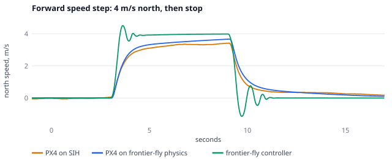
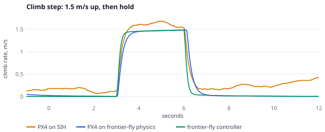
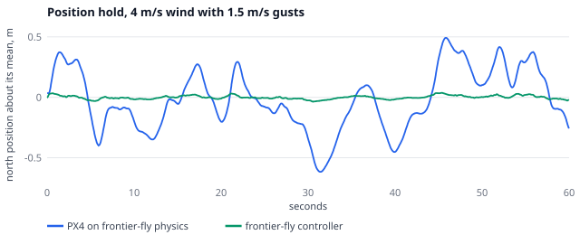
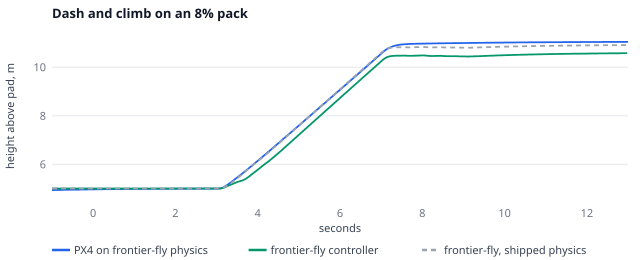
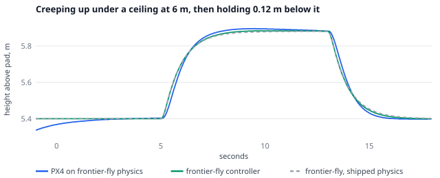
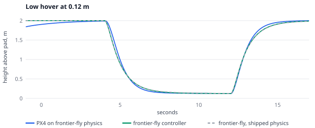

# Physics validation against PX4

frontier-fly says its quadrotor has realistic physics. This page checks that claim against PX4, the open-source autopilot most research drones fly, and against published rotor measurements where PX4's simulators have nothing to compare with.

The same nine maneuvers are flown three ways, on one airframe:

| Flown by | Controller | Physics |
| --- | --- | --- |
| **PX4 on SIH** | PX4 v1.15.4's position, velocity, attitude and rate controllers | PX4's own built-in simulator (SIH), with its mass, inertia, thrust, torque, arm length, drag and motor lag set to frontier-fly's airframe |
| **PX4 on frontier-fly physics** | the same PX4 controllers | frontier-fly's `QuadrotorDynamics`, the rigid body the missions and the policy fly, through the lockstep bridge (`scripts/px4/sim-node.ts --plant frontier`) |
| **frontier-fly controller** | frontier-fly's own angle-mode controller, set up as the mission quad flies outdoors | the same `QuadrotorDynamics` |

The first two rows share a controller, so any gap between them is a gap between the two physics models. The last two share the physics, so any gap there is a gap between the two flight controllers.

The airframe is the one airframe every part of frontier-fly flies (`src/shared/airframe.ts`): a 0.45 kg ducted quad of DJI Avata size on 3 inch props, thrust-to-weight 2.47 in the shipped model, with a 4S 2420 mAh pack. An earlier run of this page on the previous 1.2 kg, 10 inch quad is in the git history (PR #91); where the smaller airframe changed a finding, the finding says so.

Everything runs in the cloud: PX4 SITL builds in CI (`.github/workflows/px4.yml`, job `physics`), and the numbers below came from the same scripts in the cloud container.

## What it found

**1. The physics agree with PX4's own simulator at speed, less well when stopping.** Under the same PX4 controllers, frontier-fly's rigid body and PX4's SIH (given the same mass, inertia, thrust and drag) cruise at the same speed after the forward step, 3.61 against 3.58 m/s, and lean about the same, 30.5° against 32.2°. They climb at 1.48 and 1.6 m/s. The stop differs more: SIH stops in 3.1 m, frontier-fly in 4.6 m. That gap is the drag model. SIH has a single linear drag term, fitted here over 0 to 5 m/s, while frontier-fly's drag is linear plus quadratic, so at walking speed SIH's line has almost twice the drag and brakes the quad for free. On the old 1.2 kg quad drag was a third as large relative to the mass and the stops agreed within 7%; on a 0.45 kg quad drag matters more, and the shape of the drag curve shows. (SIH's estimator also drifts vertically after the climb, about 1 m over 6 s, while PX4 believes it is holding, so SIH's stop time and drift in the climb table measure PX4's estimator on SIH's sensors, not the physics.)

**2. frontier-fly's built-in flight controller is far stiffer than PX4's.** On the same physics, PX4 with its default gains takes 5.4 s to reach 3.6 m/s; it leans 30° and stops gently over 4.6 m. frontier-fly's controller gets there in 0.46 s by leaning 54°, overshoots by 12%, and stops in 1.1 m with a 1.1 m/s swing backwards. Holding position in 4 m/s wind with 1.5 m/s gusts, frontier-fly's controller wanders 0.04 m RMS; PX4 wanders 0.65 m RMS, the same in its own estimate, so the gap is control, not estimation. The missions, the crash rule and the braking model are all measured with the stiff controller, so they are optimistic about stopping and about wind compared with a drone that flies on PX4's defaults. A PX4-like controller profile (or randomizing the controller's gains) during training and in the benchmarks is the obvious next step. This finding did not change with the smaller airframe.

**3. A sagging pack costs thrust the shipped model never loses, and the small pack sags more.** The shipped model keeps a thrust-to-weight of 2.47 on any charge. With the pack model it is 2.18 on a full pack under load and 1.73 at 8%: full throttle draws about 21 A, near 9C from a 2420 mAh pack, so the loaded voltage drops further than on the old 5000 mAh pack (2.27 full, 1.80 at 8%). In the full-power dash at 8%, frontier-fly's controller holds its motors at the limit for 21% of the dash (none with the shipped model) and climbs 0.5 m less in 4 s; at 30% it is already saturated 17% of the time. PX4 barely notices (6% saturated) because its gentler velocity loop never asks for that much thrust.

**4. PX4's battery gauge reads this pack low, so it warns early, not late.** In a hover (105 W, 6.6 A, 20 minutes to empty) the cells sit at 3.62 V when 15% is left. With PX4's defaults (no capacity set, cells linear between 3.6 and 4.05 V) the gauge reads 13% there, so its low-battery warning comes half a minute early, and it reads 0% at a true 7%, where PX4 would already force a landing. Setting the capacity does not fix it: PX4 still blends in the voltage reading and warns 1.1 minutes early. Both read 34% at half charge, because this pack's loaded voltage curve sits below PX4's straight line in the middle. On the old pack the defaults read high and warned 1.5 minutes late; the smaller pack's larger sag flips the sign. frontier-fly's own gauge is the true charge, so it gets about a minute more flight than a PX4 on this pack would allow.

**5. On a 3 inch prop, the ground and ceiling effects are too small to matter at any clearance the frame allows, and the shipped model overstates them.** The effects scale with rotor radius, here 3.8 cm. Cheeseman and Bennett's model gives 6.7% more thrust one radius above the ground and 0.7% at three radii, but the collision sphere (0.15 m) keeps the rotors about four radii from any surface, where both measured effects are under 1%. The shipped linear model adds 2 to 3% below 0.4 m of world height, so it is too strong for this airframe, and it uses world height, not height above the ground, so it vanishes over terrain and on upper floors. Both controllers hover at 0.12 m above the ground or below a ceiling with a centimeter or two of error and no contact. On the old 10 inch quad the same 0.12 m was under one rotor radius, and both controllers were pulled into the ceiling; with the small ducted airframe that hazard is gone. (Ducts change near-surface aerodynamics too; the open-rotor models here do not cover that.)

## Results

<!-- physics-results:start -->
### Step response

| Flown by | Time to 3.6 m/s (s) | Overshoot (%) | Speed after 6 s (m/s) | Peak tilt (°) | Stop within 0.2 m/s (s) | Stop distance (m) | Reverse speed (m/s) |
| --- | --- | --- | --- | --- | --- | --- | --- |
| PX4 on SIH (PX4's own physics, matched airframe) | – | 0 | 3.58 | 32.2 | 3.14 | 3.12 | 0.1 |
| PX4 on frontier-fly physics | 5.36 | 0 | 3.61 | 30.5 | 5.89 | 4.57 | 0 |
| frontier-fly controller on frontier-fly physics | 0.46 | 12.3 | 3.98 | 54.4 | 1.8 | 1.1 | 1.13 |



| Flown by | Time to 1.35 m/s (s) | Overshoot (%) | Climb rate (m/s) | Stop within 0.15 m/s (s) | Drift (m) |
| --- | --- | --- | --- | --- | --- |
| PX4 on SIH (PX4's own physics, matched airframe) | 0.4 | 13.1 | 1.6 | 5.98 | 1.06 |
| PX4 on frontier-fly physics | 0.57 | 0 | 1.48 | 0.61 | 0.02 |
| frontier-fly controller on frontier-fly physics | 0.3 | 0 | 1.48 | 0.26 | 0 |



### Hover in gusts

Light wind (2 m/s, 0.75 m/s gusts):

| Flown by | Offset of the mean (m) | Wander RMS (m) | Wander RMS in PX4's own estimate (m) | Max wander (m) | Peak tilt (°) |
| --- | --- | --- | --- | --- | --- |
| PX4 on frontier-fly physics | 0.02 | 0.21 | 0.22 | 0.43 | 11 |
| frontier-fly controller on frontier-fly physics | 0 | 0.01 | – | 0.03 | 12.7 |

Moderate wind (4 m/s, 1.5 m/s gusts):

| Flown by | Offset of the mean (m) | Wander RMS (m) | Wander RMS in PX4's own estimate (m) | Max wander (m) | Peak tilt (°) |
| --- | --- | --- | --- | --- | --- |
| PX4 on frontier-fly physics | 0.05 | 0.65 | 0.65 | 1.39 | 35.6 |
| frontier-fly controller on frontier-fly physics | 0 | 0.04 | – | 0.08 | 41.1 |



### Battery sag

Full-power dash on a 100% pack: 5 m/s north while climbing at 1.5 m/s:

| Flown by | Speed (m/s) | Climb (m/s) | Climbed in 4 s (m) | Motors saturated (% of dash) | Peak tilt (°) |
| --- | --- | --- | --- | --- | --- |
| PX4 on frontier-fly physics | 4.26 | 1.48 | 5.54 | 2 | 34.1 |
| frontier-fly controller on frontier-fly physics | 4.94 | 1.5 | 5.57 | 5 | 54.4 |
| frontier-fly controller, shipped physics (no sag, linear ground effect) | 4.94 | 1.5 | 5.57 | 0 | 54.4 |

Full-power dash on a 30% pack: 5 m/s north while climbing at 1.5 m/s:

| Flown by | Speed (m/s) | Climb (m/s) | Climbed in 4 s (m) | Motors saturated (% of dash) | Peak tilt (°) |
| --- | --- | --- | --- | --- | --- |
| PX4 on frontier-fly physics | 4.27 | 1.49 | 5.57 | 4 | 34.2 |
| frontier-fly controller on frontier-fly physics | 4.93 | 1.51 | 5.31 | 17 | 57.2 |
| frontier-fly controller, shipped physics (no sag, linear ground effect) | 4.94 | 1.5 | 5.57 | 0 | 54.4 |

Full-power dash on a 8% pack: 5 m/s north while climbing at 1.5 m/s:

| Flown by | Speed (m/s) | Climb (m/s) | Climbed in 4 s (m) | Motors saturated (% of dash) | Peak tilt (°) |
| --- | --- | --- | --- | --- | --- |
| PX4 on frontier-fly physics | 4.28 | 1.49 | 5.52 | 6 | 35.1 |
| frontier-fly controller on frontier-fly physics | 4.93 | 1.51 | 5.08 | 21 | 57.7 |
| frontier-fly controller, shipped physics (no sag, linear ground effect) | 4.94 | 1.5 | 5.57 | 0 | 54.4 |



Thrust ceiling as the pack drains (full throttle, loaded voltage):

| Charge | Cell voltage, no load (V) | Full-throttle current (A) | Thrust-to-weight |
| --- | --- | --- | --- |
| 100% | 4.103 | 20.8 | 2.18 |
| 50% | 3.803 | 18.2 | 1.89 |
| 30% | 3.748 | 17.7 | 1.83 |
| 15% | 3.71 | 17.4 | 1.8 |
| 8% | 3.639 | 16.8 | 1.73 |
| shipped model, any charge | – | – | 2.47 |

What PX4's battery gauge would read on this pack in a hover (105.5 W, 6.6 A, 20.4 min to empty), with PX4's default cell voltages (empty 3.6 V, full 4.05 V):

| True charge | Cell voltage under load (V) | PX4, voltage only (default, no capacity set) | PX4, capacity set to 2420 mAh |
| --- | --- | --- | --- |
| 90% | 3.937 | 82% | 89% |
| 50% | 3.718 | 34% | 34% |
| 30% | 3.661 | 22% | 20% |
| 15% | 3.623 | 13% | 12% |
| 7% | 3.521 | 0% | 1% |

### Ground and ceiling effect

Thrust multiplier against the distance from the rotor to the surface, in rotor radii (R = 0.0381 m):

| z / R | Shipped (linear, world height) | Ground, Cheeseman–Bennett | Ceiling, Sanchez-Cuevas fit |
| --- | --- | --- | --- |
| 0.25 | 1.031 | 1.333 | 1.817 |
| 0.5 | 1.03 | 1.333 | 1.276 |
| 0.75 | 1.03 | 1.125 | 1.145 |
| 1 | 1.029 | 1.067 | 1.091 |
| 1.5 | 1.027 | 1.029 | 1.046 |
| 2 | 1.026 | 1.016 | 1.028 |
| 3 | 1.023 | 1.007 | 1.013 |
| 4 | 1.02 | 1.004 | 1.008 |

| Flown by | Closest to ceiling (m) | Hit the ceiling after (s) | Overshoot toward it (m) | Settled height error (m) |
| --- | --- | --- | --- | --- |
| PX4 on frontier-fly physics | 0.105 | – | 0.015 | 0.008 |
| frontier-fly controller on frontier-fly physics | 0.117 | – | 0.003 | 0.002 |
| frontier-fly controller, shipped physics (no sag, linear ground effect) | 0.12 | – | 0 | -0.001 |



| Flown by | Lowest (m) | Settled height error (m) | Climb-out overshoot (m) |
| --- | --- | --- | --- |
| PX4 on frontier-fly physics | 0.122 | 0.009 | -0.002 |
| frontier-fly controller on frontier-fly physics | 0.123 | 0.012 | -0.014 |
| frontier-fly controller, shipped physics (no sag, linear ground effect) | 0.126 | 0.017 | -0.017 |



<!-- physics-results:end -->

## What changed in the physics

The shipped model is unchanged by default: no checkpoint, benchmark or golden trace moves. Two opt-in models now exist, and the validation flies with them:

- **`src/sim/dynamics/aero.ts`** sets `QuadrotorDynamics.aero`. It replaces the shipped linear ground effect (8% per meter below 0.4 m of *world* height, so it ignored terrain and floors) with Cheeseman and Bennett's rotor model in height above the surface below, adds the ceiling effect from Sanchez-Cuevas, Heredia and Ollero's measurements, and lets a pack model lower the motors' top speed.
- **`src/mission/autonomy/pack.ts`** is a LiPo pack: open-circuit voltage from Chen and Rincón-Mora (2006), 12 mΩ per cell for the 2420 mAh pack, and the loaded voltage's effect on motor speed. It also ports PX4's battery estimator line for line, so the page can say what a real PX4 would report on this pack.

Turning them on for training and the missions changes flight outcomes, so it belongs with a policy retrain, not here.

## How it works

| File | Role |
| --- | --- |
| `scripts/physics/maneuvers.ts` | The maneuvers (NED setpoints, wind, pack charge, ceiling) and the PX4 parameters for each simulator |
| `scripts/physics/fly_px4.py` | Sets the parameters, arms in offboard mode, climbs to the start, and flies the segments on PX4's clock |
| `scripts/physics/native.ts` | The same maneuvers on frontier-fly's controller, with PX4's position-loop law and gains above it |
| `scripts/physics/run.sh` | A fresh PX4 per flight, with SIH or with the bridge |
| `scripts/physics/report.ts` | Puts every flight on one time base, measures it, and writes the tables, plots and `docs/physics-validation.json` |
| `src/px4/frontierPlant.ts` | PX4 on `QuadrotorDynamics`: frame conversion (ENU/FLU to NED/FRD), rotor geometry for PX4's control allocation, ground contact |
| `src/px4/rig.ts` | The wind table, the pack and the surfaces, shared by the bridge and the native runner so both feel the same air |
| `src/sim/dynamics/gust.ts` | The fault bench's Gauss-Markov gust model, sampled once at 10 Hz so simulators at different rates replay identical gusts |

Run it:

```bash
export PX4_BUILD=/path/to/PX4-Autopilot/build/px4_sitl_default   # v1.15.4, make px4_sitl_default
scripts/physics/run.sh test-results/physics all
npx vite-node scripts/physics/report.ts -- --in test-results/physics --write
```

## Limits

- PX4's SIH has no wind, ground or ceiling effect and no battery model. Gusts, sag and surfaces are therefore compared only between PX4 and frontier-fly's controller on frontier-fly's physics, and the surface and pack models are checked against the papers, not against PX4.
- SIH thrust is linear in the motor command and its drag is one linear coefficient; frontier-fly's thrust goes with rotor speed squared and its drag is linear plus quadratic. The SIH drag is fitted over 0 to 5 m/s.
- PX4 flies on its estimator, which sees noisy simulated sensors. frontier-fly's controller reads the true state. Some of the hover gap is estimation, not control.
- SIH's ground truth reaches the log over MAVLink with a 50 Hz time stamp, so its timings carry up to 20 ms of jitter.
- The ceiling fit comes from one 9.4 inch rotor and is scaled to this 3 inch rotor by radius; both surface models are for open rotors, not ducts. The pack's internal resistance is an assumption, not a measurement.
