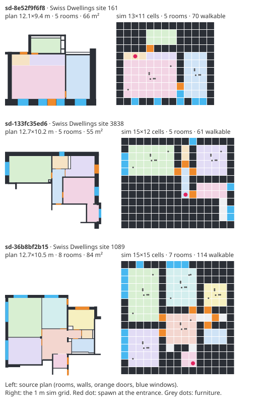

# Real floor plans

Every number elsewhere in this repository comes from buildings the generator made. This page measures the same pilots on 60 real apartments from the Swiss Dwellings dataset, next to generated buildings of the same size.



## Result

On real apartments the planners hold up better than the learned policy. The sensor-only planner covers 85.5% of a real apartment, 8 points less than on a generated building of the same size. The policy (the PPO fine-tuned checkpoint, see [REPORT.md](REPORT.md#fine-tuning-on-its-own-flights)) covers 74.3%, 20 points less than on the same-size generated buildings, and 101 of its 180 real-apartment flights end at the 16-collision limit (6 of 180 on the generated controls). The lidar guard removes almost all of those collisions and recovers 6 points, and the guarded policy trails the planner by 5 points.

| Pilot | Real, day (95% CI) | Real, night | Collisions | Generated, same size, day (95% CI) | Collisions | Real − generated, paired (95% CI) |
| --- | --- | --- | --- | --- | --- | --- |
| Teacher (privileged frontier planner) | 88.0% (84.8–91.0) | 88.0% | 0.8 | 83.6% (76.5–90.7) | 0.1 | +4.4 (-3.0 to +12.2) |
| Sensor-only planner | 85.5% (82.3–88.4) | 85.7% | 0.0 | 93.8% (92.8–94.6) | 0.0 | -8.3 (-11.0 to -5.8) |
| Learned policy | 74.3% (69.3–79.0) | 72.6% | 14.1 | 94.8% (94.0–95.2) | 4.1 | -20.5 (-25.4 to -15.8) |
| Policy + lidar guard | 80.7% (76.9–84.1) | 81.5% | 0.6 | 94.4% (93.3–95.2) | 0.2 | -13.7 (-17.0 to -10.6) |
| Waypoint follower | 34.6% (28.3–41.5) | 34.6% | 5.8 | 43.1% (36.9–49.7) | 2.2 | -8.5 (-16.8 to -0.1) |
| Lidar heuristic | 9.9% (8.0–11.9) | 11.0% | 0.5 | 26.1% (23.8–28.4) | 0.0 | -16.2 (-19.0 to -13.4) |

Coverage is the share of reachable 0.5 m voxels flown within 2,400 steps (the stage-3 protocol). Each of the 60 apartments is flown three times per lighting with different env seeds, and so is its generated control. Collisions are per flight, day. Intervals are bootstrap intervals over apartments (each apartment's mean over its three flights); the last column pairs each apartment with its own generated control. Night uses the `night-dark` preset. The teacher and the waypoint follower read the true map, so their night numbers equal their day numbers.

Against the targets: the policy meets the 60% hard-building coverage goal on real apartments (74.3%, interval 69.3–79.0%), and so does the guarded policy (80.7%). Night is 98% of day for the policy and 101% for the guarded policy, so the night-to-day target holds.

Before the PPO fine-tune, the DAgger policy covered 54.5% (49.8–59.3%) of the real apartments and 69.1% under the guard, and missed the 60% goal. That policy was measured the same way; the table above was re-run once with the new checkpoint.

One flight per apartment was not enough. With the DAgger policy, the first run, with one flight each, put it at 60.4% on one seed block and 52.3% on another; the three-flight means per repeat were 52.3%, 55.4% and 55.7%. The numbers above are from the three-flight run only.

### Why real apartments are harder

A generated building the size of an apartment is about two long rooms joined by 2 m doors. A real apartment of the same footprint has three times as many rooms, and one cell in ten is a 1 m door or passage:

| Per building (means over the 60) | Real apartments | Generated, same size |
| --- | --- | --- |
| Rooms | 6.4 | 2.1 |
| Walkable cells | 88 | 63 |
| Walkable cells with walls on both sides (1 m passages and doorways) | 10.4% | 0% |
| Furniture pieces | 12.8 | 6.6 |

The policy was trained only on generated layouts, and generated doors and halls are at least 2 m wide: in 30 hard (stage-3, 20 × 20) buildings no walkable cell has walls on both sides. A 1 m door is new to it. The planner, which plans paths on its own lidar map, loses less. The teacher's difference is within noise (its interval includes zero).

## Dataset and license

[Swiss Dwellings](https://zenodo.org/records/7788422) v3.0.0 by Archilyse AG: about 45,000 apartments in about 3,100 Swiss buildings, digitized from architects' plans with walls, doors, windows and typed rooms. It is published under [CC BY 4.0](https://creativecommons.org/licenses/by/4.0/), which allows redistribution with attribution and a note of changes. Both travel inside the data file (`dataset.attribution` and `dataset.changes`) and are listed in [CREDITS.md](../CREDITS.md).

> Standfest, M., Franzen, M., Schröder, Y., Gonzalez Medina, L., Villanueva Hernandez, Y., Buck, J. H., Tan, Y.-L., Niedzwiecka, M., Colmegna, R. (2023). Swiss Dwellings: A large dataset of apartment models. Archilyse AG. Zenodo. doi:10.5281/zenodo.7788422

Licenses were checked on the publisher's record before anything was downloaded. Not used:

- CubiCasa5K is CC BY-NC-SA 4.0 (Zenodo record 2613548). The non-commercial clause does not fit an MIT repository.
- Modified Swiss Dwellings is CC BY 4.0 but is derived from the same source, so it adds nothing here.

## Pipeline

1. **Import** (`scripts/plans/import-swiss-dwellings.ts`, run once offline on the 1.1 GB `geometries.csv`). Keep residential apartments on one floor with no stairs and at least 3 rooms (42,081 of 45,175). Order them by a hash of the apartment id, keep one per building, and split buildings into dev (one in four, by a hash of the building id) and eval. Rotate each plan so its walls run along the axes, move it to the origin, round to 1 cm, and keep rooms, walls, doors and windows. Balconies, loggias, stairs, shafts and fixtures (sinks, bathtubs) are dropped.
2. **Convert** (`src/plans/convert.ts`, at load time in the app and the study). The sim's walls are whole 1 m cells, and real walls are 10-30 cm, so a plain 1 m raster either closes 1.2 m corridors or loses walls. The converter cuts each axis into cells by dynamic programming over a 5 cm lattice, minimizing Σ (length − 1)². Every wall lies inside one cell. Walls that face each other always keep a wall-free cell between them, so no room between them disappears. A cell centre inside a door's width earns a credit, so doors survive. Each cut cell becomes one 1 m sim cell, classified by sampling the plan at the cell centre and along the wall centre lines it holds. Doors that lead outside mark the entrance, and the drone starts just inside it. Each room becomes its largest inscribed rectangle for room bookkeeping; the rest of an L-shaped room is still walkable and counted. Rooms are furnished with the same seeded props as generated buildings.
3. **Select**. A plan is kept when it is at least 97% axis-aligned, converts into a building where every room is reachable at flight altitude, keeps all but at most one of its rooms, and fits in 28 × 28 cells (stage 3 is 20 × 20). Of the 126 plans examined to fill 20 dev and 60 eval slots, 29 were not axis-aligned enough, 15 lost more than one room, and 2 had fewer than 3 rooms left. The data file records these counts.

Converted apartments come out close to metric: across the 20 dev plans the walkable area is 1.14 times the real floor area, and they keep 124 of 132 rooms.

## Protocol

- Dev: 20 apartments, env seeds 74001+, matched controls 75001+. The converter was developed and checked on these only.
- Eval: 60 apartments from other buildings, env seeds 72001+ (repeat r adds 100 r), matched controls 73001+. Measured after the converter was frozen. Nothing was tuned on them.
- Controls: for each apartment, a stage-3 generated building with the same grid size.
- Pilots and checkpoint are the shipped ones (`public/checkpoints/pretrained.bin`), flown exactly as in [BENCHMARKS.md](BENCHMARKS.md).

```bash
npm run study:plans                                  # docs/plans-bench.json (4,320 flights, about 20 min on 4 cores)
vite-node scripts/plans/figure.ts                    # docs/media/real-plans.svg
# Rebuilding the plan set needs the dataset (0.9 GB zip):
curl -L -o sd.zip https://zenodo.org/api/records/7788422/files/swiss-dwellings-v3.0.0.zip/content
unzip sd.zip 'swiss-dwellings-v3.0.0/geometries.csv'
vite-node scripts/plans/import-swiss-dwellings.ts -- swiss-dwellings-v3.0.0/geometries.csv
```

In the browser, `sim.html?plan=0` (through `?plan=59`) flies an eval apartment, and `?plan=<id>` picks one by id.

## Limits

- Single floors only. Maisonettes and stairs are excluded.
- Walls are 1 m thick in the sim, as in every generated building. Rooms lose up to about half a meter per wall, and crowded corners (a bathroom between two closets) are stretched rather than dropped.
- Ceilings are the sim's 3 m, not the plans' 2.6 m.
- Furniture is the sim's generic seeded props, not the real fixtures. Bathtubs and kitchen counters sit below flight altitude anyway.
- 23% of examined plans were rejected as not axis-aligned and 12% for losing rooms, so the set leans toward rectilinear layouts.
- Three flights per apartment and lighting. Single flights vary a lot (see above), so per-apartment numbers in `docs/plans-bench.json` are noisy.
