<!-- Generated by scripts/docs/generate.mjs. Edit the template in scripts/docs/, not this file. -->

# Searching a building without its floor plan

A technical report on frontier-fly's indoor autonomy: how much of it works from the drone's own sensors, what the learned policy adds, and where it still fails. Every number here is rendered from a JSON file a script in this repository writes; the scripts are listed under [Reproduce](#reproduce).

## Summary

- **Nothing the mission flies indoors reads the floor plan any more.** Before this work, the mission's indoor planner, its viewpoint checks and its exit routes all read the building's true cell grid. They now run on a map the drone builds from its lidar, its up and down range finders, and its own estimate of where the camera has looked. The floor-plan planner is kept only as an *oracle* reference.
- **Missions did not get worse without the floor plan.** On 120 fresh mission worlds per explorer, the sensor-only explorer meets the expected outcome in 99.2% of flights, the oracle planner in 95.8%, and the policy with the sensor-only fallback in 99.2%; the intervals overlap. 1 of the 360 flights touched anything, and none confirmed a decoy.
- **No part of a mission reads ground truth.** Confirm-clear now decides from the drone's own tracks and maps, openings are measured by a depth-camera model, the fly-through tracks the aperture it sees, contacts are placed with the drone's own pose, and outdoor flight carries GNSS noise. On the same fresh worlds, the three kinematic explorers together meet the expected outcome in 97.8% of 270 flights against 96.3% for the code that still read truth, on the three scenarios that code could fly. The cost is honest false clears: in a new sweep with a person lying in one building, 0 of 240 flights declared that building clear, which could not happen when confirm-clear read the true cells. The one traced was a person the detector saw and the confirmation rule rejected, because a lying person scores like the decoys ([Confirm-clear](#confirm-clear-without-ground-truth)).
- **Over a declared mix of conditions, the shipped autopilot declares a building clear with someone inside on 0.25% of flights** (95% CI 0.16% to 0.35%), and touches something on 1.15%. Every false clear is on a sweep of an occupied site, where the rate is 0.8%, and almost all are a person walking or hiding: the detector sees them, but repeated views never lift the mean confidence past the confirm bar. The mission bench above missed this because its occupied sweep only placed a person lying still ([Failure atlas](#failure-atlas)). Since then a person the drone saw strongly but could not confirm stays unresolved and blocks the clear, and person tracks follow a walker: on 2,000 fresh flights from the same mix, flown by both versions on the same seeds, false clears fell from 4.05% to 0.30% of flights, and walking people were found 63 of 251 times against 27 ([Unresolved contacts](#unresolved-contacts)).
- **Under the crash rule, the guarded policy covers the most and the planner never crashes.** A contact that starts faster than 0.5 m/s now ends the flight ([crash rule](#the-crash-rule)). On 30 fresh hard buildings the sensor-only planner covers 65.5% with no collisions. The learned policy under its lidar guard covers 75.1%, with 1 of 30 flights ended by a crash. Retrained under the rule, the bare policy covers 67.5% with 7 of 30 of its flights ended by a crash; the checkpoint trained before the rule crashed in 19 of 30 and covered 63.0% ([Retraining under the crash rule](#retraining-under-the-crash-rule)). The oracle teacher it imitates covers 64.5%.
- **What the policy learns from is the frontier waypoint and the local maps.** Removing the navigation block costs 14 points of coverage and removing the local maps 7, with twice the collisions; the coarse maps change little. DAgger adds 11 points over behavior cloning, and PPO on the policy's own flights adds +19.7 more on 106 held-out hard flights (61.0% to 80.8%).
- **Outdoors, a probability search finds a lost person much sooner than the lane sweep the drone used to fly**: 62 s restricted mean time against 277 s over 100 fresh daytime scenes, a paired difference of -215 s (95% CI -278 to -156 s). Most of that gain is not the prior: lanes spaced at the computed sweep width with buildings left for last differ from it by only -12 s (95% CI -33 to +5 s), and the lost-person map features add nothing measurable over a bare distance ring. When the person is placed with no regard to the prior, the behavior prior costs time (+129 s (95% CI +29 to +230 s) against the sweep-width lanes).
- **On a quadrotor, only the quad-aware planner survives the crash rule.** With rigid-body dynamics and sensor noise, the pilots built for the kinematic drone overshoot into walls: the planner covers 23.1%, the policy 11.9% and the oracle teacher 2.2%, and most of their flights end in a crash. With the braking filter and the quad-aware tracker the planner covers 46.9% with 0 crashes. Whole missions flown on the quadrotor, which slow to 1 m/s indoors behind the braking filter, meet the expected outcome in 99.2% (planner) and 98.3% (policy) of flights. An earlier run lost a third of the quadrotor compound sweeps to a stop-point time-out after the outdoor tilt limit went to 55°; the fix keeps 40° for slow moves around a building in calm air ([run 6](#confirm-clear-without-ground-truth)).
- **The planner now climbs.** Given the up and down range finders and a share of the budget per floor, the sensor-only planner takes shafts in the coverage environment. It reaches another floor in 30 of 30 fresh multi-floor buildings and covers 41.8% of them against 37.7% without climbing, with 0.00 collisions per episode. The policy and the teacher still stay on the ground floor.
- **A rendered camera and a learned detector can fly the same missions.** The drone now renders what its camera sees and a small network, trained here on CC0 people and procedural objects, finds targets in the pixels. On 180 fresh paired flights it meets the expected outcome in 95.6% (91–98%) of them against 98.9% (96–100%) for the analytic detector, with 1 false alarm(s) and 0 false clear(s). At night, under the flashlight alone, it confirms the backpack in 98.3% of flights against 100.0%.
- **Learned map prediction is accurate and does not help coverage here.** A small network predicts the unseen flyable space behind a frontier far better than counting unknown voxels (R² 0.94 against 0.45). Ranking frontiers by it leaves coverage unchanged (66.0% against 65.5% on hard buildings), and so does the true hidden gain (64.7%). In this environment coverage is limited by flight time, not by which frontier comes next.
- **A team of drones is the lever coverage was waiting for.** On 30 fresh 40 × 40 m buildings with four minutes of flight, one sensor-only planner searches 29.5%, three search 79.1% and four 93.2%, sharing maps over a weak radio that walls attenuate. On the 20 m hard buildings three drones reach 80% in a median 59 s; one drone alone does not get there in two minutes. Sharing maps is what matters: three drones without a radio do little better than one. Splitting frontiers adds a few points more and keeps the drones apart. A dedicated relay keeps the operator's picture fresher on a weak radio but costs a fifth of the coverage, so the shipped team has none.
- **The drone can estimate its own pose indoors.** An estimator that matches each lidar sweep against a map it builds itself, fused with the gyro and a downward optical-flow sensor, drifts 4.9 cm by day and 5.1 cm at night from its own map over about 200 m of flight in fresh hard buildings, and was 0.5 m off at some point in 0 of 60 flights. Dead reckoning on the same sensors drifts 1.86 m and 2.08 m. Displaced mid-flight, it noticed and re-acquired in 120 of 120 flights. Flown closed loop, with every indoor map, path and command on the estimate instead of the simulator's pose, whole missions meet the expected outcome in 99.2% of flights for the planner (vs 99.2% on the true pose) and 99.2% for the policy (vs 99.2%), with the estimate 7.5 cm from the drone's own map; daytime missions are unaffected and most of the gap is the night search. On a real robot's laser log (Intel Research Lab) the filter alone tracks locally but averages 1.169 m of relation error over a 45-minute run. With a pose-graph loop closer added behind it, the same run scores 0.035 m and 0.79° (0.031 m and 0.81° on the held-out part), against 0.22 m for a published 2009 scan matcher and 0.031 m for published graph SLAM on the same relations. On the drone's own flights it made the pose worse than the filter alone, so drone missions do not use it.

## Setup

**Coverage environment** (`src/sim/env.ts`). A drone explores a generated building: stage 0 is one room, stage 3 has rooms, hallways and loops, stage 4 adds a second floor joined by shafts. Furniture is solid. Coverage is the fraction of reachable 0.5 m voxels the drone has flown through. An episode ends at 95% coverage, after 2400 steps (1000 on stage 0) at 20 Hz, after 500 steps without new coverage, after 16 collisions, or at a crash: a contact that starts faster than 0.5 m/s into a surface ([crash rule](#the-crash-rule)). Dynamics are kinematic with a 0.15 s velocity lag unless stated; the quadrotor condition uses rigid-body dynamics with randomized mass, thrust, drag, motor lag, latency and sensor noise.

**Missions** (`src/mission/autonomy`). A drone takes off outside, sweeps the area, finds buildings, inspects their envelope for openings, enters through one, searches inside, and either confirms the targets it was sent for, declares buildings clear, or reports that it could not. Three scenarios: a daytime cabin search, a two-building safety sweep in which one building has two floors, and a night search for a backpack with every light off and only the drone's flashlight, next to a look-alike decoy. The camera detector misses with distance, occlusion, darkness and motion blur, confuses classes, and fires on decoys (`src/perception`).

### What each component may read

| Component | Reads | Privileged? |
| --- | --- | --- |
| Oracle teacher (`src/sim/frontier.ts`) | True floor plan and furniture | Yes. Used only to label training data, and as a reference row. |
| Learned policy | Observation v2: lidar ring, tilt rays, range finders, velocity, and maps built from what the drone has seen and flown | No |
| Sensor-only planner (`src/sim/sensorPlanner.ts`) | Its lidar, its seen and flown voxels, lidar occupancy evidence | No |
| Mission indoor explorer (`SensorExplorer`) | The above, plus up and down range finders (shafts) and its own estimate of what the camera has looked at | No |
| Oracle mission planner (`indoor: 'oracle'`) | True floor plan | Yes. Reference only. |
| Pose estimator (`src/loc`) | Gyro, accelerometer, optical flow, barometer, down range finder and a 90-beam 2D lidar, all with noise; the entry pose from the aperture tracker | No. In the estimated-pose mission arms, every indoor map, path, shield check, command and detection placement runs on its output. |
| Outdoor position | GNSS: RTK-grade noise (1.5 cm horizontal, 2.5 cm vertical, correlated over 30 s), plus the fault bench's errors when the fix degrades | No |
| Opening measurement (`OpeningSensor`) | The depth camera's fit of each opening's frame: position, size, face direction and door leaf angle, with errors that grow with range, a fixed bias per opening, and the drone's own pose error; views are fused by inverse variance | No. Entries are planned on the measured opening; whether a decoy opening is passable is not part of the measurement. |
| Fly-through (`ApertureSensor`) | A visual tracker's offset from the aperture it sees, 0.5 cm + 0.6% of range, filtered over 0.3 s | No. The drone flies its plan relative to the aperture it tracks, and the pose estimator starts from the last reading. |
| Contact placement | The camera's bearing and range in the drone's frame, placed with the drone's own pose; the building comes from the site map | No |
| Confirm-clear (`ownClear`) | Its own tracks, maps and explorer state: no open or confirmed contact of the class, at least 95% of the free voxels it mapped and can reach on each floor looked at, and no frontier left | No. The truth check (`truthClearStatus`) only scores the result. |
| Site map | Terrain, building footprints, tree canopy, the geofence | A declared prior, as an operator's map would be. Outdoors the drone plans and estimates what it has looked at against it. |
| Sensor models (lidar, range finders, camera detector, the two above) | The simulated world | They are the simulator side of each sensor; the mission reads only what they report. |

## Methods

**Policy.** A 512×256 MLP maps the 1088-float observation to `[vx, vy, vz, yawRate]`. It is trained by behavior cloning on the oracle teacher, then DAgger: the policy flies, the teacher labels every state it reaches, and the round kept is the one that scores best on held-out validation buildings (seeds 9001–9166), never the evaluation seeds. The shipped weights then fine-tune with PPO on the policy's own flights, with a critic that sees privileged state and a small imitation term (see [Fine-tuning on its own flights](#fine-tuning-on-its-own-flights)); that checkpoint is picked on its own tuning block, 66001–66299.

**Sensor-only planner.** Dijkstra over voxels the drone has flown or seen free and not occupied, with a cost for passing near unknown or occupied space. The goal is the frontier voxel with the best distance minus a bonus for unknown neighbours, kept with hysteresis and banned after 60 steps without progress. It flies a pure-pursuit point on the path at constant speed and 1.2 m above the floor, between the 0.9 m and 1.4 m furniture heights so the lidar ring sees the taller pieces. Every command passes a lidar velocity filter: along each ray with a return, the approach speed is capped so the drone can stop before the surface.

**Lidar occupancy.** Lidar that passes through a small window hole paints the wall behind it free. Each voxel counts returns and pass-throughs, and is occupied when its returns exceed half its pass-throughs. That closes window holes and keeps doorways, whose jambs only graze a few rays, open.

**Braking filter for the quadrotor.** The kinematic filter assumes the drone stops within a fixed horizon. A quadrotor stops by tilting back, which takes a reaction time (control latency plus the attitude loop) and then a bounded deceleration. The filter models the stopping distance as S(v) = v·t<sub>r</sub> + v²/(2a) and caps the approach speed along each lidar ray at the speed whose stopping distance fits the free range less a margin. It uses the measured velocity, so a drone that is already too fast for the gap is told to slow by the excess. t<sub>r</sub> = 0.21 s and a = 5 m/s² are the 97th percentile of stopping distances over randomized quadrotor airframes at the worst latency, measured on the tuning buildings; a unit test checks that the mission vehicle stops inside the same curve. A missing lidar reading counts as a return at the margin. The flight controller's body-rate limit was also lowered from 8 to 4 rad/s, close to PX4's default of 220°/s: at 8 rad/s, light randomized airframes flipped during hard stops.

**Taking shafts.** Wherever the up range finder reads at least 0.8 m past the ceiling, or the down range finder reads at least 0.8 m past the floor, the planner marks the voxel as part of a shaft. After 80% of an equal per-floor share of the step budget, or once no frontier is left, the drone does three things. It routes through its own map to the centre of the nearest marked group that leads to an unexplored floor. It climbs or descends there while holding xy. Then it explores the new floor. If a column turns out to be blocked, the drone forgets it and keeps sweeping. The share and the 0.8 m threshold were chosen on the tuning buildings.

**Map prediction.** For each frontier candidate the planner can subtract a predicted *hidden gain* from its path cost. The gain is the number of flyable voxels the drone has neither seen nor flown that lie within 4 m of travel. The input is the drone's own maps around the candidate at 0.5, 1 and 2 m resolution, 11×11 cells each, with known-flyable, flown, unknown and inside-the-footprint fractions. A 128×64 MLP maps that input to the gain. It is trained on 143,169 candidates sampled while the planner explores buildings from a seed stream no evaluation draws (`trainingBuilding(stage, seed, 'mappred')`), labelled by a breadth-first search on the building's true flight map. On 28,601 held-out candidates its mean absolute error is 2.9 voxels, against 11.0 for a least-squares fit of the unknown-voxel count. The same search on the true map is kept as an oracle gain source, the ceiling for any predictor. Both arms use one weight, 0.3 path-cost steps per voxel of gain, chosen on the tuning buildings.

**Lidar guard for the policy.** The policy's action goes through the same velocity filter with a tighter margin, and its altitude is pulled to 1.15 m above the floor. The guard does not descend while a wall is within 0.6 m, because a sill under the lidar ring is invisible to it.

**Mission explorer.** Per floor: *sweep* (the planner), then *look* (fly to the viewpoint that shows the most voxels the camera has not looked at, per metre of travel, and turn a full circle), then take a shaft that the up or down range finder found to a floor not yet searched, and finally return to the entry floor. At night the look estimate models the flashlight cone around the tilted camera, so the floor right under the drone does not count as looked at. The policy can fly the sweep instead; on a stall or collision it hands over to the planner, which always does the look phase.

**Pose estimation** (`src/loc`). An extended Kalman filter over position, heading and gyro bias. Between sweeps it integrates the gyro and a body-velocity filter (the accelerometer predicts, the optical-flow sensor corrects; in the dark the flow sensor drops most samples). Each 10 Hz lidar sweep is matched by Gauss-Newton against the estimator's own occupancy map, point to line: every occupied cell keeps the mean of the returns that hit it, and its wall direction comes from its neighbours, so walls sit where the lidar saw them rather than at cell centres. The odometry prior enters the match as a Mahalanobis term. Three details carry most of the accuracy. A *Manhattan heading fix* reads the building's wall directions in each sweep: walls run along the axes the drone measured from outside, so the dominant wall direction measures heading modulo 90° and removes both the entry heading error and gyro drift. *Degenerate directions* (the axis of a bare corridor) get neither a correction nor information from the sweep (Zhang, Kaess and Singh, 2016), so slight tilts in the map's wall normals can't drag the pose along the wall. When sweeps keep contradicting the map (returns landing in space it knows is free), a *correlative search* over a widening window re-acquires. The estimator reports its own health: position sigma against the building and against its map, and tracking, degraded or lost.

**Confirmation.** A contact is confirmed from at least three bearings whose best confidences average above the mission threshold. Indoors on a young map, re-views wait until the map offers enough bearings, plan one spare bearing, narrow the spacing for a target in a corner, skip bearings that added nothing, re-view the weakest bearing first, and hold longer in the dark.

## Results

### The crash rule

Until this rule, contacts cost the drone a small reward penalty and nothing else: the env stopped the motion into the wall and let the drone slide along it. The policy learned to use that, touching walls 3.4 times per flight on fresh hard buildings. Now every contact is measured by the airframe's speed into the surface at the moment it starts, the velocity the surface takes away. Faster than 0.5 m/s is a crash: the flight ends where it hit, and coverage counts what was flown until then. Slower touches are contacts, which a prop-guarded airframe survives; they are still counted and penalized. The limit is deliberately strict, a quarter of the env's 2 m/s cruise. The same rule ends missions (outcome `crashed`), and the fault bench counts a crash as unsafe. Training adds a crash penalty, and the shipped checkpoint has been retrained under the rule ([Retraining under the crash rule](#retraining-under-the-crash-rule)); FrontierBench v2 keeps contacts free so its submitted scores stay comparable.

On the 30 fresh hard buildings, the bare policy's contacts start at a median 0.03 m/s, so the rule ends 7 of 30 of its flights; under its lidar guard the median is 0.38 m/s and 1 of 30 flights crash. The ablations and the drone teams below were measured before the rule and still treat contacts as free; the speed study and the real floor plans were re-run under it.

### One airframe

Training, the benchmarks and the missions used to fly different drones: the coverage env a 0.45 kg micro quad, the mission planner and energy model a 1.2 kg quad on 10-inch props with a 74 Wh pack. They now share one airframe, `src/shared/airframe.ts`: a 0.45 kg ducted quad of the size and mass of a DJI Avata, on four 3-inch props with a 4S 2420 mAh (35.7 Wh) pack and a 0.15 m collision sphere. Ducts are what let a quad of this size bump a wall at walking pace, which is what the crash rule allows. The rigid-body dynamics, the collision radius, the battery model and the 3D mesh all read it. The momentum-theory battery model gives it about 17 minutes of hover on the usable 85% of the pack, against the reference airframe's rated 18.

That is less than the two-building sweeps need. A mission that reaches its battery budget with search left now lands at home, takes a fresh pack (up to two spares, 60 s on the pad) and flies on. A building search cut short is re-entered through the opening ranked on the first visit, and on the true pose the search resumes on the maps the first visit built. A flight whose own health monitor has flagged a fault comes home and stays home, so the fault bench still measures the failsafe (and a few nominal flights whose monitor flagged a lidar arc stop there too). Leaving a building mid-search is harder than leaving a finished one: from an upper floor the drone flies out along the shortest path on the trail it already flew, since the map's way down can cut a diagonal through a stairwell the descent check will not let it fly. The two-building compound sweep's time budget went from 20 to 25 minutes, planned as two flights. On the mission bench 283 of 960 flights swapped a battery, 283 of 480 of the compound sweeps. FrontierBench v2 keeps the old quad's power model for its energy column, so submitted results stay comparable.

### Coverage on fresh buildings

Every pilot flies the same 30 fresh buildings per condition, from `scripts/study/coverage-study.ts` at `0944176` with `public/checkpoints/pretrained.bin`. The seeds (20001+, 30001+, 40001+, 50001+) are drawn nowhere else: not by training, checkpoint selection (9001–9166), or the tuning of the sensor planner and guard (9101–9108). Brackets are bootstrap 95% intervals of the mean. Easy buildings end at 95% coverage, so that row saturates. Every flight runs under the crash rule: a contact that starts faster than 0.5 m/s into a surface is a crash and ends the flight, and coverage counts what was flown until then. Slower touches are counted as collisions.

| Pilot | Hard, day | Hard, night (no lights) | Hard collisions per episode | Hard, flights ended by a crash (> 0.5 m/s) | Two floors | Quadrotor + noise | Quad collisions per episode |
| --- | --- | --- | --- | --- | --- | --- | --- |
| Oracle teacher (floor plan) | 64.5% (58.4–70.3) | 64.5% (57.6–70.1) | 0.13 | 3/30 | 37.6% (33.6–41.2) | 2.2% (1.9–2.5) | 1.0 |
| Sensor-only planner | 65.5% (62.2–68.7) | 65.8% (62.4–69.1) | 0.00 | 0/30 | 37.7% (34.9–40.4) | 23.1% (19.1–27.3) | 1.1 |
| Policy | 67.5% (59.5–75.1) | 76.3% (70.3–81.6) | 4.90 | 7/30 | 37.5% (34.3–40.5) | 11.9% (9.9–13.8) | 3.3 |
| Policy + lidar guard | 75.1% (70.5–79.4) | 77.0% (72.9–80.8) | 0.17 | 1/30 | 38.8% (35.7–41.8) | 13.1% (10.5–16.0) | 1.2 |

<details>
<summary>Every condition and pilot</summary>

| Condition | Lighting | Pilot | Coverage (95% CI) | Collisions per episode | Episodes with a collision | Ended by a crash |
| --- | --- | --- | --- | --- | --- | --- |
| Easy: one room (stage 0) | day | Oracle teacher (floor plan) | 95.1% (95.1–95.1) | 0.00 | 0/30 | 0/30 |
| Easy: one room (stage 0) | day | Sensor-only planner | 95.1% (95.1–95.1) | 0.00 | 0/30 | 0/30 |
| Easy: one room (stage 0) | day | Policy | 95.1% (95.1–95.1) | 0.00 | 0/30 | 0/30 |
| Easy: one room (stage 0) | day | Policy + lidar guard | 94.1% (92.2–95.1) | 0.03 | 1/30 | 1/30 |
| Easy: one room (stage 0) | day | Waypoint follower | 52.8% (52.8–52.8) | 1.00 | 30/30 | 30/30 |
| Easy: one room (stage 0) | day | Lidar heuristic | 29.3% (29.2–29.5) | 0.00 | 0/30 | 0/30 |
| Easy: one room (stage 0) | night-dark | Oracle teacher (floor plan) | 95.1% (95.1–95.1) | 0.00 | 0/30 | 0/30 |
| Easy: one room (stage 0) | night-dark | Sensor-only planner | 95.1% (95.1–95.1) | 0.00 | 0/30 | 0/30 |
| Easy: one room (stage 0) | night-dark | Policy | 95.1% (95.1–95.1) | 0.00 | 0/30 | 0/30 |
| Easy: one room (stage 0) | night-dark | Policy + lidar guard | 95.1% (95.1–95.1) | 0.00 | 0/30 | 0/30 |
| Easy: one room (stage 0) | night-dark | Waypoint follower | 52.8% (52.8–52.8) | 1.00 | 30/30 | 30/30 |
| Easy: one room (stage 0) | night-dark | Lidar heuristic | 29.4% (29.1–29.6) | 0.00 | 0/30 | 0/30 |
| Hard: rooms, hallways, loops (stage 3) | day | Oracle teacher (floor plan) | 64.5% (58.4–70.3) | 0.13 | 4/30 | 3/30 |
| Hard: rooms, hallways, loops (stage 3) | day | Sensor-only planner | 65.5% (62.2–68.7) | 0.00 | 0/30 | 0/30 |
| Hard: rooms, hallways, loops (stage 3) | day | Sensor-only planner + learned map prediction | 66.0% (62.9–69.3) | 0.00 | 0/30 | 0/30 |
| Hard: rooms, hallways, loops (stage 3) | day | Sensor-only planner + true hidden gain (reference) | 64.7% (61.1–67.8) | 0.00 | 0/30 | 0/30 |
| Hard: rooms, hallways, loops (stage 3) | day | Policy | 67.5% (59.5–75.1) | 4.90 | 16/30 | 7/30 |
| Hard: rooms, hallways, loops (stage 3) | day | Policy + lidar guard | 75.1% (70.5–79.4) | 0.17 | 5/30 | 1/30 |
| Hard: rooms, hallways, loops (stage 3) | day | Waypoint follower | 24.1% (19.3–29.0) | 1.07 | 30/30 | 30/30 |
| Hard: rooms, hallways, loops (stage 3) | day | Lidar heuristic | 15.1% (13.2–17.2) | 0.00 | 0/30 | 0/30 |
| Hard: rooms, hallways, loops (stage 3) | night-dark | Oracle teacher (floor plan) | 64.5% (57.6–70.1) | 0.13 | 4/30 | 3/30 |
| Hard: rooms, hallways, loops (stage 3) | night-dark | Sensor-only planner | 65.8% (62.4–69.1) | 0.00 | 0/30 | 0/30 |
| Hard: rooms, hallways, loops (stage 3) | night-dark | Sensor-only planner + learned map prediction | 65.8% (62.5–68.8) | 0.00 | 0/30 | 0/30 |
| Hard: rooms, hallways, loops (stage 3) | night-dark | Sensor-only planner + true hidden gain (reference) | 65.0% (61.9–68.1) | 0.00 | 0/30 | 0/30 |
| Hard: rooms, hallways, loops (stage 3) | night-dark | Policy | 76.3% (70.3–81.6) | 3.67 | 19/30 | 6/30 |
| Hard: rooms, hallways, loops (stage 3) | night-dark | Policy + lidar guard | 77.0% (72.9–80.8) | 0.03 | 1/30 | 1/30 |
| Hard: rooms, hallways, loops (stage 3) | night-dark | Waypoint follower | 24.1% (19.5–28.7) | 1.07 | 30/30 | 30/30 |
| Hard: rooms, hallways, loops (stage 3) | night-dark | Lidar heuristic | 16.6% (14.5–18.8) | 0.00 | 0/30 | 0/30 |
| Multi-floor with shafts (stage 4) | day | Oracle teacher (floor plan) | 37.6% (33.6–41.2) | 0.17 | 4/30 | 2/30 |
| Multi-floor with shafts (stage 4) | day | Sensor-only planner | 37.7% (34.9–40.4) | 0.00 | 0/30 | 0/30 |
| Multi-floor with shafts (stage 4) | day | Sensor-only planner, takes shafts | 41.8% (38.9–44.8) | 0.00 | 0/30 | 0/30 |
| Multi-floor with shafts (stage 4) | day | Sensor-only planner + learned map prediction | 37.2% (34.4–39.9) | 0.00 | 0/30 | 0/30 |
| Multi-floor with shafts (stage 4) | day | Sensor-only planner + true hidden gain (reference) | 37.6% (35.0–40.3) | 0.00 | 0/30 | 0/30 |
| Multi-floor with shafts (stage 4) | day | Policy | 37.5% (34.3–40.5) | 2.90 | 26/30 | 23/30 |
| Multi-floor with shafts (stage 4) | day | Policy + lidar guard | 38.8% (35.7–41.8) | 0.43 | 9/30 | 4/30 |
| Multi-floor with shafts (stage 4) | day | Waypoint follower | 10.6% (8.6–12.9) | 1.00 | 30/30 | 30/30 |
| Multi-floor with shafts (stage 4) | day | Lidar heuristic | 9.2% (8.0–10.4) | 0.00 | 0/30 | 0/30 |
| Hard, quadrotor dynamics + noise | day | Oracle teacher (floor plan) | 2.2% (1.9–2.5) | 1.00 | 30/30 | 30/30 |
| Hard, quadrotor dynamics + noise | day | Sensor-only planner | 23.1% (19.1–27.3) | 1.07 | 28/30 | 28/30 |
| Hard, quadrotor dynamics + noise | day | Sensor-only planner, braking filter | 32.5% (28.0–37.0) | 0.63 | 19/30 | 17/30 |
| Hard, quadrotor dynamics + noise | day | Sensor-only planner + quad tracker | 30.6% (24.2–37.1) | 1.03 | 24/30 | 20/30 |
| Hard, quadrotor dynamics + noise | day | Sensor-only planner, braking filter + quad tracker | 46.9% (44.6–49.3) | 0.03 | 1/30 | 0/30 |
| Hard, quadrotor dynamics + noise | day | Policy | 11.9% (9.9–13.8) | 3.33 | 30/30 | 30/30 |
| Hard, quadrotor dynamics + noise | day | Policy + lidar guard | 13.1% (10.5–16.0) | 1.17 | 30/30 | 30/30 |
| Hard, quadrotor dynamics + noise | day | Policy + braking guard | 31.2% (26.8–35.2) | 0.73 | 19/30 | 16/30 |
| Hard, quadrotor dynamics + noise | day | Waypoint follower | 3.2% (2.8–3.7) | 1.07 | 30/30 | 30/30 |
| Hard, quadrotor dynamics + noise | day | Lidar heuristic | 18.1% (16.4–19.8) | 0.00 | 0/30 | 0/30 |
| Hard, quadrotor dynamics + noise | night-dark | Oracle teacher (floor plan) | 2.2% (1.9–2.5) | 1.00 | 30/30 | 30/30 |
| Hard, quadrotor dynamics + noise | night-dark | Sensor-only planner | 25.6% (20.2–31.0) | 1.07 | 26/30 | 25/30 |
| Hard, quadrotor dynamics + noise | night-dark | Sensor-only planner, braking filter | 32.9% (28.5–37.1) | 0.80 | 22/30 | 16/30 |
| Hard, quadrotor dynamics + noise | night-dark | Sensor-only planner + quad tracker | 31.8% (26.6–37.0) | 1.13 | 26/30 | 21/30 |
| Hard, quadrotor dynamics + noise | night-dark | Sensor-only planner, braking filter + quad tracker | 46.7% (44.3–49.1) | 0.03 | 1/30 | 0/30 |
| Hard, quadrotor dynamics + noise | night-dark | Policy | 8.6% (7.1–9.9) | 2.80 | 30/30 | 30/30 |
| Hard, quadrotor dynamics + noise | night-dark | Policy + lidar guard | 14.6% (11.2–18.4) | 1.27 | 30/30 | 30/30 |
| Hard, quadrotor dynamics + noise | night-dark | Policy + braking guard | 28.6% (23.9–33.4) | 1.03 | 23/30 | 19/30 |
| Hard, quadrotor dynamics + noise | night-dark | Waypoint follower | 3.2% (2.6–3.8) | 1.00 | 30/30 | 30/30 |
| Hard, quadrotor dynamics + noise | night-dark | Lidar heuristic | 18.7% (17.1–20.2) | 0.00 | 0/30 | 0/30 |

</details>

### Missions on fresh worlds

Each scenario's settings flown on 30 fresh world seeds (79201–79230) with each indoor explorer, from `src/eval/missions.ts` at `0944176`. The policy flies first under a lidar guard and hands a building to the sensor-only planner after 8 s without new coverage or on a collision; the planner always does the look-around. The sensor-only planner reads only the drone's own lidar, range finders and camera estimate. The oracle planner reads the true floor plan and is a reference, not a flyable mode. `compound-occupied` is the compound sweep with a person lying inside one building, so a sweep that declares that building clear is a false clear; its expected outcome is found. The quadrotor rows fly the policy and the planner on the rigid-body quadrotor airframe (`shared/airframe.ts`) under an angle-mode flight controller instead of the kinematic airframe, with the braking filter as the indoor shield. The estimated-pose rows fly the same explorers indoors on the drone's own pose estimate (lidar scan matching, IMU and optical flow, `src/loc`) instead of the simulator's pose, and the estimate starts at the doorway from the aperture tracker. Marginal openings ask an operator even under auto entry, and the bench approves every ask. Intervals are Wilson 95%.

| Scenario | Indoors | Expected outcome (95% CI) | Buildings entered | Handed to planner (95% CI) | Indoor coverage | Collisions per flight | Mean mission time | False clears | False alarms |
| --- | --- | --- | --- | --- | --- | --- | --- | --- | --- |
| cabin-day | Policy, sensor planner fallback | 100.0% (89–100%) | 30 | 0.0% (0–11%) | 92.3% | 0.00 | 2:59 | 0 | 0 |
| cabin-day | Sensor-only planner | 100.0% (89–100%) | 30 | — | 92.7% | 0.00 | 3:02 | 0 | 0 |
| cabin-day | Oracle planner (floor plan) | 100.0% (89–100%) | 30 | — | 89.5% | 0.00 | 3:00 | 0 | 0 |
| cabin-day | Quadrotor: policy, planner fallback | 100.0% (89–100%) | 30 | 0.0% (0–11%) | 91.6% | 0.00 | 2:54 | 0 | 0 |
| cabin-day | Quadrotor: sensor-only planner | 100.0% (89–100%) | 30 | — | 93.2% | 0.00 | 2:59 | 0 | 0 |
| cabin-day | Estimated pose: policy, planner fallback | 100.0% (89–100%) | 30 | 0.0% (0–11%) | 92.7% | 0.00 | 2:59 | 0 | 0 |
| cabin-day | Estimated pose: sensor-only planner | 100.0% (89–100%) | 30 | — | 93.0% | 0.00 | 3:02 | 0 | 0 |
| cabin-day | Estimated pose, quadrotor: sensor-only planner | 100.0% (89–100%) | 30 | — | 89.9% | 0.00 | 2:56 | 0 | 0 |
| compound-clear | Policy, sensor planner fallback | 96.7% (83–99%) | 70 | 74.3% (63–83%) | 98.9% | 0.00 | 17:23 | 0 | 0 |
| compound-clear | Sensor-only planner | 96.7% (83–99%) | 72 | — | 98.9% | 0.00 | 16:14 | 0 | 0 |
| compound-clear | Oracle planner (floor plan) | 93.3% (79–98%) | 60 | — | 97.3% | 0.00 | 8:59 | 0 | 0 |
| compound-clear | Quadrotor: policy, planner fallback | 96.7% (83–99%) | 73 | 67.1% (56–77%) | 98.9% | 0.00 | 15:52 | 0 | 0 |
| compound-clear | Quadrotor: sensor-only planner | 96.7% (83–99%) | 70 | — | 98.9% | 0.00 | 14:10 | 0 | 0 |
| compound-clear | Estimated pose: policy, planner fallback | 96.7% (83–99%) | 73 | 80.8% (70–88%) | 98.9% | 0.00 | 17:01 | 0 | 0 |
| compound-clear | Estimated pose: sensor-only planner | 96.7% (83–99%) | 69 | — | 98.9% | 0.00 | 15:12 | 0 | 0 |
| compound-clear | Estimated pose, quadrotor: sensor-only planner | 83.3% (66–93%) | 61 | — | 95.6% | 0.53 | 12:36 | 0 | 0 |
| backpack-night | Policy, sensor planner fallback | 100.0% (89–100%) | 30 | 6.7% (2–21%) | 87.9% | 0.00 | 3:29 | 0 | 0 |
| backpack-night | Sensor-only planner | 100.0% (89–100%) | 30 | — | 90.0% | 0.00 | 3:28 | 0 | 0 |
| backpack-night | Oracle planner (floor plan) | 93.3% (79–98%) | 30 | — | 87.8% | 0.00 | 3:15 | 0 | 0 |
| backpack-night | Quadrotor: policy, planner fallback | 96.7% (83–99%) | 30 | 10.0% (3–26%) | 89.7% | 0.00 | 3:34 | 0 | 0 |
| backpack-night | Quadrotor: sensor-only planner | 100.0% (89–100%) | 30 | — | 90.0% | 0.00 | 3:23 | 0 | 0 |
| backpack-night | Estimated pose: policy, planner fallback | 100.0% (89–100%) | 30 | 26.7% (14–44%) | 88.9% | 0.00 | 3:39 | 0 | 0 |
| backpack-night | Estimated pose: sensor-only planner | 100.0% (89–100%) | 30 | — | 91.1% | 0.00 | 3:31 | 0 | 0 |
| backpack-night | Estimated pose, quadrotor: sensor-only planner | 100.0% (89–100%) | 30 | — | 92.3% | 0.00 | 3:23 | 0 | 0 |
| compound-occupied | Policy, sensor planner fallback | 100.0% (89–100%) | 74 | 67.6% (56–77%) | 98.9% | 0.10 | 19:12 | 0 | 0 |
| compound-occupied | Sensor-only planner | 100.0% (89–100%) | 82 | — | 98.9% | 0.00 | 18:29 | 0 | 0 |
| compound-occupied | Oracle planner (floor plan) | 96.7% (83–99%) | 60 | — | 97.4% | 0.00 | 9:25 | 0 | 0 |
| compound-occupied | Quadrotor: policy, planner fallback | 100.0% (89–100%) | 83 | 51.8% (41–62%) | 98.9% | 0.00 | 18:10 | 0 | 0 |
| compound-occupied | Quadrotor: sensor-only planner | 100.0% (89–100%) | 79 | — | 98.9% | 0.00 | 16:42 | 0 | 0 |
| compound-occupied | Estimated pose: policy, planner fallback | 100.0% (89–100%) | 83 | 85.5% (76–92%) | 98.9% | 0.00 | 20:11 | 0 | 0 |
| compound-occupied | Estimated pose: sensor-only planner | 100.0% (89–100%) | 79 | — | 98.9% | 0.00 | 18:20 | 0 | 0 |
| compound-occupied | Estimated pose, quadrotor: sensor-only planner | 93.3% (79–98%) | 67 | — | 97.2% | 0.50 | 15:00 | 0 | 0 |
| **All** | Policy, sensor planner fallback | 99.2% (95–100%) | 204 | 51.0% (44–58%) | 94.5% | 0.03 | 10:46 | 0 | 0 |
| **All** | Sensor-only planner | 99.2% (95–100%) | 214 | — | 95.1% | 0.00 | 10:18 | 0 | 0 |
| **All** | Oracle planner (floor plan) | 95.8% (91–98%) | 180 | — | 93.0% | 0.00 | 6:10 | 0 | 0 |
| **All** | Quadrotor: policy, planner fallback | 98.3% (94–100%) | 216 | 44.0% (38–51%) | 94.7% | 0.00 | 10:07 | 0 | 0 |
| **All** | Quadrotor: sensor-only planner | 99.2% (95–100%) | 209 | — | 95.2% | 0.00 | 9:19 | 0 | 0 |
| **All** | Estimated pose: policy, planner fallback | 99.2% (95–100%) | 216 | 63.9% (57–70%) | 94.8% | 0.00 | 10:57 | 0 | 0 |
| **All** | Estimated pose: sensor-only planner | 99.2% (95–100%) | 208 | — | 95.5% | 0.00 | 10:01 | 0 | 0 |
| **All** | Estimated pose, quadrotor: sensor-only planner | 94.2% (88–97%) | 188 | — | 93.7% | 0.26 | 8:29 | 0 | 0 |

The night search is where the explorers differ most: the sensor-only explorer finds the backpack in 100.0% of worlds and the oracle planner in 93.3%. The oracle knows the floor plan, but the night changes (the flashlight-cone look estimate, closer re-views and a longer dwell) key off the drone's own sensing and do not apply to it. The compound sweep succeeds in 96.7% of worlds for every explorer; the misses are worlds where no opening into one building is safe enough to enter, so the drone correctly reports the sweep incomplete. The policy hands 51.0% of buildings to the planner, all after a stall and most of them in the compound sweep.

### Confirm-clear without ground truth

Until this change, a safety sweep asked the simulator whether the camera had seen every cell of a building, and a building with a person in it could never be declared clear, because the check read the person's cell. The drone now decides alone. A building is clear for a class when no contact of that class is open or confirmed there, at least 95% of the free voxels it mapped and can reach on each floor were looked at by its camera estimate (and a floor has at least 16 of them), and its explorer ran out of frontiers. Outdoors it uses the same look estimate on the site map. The truth check (`truthClearStatus`) only scores the result.

The rest of the mission path lost its truth reads at the same time: openings are measured by a depth-camera model whose error grows with range and carries a fixed bias per opening, views fused by inverse variance; the fly-through servoes on a visual tracker of the aperture, and the pose estimator starts from that tracker; contacts are placed with the drone's own pose; and outdoor flight carries RTK-grade GNSS noise.

To measure false clears the bench adds `compound-occupied`: the compound sweep with a person lying inside one building, expected outcome found. Both versions flew the same 30 fresh worlds per scenario (code before this change at `9fa34ba`, control → this code). The code before could not fly the occupied sweep, so the arrows cover the other scenarios and the occupied sweep is reported for this code alone. The control also predates the quadrotor stop-point fix (run 6 below), so its quadrotor rows differ for that reason as well, not only for ground truth:

| Indoors | cabin-day | compound-clear | backpack-night | compound-occupied (this code only) | False clears (this code) |
| --- | --- | --- | --- | --- | --- |
| policy | 100.0% (89–100%) → 100.0% (89–100%) | 93.3% (79–98%) → 96.7% (83–99%) | 96.7% (83–99%) → 100.0% (89–100%) | 100.0% (89–100%) | 0 |
| sensor | 100.0% (89–100%) → 100.0% (89–100%) | 93.3% (79–98%) → 96.7% (83–99%) | 96.7% (83–99%) → 100.0% (89–100%) | 100.0% (89–100%) | 0 |
| oracle | 96.7% (83–99%) → 100.0% (89–100%) | 93.3% (79–98%) → 93.3% (79–98%) | 96.7% (83–99%) → 93.3% (79–98%) | 96.7% (83–99%) | 0 |
| policyQuad | 100.0% (89–100%) → 100.0% (89–100%) | 46.7% (30–64%) → 96.7% (83–99%) | 96.7% (83–99%) → 96.7% (83–99%) | 100.0% (89–100%) | 0 |
| sensorQuad | 100.0% (89–100%) → 100.0% (89–100%) | 53.3% (36–70%) → 96.7% (83–99%) | 96.7% (83–99%) → 100.0% (89–100%) | 100.0% (89–100%) | 0 |
| policyLoc | 100.0% (89–100%) → 100.0% (89–100%) | 93.3% (79–98%) → 96.7% (83–99%) | 93.3% (79–98%) → 100.0% (89–100%) | 100.0% (89–100%) | 0 |
| sensorLoc | 100.0% (89–100%) → 100.0% (89–100%) | 93.3% (79–98%) → 96.7% (83–99%) | 90.0% (74–97%) → 100.0% (89–100%) | 100.0% (89–100%) | 0 |
| sensorQuadLoc | 100.0% (89–100%) → 100.0% (89–100%) | 53.3% (36–70%) → 83.3% (66–93%) | 96.7% (83–99%) → 100.0% (89–100%) | 93.3% (79–98%) | 0 |

Across the three kinematic explorers, on the three scenarios both versions flew, the expected outcome is 97.8% now against 96.3% before, and the empty compound sweep ends correctly cleared in 95.6% against 93.3%. Flights that touched anything: 0 of 270, against 3 before. Across every explorer, the occupied sweep ends found in 98.8% of flights. False clears, flights that declared a building clear with a person inside it: 0 of 240; the old check could not produce one. In this run it was the oracle reference arm; development (79001–79016) had three in 128 occupied-sweep flights, one of them the sensor-only planner. The ones traced that were not the window bug below had the same cause: the detector saw the lying person from several bearings at a mean confidence of 0.62–0.67, under the 0.8 confirmation threshold, and the tracker rejected the contact after its re-views; the look estimate then counted the floor as searched. Refusing to clear any building with such a contact does not work here: the empty sweep's look-alike decoys score the same (0.66–0.67 on the tuning worlds), and with that rule no empty compound was ever cleared. Telling a lying person from a decoy is the detector's job, and until it can, the false-clear rate above is the number to quote.

Runs 1–5 flew seeds 79101–79130, each change between them a bug fix or from the tuning worlds. The table is run 6, a single run on a fresh block, 79201–79230, flown after the quadrotor fix below; no parameter was set from these seeds. Development used 79001–79016 and the showcase seeds.

- **Run 1** (97.2% across explorers) found that climb and descent columns around buildings were checked at the bare sweep radius, so inspection descents grazed tree canopy within millimetres, and 2 cm of GNSS error turned two such grazes into collisions. Every leg now keeps the inspection margin.
- **Run 2** (98.8%, 1 false clear) was the first report. Afterwards the night showcase world failed: the backpack's weakest view could never be re-viewed, because a hover point needed a metre of mapped free air and that bearing had half a metre. Re-view hover points now need one free voxel, the clearance the planner already flies doorways with; the tuning worlds showed no new collisions or false alarms.
- **Run 3** (99.1%, 3 false clears) flew that change, with the control re-flown on the then-current main. Two of its false clears were a bug: a track keeps the building of its first contact, so a person first seen through a window had none and, once confirmed, did not stop that building being declared clear. Tracks without a building are now placed by their current estimate.
- **Run 4** (99.1% against 97.9% for the control, 1 false clear) had no code changes after run 3 and was the version first approved.
- **Run 5** re-flew both versions on a main that had gained the reinforcement-learned policy checkpoint and the flight-control changes from the fault bench. The quadrotor arms then finished only about two thirds of compound sweeps, found or cleared, in both versions alike: the flights did not collide, they ran out of mission time near 1,170 s. That was a regression on main, not this change.
- **Run 6** is the table, on fresh seeds because 9600–9629 had been used to diagnose that regression. Its cause was the outdoor tilt limit moving to 55°: near a stop point the quadrotor leaned the whole limit each way, reversed late, and circled the point without getting inside its tolerance. The quadrotor now keeps the earlier 40° limit for slow moves (commanded under 0.5 m/s) during building approach and inspection, in calm air with no fault flagged, and the quadrotor rows are back at or near the kinematic rows' level. The control was flown at `9fa34ba`, before that fix, which is why its quadrotor rows sit lower.

### Quadrotor dynamics and the braking filter

The quadrotor condition flies the same pilots on rigid-body dynamics with randomized mass, thrust, drag and motor lag, sensor noise and 0–2 ticks of control latency. The braking pilots are the planner and the guarded policy with the braking filter in place of the kinematic one; they run only on the quadrotor, where the model applies.

- **The planner** with the kinematic filter covers 23.1% at 1.1 collisions per episode. With the braking filter it covers 32.5% at 0.6.
- **The guarded policy** covers 13.1% at 1.2 collisions per episode with the kinematic guard, and 31.2% at 0.7 with the braking guard. Fewer crashes leave it more of the episode to explore.
- **The quad-aware tracker** (`SensorPlannerOptions.tracker`, src/sim/tracker.ts) shapes the planner's command into one the airframe can fly: it ramps the command at the airframe's acceleration, slows for corners and for the U-turn at the end of each sweep lane, and caps the yaw rate while facing the direction of travel. With the braking filter the planner then covers 46.9% (44.6–49.3%) at 0.03 collisions per episode, touching anything in 1 of 30 day episodes; without the filter it covers 30.6% at 1.0. On the tuning buildings the yaw cap did most of the work. The env's command is body-frame velocity, so a drone yawing at full rate through a U-turn asks for a world velocity that keeps rotating under it, and with the quadrotor's lag its sweep lanes broke up into loops. The default controller and the trained checkpoints are unchanged; the tracker is opt-in.
- **The lane U-turn explains only part of the gap to the kinematic airframe.** The planner covers by sweeping lanes one 0.5 m voxel apart, and the U-turn between two lanes has a 0.25 m radius, which the quadrotor (about 4 m/s² of acceleration at its 0.4 rad tilt limit) can only take at about 1 m/s. The kinematic drone takes it at cruise speed. But scored by what its sensor saw rather than the voxels it flew ([below](#coverage-the-way-exploration-papers-measure-it)), the quadrotor's gap is as large as before, so it also sees less of the building. On the tuning buildings (`scripts/study/footprint-diag.ts`, 9101–9108) the quadrotor flies about 13% less distance in the same episode, and enters about two thirds of the rooms where the kinematic drone enters nearly all of them. Latency and noise slow every approach, and the shortfall is in reaching rooms, not in sweeping them.

On whole missions, `policyQuad` and `sensorQuad` in the bench above fly the policy and the planner on the quadrotor airframe (`shared/airframe.ts`) with the braking filter as the indoor shield: 0 of 240 quadrotor flights touched anything.

### Climbing and map prediction

- **Climbing** on 30 fresh multi-floor buildings: 41.8% (38.9–44.8%) against 37.7% (34.9–40.4%) for the same planner without it. The gain is modest because the step budget is shared. The drone gives up the slow tail of the first floor for the fast start of the next, and coverage of a whole building stays budget-limited.
- **Map prediction** on hard buildings covers 66.0% (62.9–69.3%), and the oracle gain covers 64.7%. On multi-floor buildings the two cover 37.2% and 37.6%. Neither moves coverage outside the noise. The planner already prefers frontiers that border flown and blocked space, and in a 2400-step episode the drone is still finding new space when time runs out. Which frontier it takes next costs a few steps, not whole rooms. A learned gain is likely to matter where the goal is to see a target soon rather than to fly every voxel. The [sensor-footprint section](#coverage-the-way-exploration-papers-measure-it) measures that, and there map prediction is a clear gain.

A geometry fix in this round changes the multi-floor numbers slightly for pilots that do not climb. Before it, on buildings with three or more floors, a slab opened over every shaft cell of the floor above it, while the physics kept some of those holes closed. The range finders could see through ceilings the drone could not fly through. Slabs and physics now open only where a shaft joins the two floors, and the ground-floor slab no longer has holes over shafts that lead up.

### Speed and energy

Every pilot above cruises at 2 m/s. This study raises the speed cap to 3, 4 and 5 m/s on the same 30 held-out hard buildings, on the kinematic drone and on the quadrotor with domain randomization, and meters energy along each flight. A full action now asks for the episode's cap, so the shipped policy flies faster without retraining. The planner's speed is set to the cap. Brackets are bootstrap 95% intervals; collisions per episode are in parentheses in the table. The momentum weight was chosen on the tuning buildings (`scripts/study/speed-diag.ts`).

- **On the kinematic drone, speed is the lever.** The planner covers 65.5% (62.3–68.6%) at 2 m/s and 84.4% (81.3–87.3%) at 5 m/s, with no collisions at any speed. Half the building is flown after 89 s at 2 m/s and 60 s at 5 m/s. This is the flight-time limit the map-prediction null result pointed to: choosing better frontiers barely matters, flying them faster does.
- **Momentum-aware goal choice saves energy, not coverage.** Scoring each frontier by how far the drone would have to swing round to reach it leaves coverage where it was (65.6% at 2 m/s, 84.1% at 5 m/s) and uses 7% less energy at 2 m/s and 20% less at 5 m/s, because the drone brakes and re-accelerates less. Energy is metered with the mission battery model for the airframe (`shared/airframe.ts`), which charges for acceleration and gives nothing back on braking.
- **The guarded policy also gains from speed; the raw policy does not.** With the lidar guard it covers 75.1% at 2 m/s and 59.6% at 5 m/s, at 0.9 collisions per episode. Without the guard it falls from 67.5% to 5.2%, and most episodes end early at the collision limit, which is why its energy falls. It was trained at 2 m/s and never saw these speeds.
- **On the quadrotor, a higher cap makes the planners worse.** With the braking filter the planner covers 32.5% at 2 m/s and 20.4% at 5 m/s, and energy barely moves: the airframe seldom reaches the cap. Indoors the quadrotor spends its time turning. It accelerates at about 3 m/s², so each change of direction costs most of a second, and a faster cruise only overshoots the next corner. On the tuning buildings, the kinematic drone with its lag slowed from 0.15 s to 0.5 s loses about as much coverage as the quadrotor does. Momentum-aware goal choice helps a little where the overshoot is worst: 17.7% against 22.5% at 4 m/s.
- **A quad-aware tracker recovers part of the gap and nearly all the collisions** (`SensorPlannerOptions.tracker`, src/sim/tracker.ts). It ramps the command at the airframe's acceleration, slows for corners and for the U-turn at the end of each sweep lane, and caps the yaw rate while the drone faces its direction of travel. On the tuning buildings the last part mattered most: the env's command is body-frame velocity, so a drone yawing at full rate through a U-turn asks for a velocity that keeps rotating under it, and with the quadrotor's lag its sweep lanes broke up into loops. With the braking filter it covers 46.9% (44.6–49.3%) at 2 m/s against 32.5% without it, at 0.03 collisions per episode against 0.63, and 43.3% at 5 m/s. A higher cap still does not pay: the U-turns between 0.5 m lanes limit the quadrotor to about 1 m/s whatever the cruise speed, and it stays well short of the kinematic drone. An earlier tracker with only the corner speeds and the ramp did no better than the planner.
- **The guarded policy is the exception on the quadrotor.** It covers 31.2% at 2 m/s and 13.6% at 5 m/s, more than any planner, but at 1.1 collisions per episode. It pushes into corners the planners slow down for.

| Airframe | Pilot | 2 m/s | 3 m/s | 4 m/s | 5 m/s | Energy, Wh (2 → 5 m/s) |
| --- | --- | --- | --- | --- | --- | --- |
| Kinematic | Planner | 65.5% (0.0) | 79.3% (0.0) | 83.3% (0.0) | 84.4% (0.0) | 4.12 → 7.21 |
| Kinematic | Planner + momentum | 65.6% (0.0) | 79.4% (0.0) | 82.2% (0.0) | 84.1% (0.0) | 3.85 → 5.73 |
| Kinematic | Policy | 67.5% (4.9) | 25.6% (1.9) | 7.1% (1.1) | 5.2% (1.1) | 3.47 → 0.31 |
| Kinematic | Guarded policy | 75.1% (0.2) | 78.0% (0.3) | 65.6% (0.7) | 59.6% (0.9) | 4.26 → 4.57 |
| Quadrotor | Planner | 23.1% (1.1) | 11.5% (1.2) | 11.2% (1.1) | 9.1% (1.0) | 1.95 → 0.73 |
| Quadrotor | Planner + momentum | 19.1% (1.2) | 9.2% (1.1) | 5.1% (1.1) | 4.0% (1.0) | 1.50 → 0.20 |
| Quadrotor | Planner, braking filter | 32.5% (0.6) | 26.8% (1.0) | 22.5% (0.9) | 20.4% (0.9) | 2.99 → 2.31 |
| Quadrotor | Planner, braking filter + momentum | 33.5% (0.7) | 29.0% (0.9) | 17.7% (0.9) | 20.2% (1.0) | 3.00 → 1.90 |
| Quadrotor | Planner + quad tracker | 30.6% (1.0) | 18.0% (1.2) | 17.0% (1.1) | 16.4% (1.1) | 2.34 → 1.35 |
| Quadrotor | Planner, braking filter + quad tracker | 46.9% (0.0) | 42.9% (0.2) | 40.0% (0.3) | 43.3% (0.2) | 3.94 → 3.88 |
| Quadrotor | Policy | 11.9% (3.3) | 4.4% (1.1) | 3.0% (1.0) | 2.6% (1.0) | 0.92 → 0.11 |
| Quadrotor | Guarded policy | 31.2% (0.7) | 26.6% (1.1) | 20.7% (1.0) | 13.6% (1.1) | 3.02 → 0.69 |

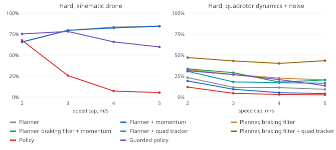

### Coverage the way exploration papers measure it

Every coverage number above counts the 0.5 m voxels the drone's *center* flew through. That is a strict metric, and it rewards sweeping lanes one voxel apart, which is the U-turn the quadrotor cannot take at speed. Exploration papers usually score what the sensor observed instead. This section scores the same episodes both ways: **flown** as above, and **footprint**, the share of the reachable building that came within a sensor's view. The headline radius is 3 m, about where the detector's recall falls to half for the smallest search items (phone, radio); 1.5, 3, 8 m are tracked from the same rays. The radius was set from the detector model before any footprint number was computed, and no pilot or checkpoint was changed or chosen on it. Flown coverage stays the training reward, the checkpoint-selection metric and the FrontierBench score, so earlier numbers remain comparable; the footprint is reported beside it.

Same episodes as the coverage study (`scripts/study/coverage-study.ts` at `0944176`), scored both ways. The footprint is a 90-ray horizontal ring of ground-truth rays at the drone's altitude, blocked by walls and furniture, with no noise and no lighting effect (`src/eval/footprint.ts`). Both metrics divide by the same reachable voxels. Brackets are bootstrap 95% intervals. *Area* is the normalized area under the coverage-over-time curve (1 would be everything covered at the first instant); *half* is the mean time to cover half the building, over the flights that did.

- **The quadrotor's gap is real.** On the hard buildings the sensor-only planner flies through 65.5% on the kinematic drone and 23.1% on the quadrotor, a gap of 42.4 points. Inside the 3 m footprint the two cover 91.3% and 46.7%, a gap of 44.6 points. So the gap is not an artifact of the metric: the quadrotor sees less of the building, it does not just fly fewer lanes. The lane U-turn explains why it flies fewer voxels, not why it covers less. With the braking filter and quad tracker the quadrotor reaches 72.1% (67.9–76.5), at 0.03 collisions per episode.
- **Map prediction is no longer a null result.** By flown coverage the learned map prediction covers 66.0% against 65.5% for the planner without it, inside the noise. By footprint it covers 98.5% (97.1–99.6) against 91.3% (87.7–94.8), with the intervals apart, and it has half the building in view after 9 s instead of 40 s (area under the curve 0.85 against 0.63). The true hidden gain does about as well (95.3%, half after 9 s). Preferring frontiers that open onto unseen space pays off in what the drone sees, and soon, even though it does not change which voxels it flies.
- **Ranking on the hard buildings, by day.** By flown coverage: Policy + lidar guard > Policy > Planner + learned map prediction > Sensor-only planner > Planner + true hidden gain (reference) > Oracle teacher (floor plan) > Waypoint follower > Lidar heuristic. By 3 m footprint: Planner + learned map prediction > Planner + true hidden gain (reference) > Policy + lidar guard > Sensor-only planner > Oracle teacher (floor plan) > Policy > Waypoint follower > Lidar heuristic. Policy + lidar guard flies the most (75.1%) but planner + learned map prediction sees the most: 98.5% against 94.9%, half the building in view after 9 s against 27 s, with 0.00 collisions per episode against 0.17.
- **On the quadrotor, by footprint:** Planner, braking filter + quad tracker 72.1%, Policy + braking guard 66.6%, Lidar heuristic 64.1%, Planner, braking filter 56.1%, Planner + quad tracker 53.6%, Sensor-only planner 46.7%, Policy + lidar guard 46.4%, Policy 46.2%, Waypoint follower 30.4%, Oracle teacher (floor plan) 26.9%. The leader has 0.03 collisions per episode. The lidar heuristic, which flies the fewest voxels (18.1%), sees more than policy and policy + lidar guard, with 0.00 collisions per episode: it keeps moving through open space, and the ring sees the rooms it passes.
- **On multi-floor buildings the footprint shows what climbing is for.** A pilot that stays on the ground floor sees little more than it flies (37.7% flown, 40.2% footprint for the planner): the ring looks along one floor, and the other floors count in the denominator. The planner that takes shafts flies 41.8% but sees 75.2% (71.7–78.9).
- **Footprint coverage rises much faster than flown coverage.** The kinematic planner has half the hard building in view after 40 s and flown after 89 s; the area under the curve is 0.63 against 0.36. At the lidar's 8 m range nearly everything is seen (98.6%), so that radius no longer separates pilots; 3 m still does. One-room buildings saturate under any radius (100.0%), so the easy condition says nothing here.

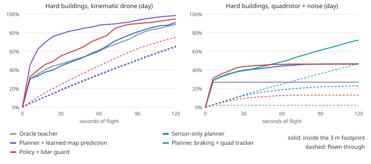

<details>
<summary>Every condition and pilot, flown and footprint</summary>

| Condition | Lighting | Pilot | Flown | Footprint 3 m (95% CI) | Footprint 1.5 m | Footprint 8 m | Area, flown / footprint | Half, flown / footprint |
| --- | --- | --- | --- | --- | --- | --- | --- | --- |
| Easy: one room (stage 0) | day | Oracle teacher (floor plan) | 95.1% | **100.0%** (100.0–100.0) | 100.0% | 100.0% | 0.63 / 0.97 | 19 s / 1 s |
| Easy: one room (stage 0) | day | Sensor-only planner | 95.1% | **100.0%** (100.0–100.0) | 100.0% | 100.0% | 0.61 / 1.00 | 19 s / 1 s |
| Easy: one room (stage 0) | day | Policy | 95.1% | **100.0%** (100.0–100.0) | 100.0% | 100.0% | 0.73 / 0.98 | 13 s / 1 s |
| Easy: one room (stage 0) | day | Policy + lidar guard | 94.1% | **100.0%** (100.0–100.0) | 100.0% | 100.0% | 0.68 / 0.98 | 15 s / 1 s |
| Easy: one room (stage 0) | day | Waypoint follower | 52.8% | **100.0%** (100.0–100.0) | 99.3% | 100.0% | 0.43 / 0.99 | 21 s / 1 s |
| Easy: one room (stage 0) | day | Lidar heuristic | 29.3% | **100.0%** (100.0–100.0) | 99.3% | 100.0% | 0.19 / 0.97 | — / 2 s |
| Easy: one room (stage 0) | night-dark | Oracle teacher (floor plan) | 95.1% | **100.0%** (100.0–100.0) | 100.0% | 100.0% | 0.63 / 0.97 | 19 s / 1 s |
| Easy: one room (stage 0) | night-dark | Sensor-only planner | 95.1% | **100.0%** (100.0–100.0) | 100.0% | 100.0% | 0.61 / 1.00 | 18 s / 1 s |
| Easy: one room (stage 0) | night-dark | Policy | 95.1% | **100.0%** (100.0–100.0) | 100.0% | 100.0% | 0.73 / 0.98 | 13 s / 1 s |
| Easy: one room (stage 0) | night-dark | Policy + lidar guard | 95.1% | **100.0%** (100.0–100.0) | 100.0% | 100.0% | 0.69 / 0.98 | 15 s / 1 s |
| Easy: one room (stage 0) | night-dark | Waypoint follower | 52.8% | **100.0%** (100.0–100.0) | 99.3% | 100.0% | 0.43 / 0.99 | 21 s / 1 s |
| Easy: one room (stage 0) | night-dark | Lidar heuristic | 29.4% | **100.0%** (100.0–100.0) | 99.3% | 100.0% | 0.19 / 0.97 | — / 2 s |
| Hard: rooms, hallways, loops (stage 3) | day | Oracle teacher (floor plan) | 64.5% | **89.0%** (84.0–93.4) | 81.3% | 96.9% | 0.36 / 0.62 | 87 s / 37 s |
| Hard: rooms, hallways, loops (stage 3) | day | Sensor-only planner | 65.5% | **91.3%** (87.7–94.8) | 87.5% | 98.6% | 0.36 / 0.63 | 89 s / 40 s |
| Hard: rooms, hallways, loops (stage 3) | day | Planner + learned map prediction | 66.0% | **98.5%** (97.1–99.6) | 93.1% | 100.0% | 0.36 / 0.85 | 90 s / 9 s |
| Hard: rooms, hallways, loops (stage 3) | day | Planner + true hidden gain (reference) | 64.7% | **95.3%** (92.8–97.4) | 90.2% | 100.0% | 0.36 / 0.83 | 90 s / 9 s |
| Hard: rooms, hallways, loops (stage 3) | day | Policy | 67.5% | **88.6%** (83.2–93.4) | 83.4% | 97.0% | 0.43 / 0.70 | 62 s / 26 s |
| Hard: rooms, hallways, loops (stage 3) | day | Policy + lidar guard | 75.1% | **94.9%** (91.7–97.6) | 90.8% | 99.5% | 0.45 / 0.72 | 70 s / 27 s |
| Hard: rooms, hallways, loops (stage 3) | day | Waypoint follower | 24.1% | **61.1%** (54.2–68.1) | 49.2% | 79.5% | 0.19 / 0.54 | 96 s / 25 s |
| Hard: rooms, hallways, loops (stage 3) | day | Lidar heuristic | 15.1% | **57.1%** (50.5–64.1) | 49.2% | 77.8% | 0.11 / 0.52 | — / 23 s |
| Hard: rooms, hallways, loops (stage 3) | night-dark | Oracle teacher (floor plan) | 64.5% | **89.0%** (83.7–93.6) | 81.3% | 96.9% | 0.36 / 0.62 | 87 s / 37 s |
| Hard: rooms, hallways, loops (stage 3) | night-dark | Sensor-only planner | 65.8% | **91.0%** (87.3–94.4) | 87.3% | 98.5% | 0.36 / 0.63 | 89 s / 40 s |
| Hard: rooms, hallways, loops (stage 3) | night-dark | Planner + learned map prediction | 65.8% | **97.6%** (95.9–99.0) | 92.6% | 100.0% | 0.36 / 0.84 | 89 s / 9 s |
| Hard: rooms, hallways, loops (stage 3) | night-dark | Planner + true hidden gain (reference) | 65.0% | **96.1%** (93.7–98.3) | 91.3% | 100.0% | 0.36 / 0.83 | 90 s / 9 s |
| Hard: rooms, hallways, loops (stage 3) | night-dark | Policy | 76.3% | **94.5%** (90.3–97.8) | 90.1% | 98.7% | 0.46 / 0.71 | 65 s / 27 s |
| Hard: rooms, hallways, loops (stage 3) | night-dark | Policy + lidar guard | 77.0% | **97.0%** (94.9–98.7) | 92.9% | 99.9% | 0.45 / 0.71 | 71 s / 28 s |
| Hard: rooms, hallways, loops (stage 3) | night-dark | Waypoint follower | 24.1% | **61.1%** (54.2–67.4) | 49.2% | 79.5% | 0.19 / 0.54 | 96 s / 25 s |
| Hard: rooms, hallways, loops (stage 3) | night-dark | Lidar heuristic | 16.6% | **58.8%** (52.7–66.1) | 51.9% | 78.9% | 0.12 / 0.52 | — / 29 s |
| Multi-floor with shafts (stage 4) | day | Oracle teacher (floor plan) | 37.6% | **39.4%** (36.4–42.5) | 38.9% | 40.0% | 0.23 / 0.34 | 109 s / 80 s |
| Multi-floor with shafts (stage 4) | day | Sensor-only planner | 37.7% | **40.2%** (37.3–43.1) | 40.2% | 40.2% | 0.22 / 0.33 | 120 s / 72 s |
| Multi-floor with shafts (stage 4) | day | Planner, takes shafts | 41.8% | **75.2%** (71.7–78.9) | 68.4% | 91.3% | 0.22 / 0.44 | 109 s / 76 s |
| Multi-floor with shafts (stage 4) | day | Planner + learned map prediction | 37.2% | **40.2%** (37.1–43.1) | 40.2% | 40.2% | 0.22 / 0.37 | 119 s / 50 s |
| Multi-floor with shafts (stage 4) | day | Planner + true hidden gain (reference) | 37.6% | **40.2%** (37.4–43.2) | 40.2% | 40.2% | 0.22 / 0.37 | 114 s / 64 s |
| Multi-floor with shafts (stage 4) | day | Policy | 37.5% | **40.2%** (37.3–43.2) | 39.8% | 40.2% | 0.26 / 0.35 | 95 s / 54 s |
| Multi-floor with shafts (stage 4) | day | Policy + lidar guard | 38.8% | **40.2%** (37.2–43.3) | 40.2% | 40.2% | 0.26 / 0.35 | 102 s / 69 s |
| Multi-floor with shafts (stage 4) | day | Waypoint follower | 10.6% | **27.3%** (23.9–31.1) | 22.4% | 35.6% | 0.09 / 0.26 | — / 55 s |
| Multi-floor with shafts (stage 4) | day | Lidar heuristic | 9.2% | **33.2%** (29.8–36.5) | 29.7% | 38.0% | 0.07 / 0.30 | — / 62 s |
| Hard, quadrotor dynamics + noise | day | Oracle teacher (floor plan) | 2.2% | **26.9%** (24.7–29.1) | 13.8% | 55.3% | 0.02 / 0.27 | — / — |
| Hard, quadrotor dynamics + noise | day | Sensor-only planner | 23.1% | **46.7%** (42.3–51.3) | 39.2% | 65.8% | 0.17 / 0.42 | 110 s / 47 s |
| Hard, quadrotor dynamics + noise | day | Planner, braking filter | 32.5% | **56.1%** (50.7–61.7) | 48.9% | 75.6% | 0.21 / 0.47 | 112 s / 51 s |
| Hard, quadrotor dynamics + noise | day | Planner + quad tracker | 30.6% | **53.6%** (46.1–61.3) | 46.3% | 71.4% | 0.20 / 0.44 | 105 s / 45 s |
| Hard, quadrotor dynamics + noise | day | Planner, braking filter + quad tracker | 46.9% | **72.1%** (67.9–76.5) | 64.7% | 89.4% | 0.26 / 0.51 | 108 s / 61 s |
| Hard, quadrotor dynamics + noise | day | Policy | 11.9% | **46.2%** (41.6–50.7) | 35.7% | 67.4% | 0.11 / 0.44 | — / 21 s |
| Hard, quadrotor dynamics + noise | day | Policy + lidar guard | 13.1% | **46.4%** (42.0–51.4) | 35.6% | 68.5% | 0.11 / 0.44 | — / 27 s |
| Hard, quadrotor dynamics + noise | day | Policy + braking guard | 31.2% | **66.6%** (59.6–73.8) | 58.5% | 82.7% | 0.19 / 0.54 | 114 s / 43 s |
| Hard, quadrotor dynamics + noise | day | Waypoint follower | 3.2% | **30.4%** (27.8–33.0) | 17.3% | 56.7% | 0.03 / 0.30 | — / — |
| Hard, quadrotor dynamics + noise | day | Lidar heuristic | 18.1% | **64.1%** (58.1–70.2) | 55.9% | 82.9% | 0.13 / 0.58 | — / 23 s |
| Hard, quadrotor dynamics + noise | night-dark | Oracle teacher (floor plan) | 2.2% | **26.9%** (24.6–29.1) | 13.8% | 55.3% | 0.02 / 0.27 | — / — |
| Hard, quadrotor dynamics + noise | night-dark | Sensor-only planner | 25.6% | **48.5%** (42.7–54.7) | 41.1% | 67.3% | 0.18 / 0.42 | 110 s / 51 s |
| Hard, quadrotor dynamics + noise | night-dark | Planner, braking filter | 32.9% | **57.5%** (52.1–62.6) | 49.9% | 75.3% | 0.21 / 0.47 | 109 s / 52 s |
| Hard, quadrotor dynamics + noise | night-dark | Planner + quad tracker | 31.8% | **54.8%** (48.6–60.9) | 47.3% | 73.4% | 0.21 / 0.46 | 109 s / 42 s |
| Hard, quadrotor dynamics + noise | night-dark | Planner, braking filter + quad tracker | 46.7% | **71.3%** (67.0–75.9) | 64.1% | 87.3% | 0.26 / 0.52 | 113 s / 54 s |
| Hard, quadrotor dynamics + noise | night-dark | Policy | 8.6% | **43.3%** (38.7–47.7) | 31.1% | 64.6% | 0.08 / 0.42 | — / 19 s |
| Hard, quadrotor dynamics + noise | night-dark | Policy + lidar guard | 14.6% | **45.5%** (40.6–50.4) | 35.9% | 66.6% | 0.12 / 0.44 | — / 22 s |
| Hard, quadrotor dynamics + noise | night-dark | Policy + braking guard | 28.6% | **65.1%** (57.8–72.8) | 56.8% | 82.3% | 0.18 / 0.54 | 117 s / 30 s |
| Hard, quadrotor dynamics + noise | night-dark | Waypoint follower | 3.2% | **30.6%** (27.5–33.5) | 17.1% | 56.4% | 0.03 / 0.30 | — / — |
| Hard, quadrotor dynamics + noise | night-dark | Lidar heuristic | 18.7% | **64.0%** (58.1–70.1) | 56.1% | 83.0% | 0.13 / 0.57 | — / 23 s |

</details>

The speed study scored the same way, flown / footprint at each speed cap:

| Airframe | Pilot | 2 m/s, flown / footprint | 3 m/s, flown / footprint | 4 m/s, flown / footprint | 5 m/s, flown / footprint |
| --- | --- | --- | --- | --- | --- |
| Kinematic | Planner | 65.5% / **91.3%** | 79.3% / **97.0%** | 83.3% / **98.7%** | 84.4% / **98.7%** |
| Kinematic | Planner + momentum | 65.6% / **91.2%** | 79.4% / **96.4%** | 82.2% / **96.7%** | 84.1% / **97.4%** |
| Kinematic | Policy | 67.5% / **88.6%** | 25.6% / **53.1%** | 7.1% / **38.2%** | 5.2% / **36.3%** |
| Kinematic | Guarded policy | 75.1% / **94.9%** | 78.0% / **97.0%** | 65.6% / **91.5%** | 59.6% / **88.5%** |
| Quadrotor | Planner | 23.1% / **46.7%** | 11.5% / **37.6%** | 11.2% / **38.6%** | 9.1% / **36.0%** |
| Quadrotor | Planner + momentum | 19.1% / **43.1%** | 9.2% / **36.0%** | 5.1% / **34.6%** | 4.0% / **32.7%** |
| Quadrotor | Planner, braking filter | 32.5% / **56.1%** | 26.8% / **50.5%** | 22.5% / **47.8%** | 20.4% / **46.4%** |
| Quadrotor | Planner, braking filter + momentum | 33.5% / **58.2%** | 29.0% / **55.1%** | 17.7% / **44.6%** | 20.2% / **46.9%** |
| Quadrotor | Planner + quad tracker | 30.6% / **53.6%** | 18.0% / **42.1%** | 17.0% / **42.8%** | 16.4% / **40.7%** |
| Quadrotor | Planner, braking filter + quad tracker | 46.9% / **72.1%** | 42.9% / **72.7%** | 40.0% / **67.2%** | 43.3% / **70.6%** |
| Quadrotor | Policy | 11.9% / **46.2%** | 4.4% / **35.0%** | 3.0% / **31.7%** | 2.6% / **30.9%** |
| Quadrotor | Guarded policy | 31.2% / **66.6%** | 26.6% / **64.6%** | 20.7% / **60.7%** | 13.6% / **50.5%** |

### Against published exploration methods

The planner above was designed in this repository, so it needs comparison against methods others published. FrontierBench now carries three of them as baselines ([LEADERBOARD.md](LEADERBOARD.md), `src/sim/explorers`), each written from its paper:

- **Nearest frontier** (B. Yamauchi, *A frontier-based approach for autonomous exploration*, IEEE CIRA 1997). Frontier cells are known-free cells next to unknown space. Regions smaller than three voxels are dropped. The drone flies to the nearest region by path length and keeps that goal until it arrives or makes no progress. Reached and inaccessible destinations are skipped after that.
- **Receding-horizon next-best-view, NBVP** (A. Bircher et al., *Receding horizon "next-best-view" planner for 3D exploration*, IEEE ICRA 2016). An RRT grows through known free space. Each node's gain is the unknown voxels its sensor would see, discounted by exp(−0.5 · path length) and summed along the branch. The drone flies only the first edge of the best branch, then regrows the tree from the rest of that branch.
- **Online boustrophedon coverage, BA\*** (H. H. Viet et al., *BA\*: an online complete coverage algorithm for cleaning robots*, Applied Intelligence 2013; after H. Choset and P. Pignon, *Coverage path planning: the boustrophedon cellular decomposition*, FSR 1997). It steps north, south, east or west, in that priority, into known-free cells it has not flown. At a dead end it backtracks along the shortest known path to the nearest uncovered cell next to a covered one. Its cell is the bench's 0.5 m voxel, so its lanes are one voxel apart.

All three run on the same inputs as the planner. They use its lidar occupancy map, its path cost near unknown space, its pure pursuit, its altitude hold and its safety filter (the braking filter on the quadrotor), and they take shafts through the same climber. So the comparison isolates *where each method chooses to go*. Parameters are the papers' own where a paper gives one (NBVP's λ = 0.5) and were not tuned on any split. The papers' 360° sweep and NBVP's yaw sampling are dropped, because the lidar ring already sees 360° on every step. Every pilot flies the same 240 test flights:

| Pilot | Score (flown) | Footprint score | Footprint curve area | Half seen, s | Flights that touched nothing |
| --- | --- | --- | --- | --- | --- |
| Sensor-only planner (this repository) | 67.5% | 87.0% | 0.66 | 39.5 | 94% |
| Nearest frontier (Yamauchi 1997) | 8.8% | 73.9% | 0.72 | 8.9 | 99% |
| Next-best-view RRT (NBVP, Bircher et al. 2016) | 27.5% | 90.5% | 0.84 | 10.5 | 98% |
| Boustrophedon coverage (BA*, Viet et al. 2013) | 66.7% | 88.6% | 0.68 | 35.0 | 95% |

*Footprint curve area* is the normalized area under the footprint-over-time curve: 1 means the whole building was in view at once. *Half seen* is the mean time until half the building was inside the 3 m footprint.

The two kinds of method optimize different things, and the two metrics show it. Nearest frontier and NBVP are *mapping* methods. They stop when nothing in range is unknown, and the 8 m lidar maps most rooms from the doorway, so they fly through little of the building. Boustrophedon and this repository's planner are *coverage* methods: they keep flying until every reachable voxel is flown. On the bench score, which counts voxels flown, the planner and boustrophedon are about tied, and the mapping methods trail far behind. On the footprint, which counts what came within 3 m of the sensor, **NBVP beats the planner**. It also sees half the building in about a quarter of the time, and on the quadrotor it keeps far more of the building in view, because it never asks for the one-voxel U-turns the airframe cannot fly. Nearest frontier sees the least: it leaves each room once the lidar has mapped it from the door, which keeps a room's far corners outside 3 m. On multi-floor buildings both mapping methods use up a floor early, before they have flown over many shafts, so they reach fewer floors.

### Indoor localization

Each flight is a trajectory the sensor-only planner flew with the true pose on a fresh building (hard: seeds 60001+, easy: 62001+, 30 each, day and night), replayed open loop through every estimator arm with its own simulated sensors, from `scripts/study/loc-study.ts` at `ba4e165`. The estimator's parameters were tuned only on stage-3 seeds 7001–7012. *Drift vs own map* removes the entry offset (the estimator starts 10 cm and 1.7° off, 1-sigma, and cannot learn where its map sits); *vs building* keeps it. *Inside own 95%* is the share of ticks whose map-relative error falls inside the filter's own 95% ellipse; 95% is ideal, lower is overconfident. Brackets are bootstrap 95% intervals of the mean over flights.

| Estimator (hard buildings) | Drift vs own map, day | Drift vs own map, night | Error vs building, day / night | Heading error, day / night | Worst error | Flights ever 0.5 m off | Inside own 95% |
| --- | --- | --- | --- | --- | --- | --- | --- |
| Shipped: IMU + flow + 90-beam lidar scan matching | 4.9 cm (4.3–5.7) | 5.1 cm (4.4–5.9) | 14.1 cm / 14.2 cm | 0.27° / 0.28° | 34.9 cm | 0 of 60 | 96.2% |
| Dead reckoning: IMU + flow only | 1.86 m (1.58–2.15 m) | 2.08 m (1.82–2.35 m) | 1.87 m / 2.10 m | 16.26° / 14.66° | 8.88 m | 60 of 60 | 100.0% |
| Scan matching only (no IMU or flow) | 36.3 cm (10.4–76.9) | 45.9 cm (0.10–1.18 m) | 42.7 cm / 52.1 cm | 4.50° / 8.33° | 21.09 m | 6 of 60 | 86.0% |
| Fused with the policy's 32-beam ring | 17.2 cm (12.9–22.6) | 45.4 cm (23.8–71.2) | 24.0 cm / 52.0 cm | 0.95° / 1.04° | 4.22 m | 14 of 60 | 84.6% |

The shipped estimator's error against the building (14.2 cm on average) is mostly the entry offset, which no amount of matching against its own map can remove; its drift against that map is about 5 cm. Without the lidar the same sensors drift 1.86 m and 2.08 m by day and at night, mostly from gyro bias (15° of heading error on average). Matching sweeps without the IMU and flow drifts 36.3 cm and 45.9 cm and occasionally loses the building outright. The 32-beam ring the policy reads is too sparse: 17.2 cm and 45.4 cm of drift, with 14 of 60 flights at some point 0.5 m off. The seen-free map the explorers plan on agrees 99.8% with the one painted from the true pose. The filter's own 95% ellipse held the true map-relative error 96.2% of the time. The shipped estimator called itself lost while still accurate in 0 of 120 flights.

**Kidnapped drone.** Halfway through each flight the estimate is moved 1 m and 15° without telling the filter, as a collision spin might. It re-acquired in 120 of 120 flights, in 0.4 s on average:

| Condition | Lighting | Re-acquired | Median time to < 30 cm | Error ticks > 0.5 m flagged |
| --- | --- | --- | --- | --- |
| easy | day | 30 of 30 | 0.40 s | 64.7% |
| easy | night-dark | 30 of 30 | 0.45 s | 65.8% |
| hard | day | 30 of 30 | 0.40 s | 69.6% |
| hard | night-dark | 30 of 30 | 0.40 s | 67.4% |

<details>
<summary>Every condition and estimator</summary>

| Condition | Lighting | Estimator | Error vs building | Drift vs own map (95% CI) | Heading error | Worst | Flights ever 0.5 m off | Inside own 95% | Seen-map agreement | CPU per flight |
| --- | --- | --- | --- | --- | --- | --- | --- | --- | --- | --- |
| easy | day | Shipped: IMU + flow + 90-beam lidar scan matching | 14.1 cm | 2.7 cm (2.4–2.9) | 0.25° | 29.9 cm | 0 of 30 | 100.0% | 100.0% | 0.4 s |
| easy | day | Dead reckoning: IMU + flow only | 33.0 cm | 32.2 cm (29.1–35.5) | 3.81° | 1.09 m | 22 of 30 | 100.0% | 100.0% | 0.2 s |
| easy | day | Scan matching only (no IMU or flow) | 21.2 cm | 13.4 cm (7.0–25.9) | 4.06° | 4.82 m | 1 of 30 | 99.0% | 100.0% | 0.4 s |
| easy | day | Fused with the policy's 32-beam ring | 14.5 cm | 4.3 cm (3.5–5.3) | 0.76° | 49.1 cm | 0 of 30 | 99.0% | 100.0% | 0.3 s |
| easy | day | Fused, drone displaced 1 m and 15° mid-flight | 17.7 cm | 10.5 cm (9.8–11.4) | 1.53° | 1.35 m | 30 of 30 | 98.9% | 100.0% | 0.4 s |
| hard | day | Shipped: IMU + flow + 90-beam lidar scan matching | 14.1 cm | 4.9 cm (4.3–5.7) | 0.27° | 33.0 cm | 0 of 30 | 96.7% | 99.8% | 2.2 s |
| hard | day | Dead reckoning: IMU + flow only | 1.87 m | 1.86 m (1.58–2.15 m) | 16.26° | 8.43 m | 30 of 30 | 100.0% | 86.7% | 0.9 s |
| hard | day | Scan matching only (no IMU or flow) | 42.7 cm | 36.3 cm (10.4–76.9) | 4.50° | 11.64 m | 4 of 30 | 85.6% | 98.3% | 2.4 s |
| hard | day | Fused with the policy's 32-beam ring | 24.0 cm | 17.2 cm (12.9–22.6) | 0.95° | 1.02 m | 6 of 30 | 84.2% | 99.5% | 1.7 s |
| hard | day | Fused, drone displaced 1 m and 15° mid-flight | 16.1 cm | 8.9 cm (8.2–9.6) | 1.13° | 1.43 m | 30 of 30 | 96.1% | 99.8% | 2.3 s |
| easy | night-dark | Shipped: IMU + flow + 90-beam lidar scan matching | 13.8 cm | 2.8 cm (2.5–3.2) | 0.25° | 30.7 cm | 0 of 30 | 100.0% | 100.0% | 0.4 s |
| easy | night-dark | Dead reckoning: IMU + flow only | 90.7 cm | 91.7 cm (0.79–1.05 m) | 3.87° | 2.77 m | 30 of 30 | 100.0% | 100.0% | 0.2 s |
| easy | night-dark | Scan matching only (no IMU or flow) | 15.7 cm | 7.2 cm (7.0–7.4) | 2.58° | 41.5 cm | 0 of 30 | 99.9% | 100.0% | 0.4 s |
| easy | night-dark | Fused with the policy's 32-beam ring | 14.8 cm | 5.8 cm (4.6–7.4) | 0.88° | 48.9 cm | 0 of 30 | 97.6% | 100.0% | 0.3 s |
| easy | night-dark | Fused, drone displaced 1 m and 15° mid-flight | 17.8 cm | 11.3 cm (10.2–12.4) | 1.63° | 1.45 m | 30 of 30 | 98.8% | 100.0% | 0.4 s |
| hard | night-dark | Shipped: IMU + flow + 90-beam lidar scan matching | 14.2 cm | 5.1 cm (4.4–5.9) | 0.28° | 34.9 cm | 0 of 30 | 95.6% | 99.8% | 2.3 s |
| hard | night-dark | Dead reckoning: IMU + flow only | 2.10 m | 2.08 m (1.82–2.35 m) | 14.66° | 8.88 m | 30 of 30 | 100.0% | 88.1% | 0.9 s |
| hard | night-dark | Scan matching only (no IMU or flow) | 52.1 cm | 45.9 cm (0.10–1.18 m) | 8.33° | 21.09 m | 2 of 30 | 86.4% | 98.5% | 2.5 s |
| hard | night-dark | Fused with the policy's 32-beam ring | 52.0 cm | 45.4 cm (23.8–71.2) | 1.04° | 4.22 m | 8 of 30 | 84.9% | 97.3% | 1.6 s |
| hard | night-dark | Fused, drone displaced 1 m and 15° mid-flight | 16.2 cm | 8.9 cm (8.2–9.7) | 1.12° | 1.36 m | 30 of 30 | 94.7% | 99.8% | 2.3 s |

</details>

**Closed loop, in missions.** The `Loc` arms of the mission bench fly each explorer indoors on this estimate. The estimator starts at the doorway from the aperture tracker's last reading, so its entry error is the tracker's error plus the error in the measured opening the plan was made on. From there the drone's lidar paints its maps where the estimate says it is, the planners and the shield read the estimate, and each velocity and heading command turns by the heading error on its way to the airframe, as a flight controller holding the estimated heading would fly it. When the estimate reports itself lost, the drone hovers so the matcher can re-acquire. If it is still lost after 20 s, the failsafe ([SAFETY_CASE.md](SAFETY_CASE.md)) lands it where it is. The failsafe also sends it out of the building slowly once the estimate's own 1-sigma error passes 0.35 m. Over 360 flights, 360 of which entered a building:

| Indoors | Expected outcome, estimate vs truth | Flights with a collision, estimate vs truth | Error vs own map (RMS) | Error vs building (RMS) | Worst error per flight, median / max | Heading error (RMS) | Flights ever 0.5 m off | Flights that lost the pose (time lost) |
| --- | --- | --- | --- | --- | --- | --- | --- | --- |
| Estimated pose: sensor-only planner | 99.2% vs 99.2% | 0 vs 0 | 7.4 cm | 8.4 cm | 11.1 cm / 31.4 cm | 0.33° | 0 of 120 | 0 (0.0 s) |
| Estimated pose: policy, planner fallback | 99.2% vs 99.2% | 0 vs 1 | 7.4 cm | 8.4 cm | 11.3 cm / 36.3 cm | 0.32° | 0 of 120 | 0 (0.0 s) |
| Estimated pose, quadrotor: sensor-only planner | 94.2% vs 99.2% | 6 vs 0 | 7.8 cm | 9.0 cm | 11.7 cm / 52.4 cm | 0.85° | 1 of 120 | 1 (25.3 s) |

Daytime missions are unchanged: the cabin search succeeds in every world on either pose. The estimate costs 2 points of expected outcome overall, and the Wilson intervals overlap. Most of it is the night search (100.0% on the estimate vs 100.0% on the true pose), where the flashlight cone leaves little margin for a re-view placed 15–20 cm off. Before the aperture tracker, the estimate started from the true pose plus a drawn 10 cm, 1.7° error, and the compound sweeps lost more: some ended aborted when the estimate went lost and did not re-acquire within 20 s, and some ended incomplete on unreachable free slivers that the look estimate counted. Starting from the tracker and counting only free space connected to where the drone flew removed both on these worlds. 6 estimated-pose flights touched anything (vs 1 for the same explorers on the true pose). The worst error in any flight was 52 cm; flights ever 0.5 m off: 1. Flights that called the pose lost at some point: 1.

Closing the loop found faults that replaying logged flights could not, all fixed on the mission tuning worlds (9101–9116) or by construction:

- **Walls first seen edge-on read as contradictions.** A free ray grazing along a wall marks the cells beside it free; a later return from that wall, a few cm off, lands in one of those cells, and the estimator rejected whole sweeps as inconsistent with its map. A return now contradicts the map only where the cell and all its neighbours have been seen: free space next to unseen space is where new surfaces appear. On the first mission tried, matched sweeps went from 78% to all but one.
- **Shaft climbs relied on the voxel grid lining up with the building.** The explorer climbed or descended at the centre of the voxels where the range finder saw through to the next floor. On the true pose those 0.5 m voxels align with the 1 m building cells, so a voxel that saw through lies inside the shaft. Offset by the entry error they don't, and a drone 9 cm from the slab edge clipped it. Before a climb the drone now finds the hole's edges with the range finder itself, flying slowly along each building axis until the reading closes, and centres between them. This changes the true-pose arms too.
- **Detections were placed with the true pose.** The camera model places a contact from the true pose, while the drone planned its re-views in the estimate's frame, so night re-views aimed 15–25 cm off the target. Contacts are now re-placed with the estimate. This fix came after a first full bench run, which it changed only in the estimated-pose arms (sensor planner at night: 73% to 80%).
- **A gyro read once per tick misses the turn.** The quadrotor's body rate sampled at the end of each 50 ms tick differs from its mean over the tick while the heading controller is turning, and the estimator, trusting it, drifted 15° in heading on quadrotor flights. A real IMU is read far faster than the control loop and its rate is integrated over the tick; the localizer now feeds the tick's heading change, and the quadrotor's heading error dropped to under 1°.
- **A sweep through the slab founded the next floor's map.** Climbing a shaft, the drone's estimated floor changes as it passes the slab, and the first sweep on the new floor founds that floor's map. Taken at slab height, that sweep sees the edge of the hole, not the rooms above, and nothing later matched it: the estimate coasted on odometry until it called itself lost. Sweeps within 35 cm of an upper slab are now neither matched nor mapped. It showed up after the slab geometry changed (a slab is now open only where a shaft joins two floors). It appeared on a tuning world and in a third full bench run, where the sensor planner's compound sweep ended aborted in 8 of 30 worlds. The fix was found on the tuning world, and the bench above is the fourth run.

### Real data: Intel Research Lab

Everything above is simulated. To check the estimator on a real robot's data, `scripts/study/intel-lab.ts` replays the Intel Research Lab log, a standard SLAM dataset: 45 minutes of a wheeled robot driving loops around an office floor in Seattle, 13,631 sweeps of a 180° SICK LMS laser, with wheel odometry ([data/intel-lab/README.md](../data/intel-lab/README.md) has the source and licenses). It is scored the way the published results on this log are: with the 2,984 manually verified relations of the Freiburg SLAM benchmark (Kümmerle et al., *On measuring the accuracy of SLAM algorithms*, Autonomous Robots 2009). Each relation says where the robot was at one sweep in the frame of another; the error of a trajectory is the difference between its own displacement and the relation's, split into translation and rotation, averaged over relations. About 40% of the relations join the same place visited minutes apart, so they measure loop closure as much as tracking.

The estimator is the one the drone flies, unchanged; only the inputs are adapted. The 180 beams of a sweep fill the front half of its 360-slot ring at 1° each (the back half reads as misses; the drone's own lidar has 90 beams all round), the odometry's heading change stands in for the gyro, its step for the optical flow, and the change of that step for the accelerometer. Height sensors read a flat floor. The robot is not a drone, so the shipped parameters (20 cm map cells, the noise of a flow sensor, the drone's 8 m lidar range) are not its parameters either. The *adapted* arm changes two of them, to 10 cm cells and wheel-odometry noise, picked from a 24-point grid on the first 3,000 sweeps of the log only; the *held-out* column scores relations whose sweeps both come later. The score turned out to depend strongly on where the map grid's corner sits, a sign of how close to failure the estimator runs on this log, so every arm is run at five sub-cell shifts of the grid and the table gives the mean over them and, in brackets, the lowest and highest mean. Published rows are quoted from the papers, not rerun.

The *loop* arm adds loop closure (`src/loc/graph.ts`). The estimator runs in odometry mode as the front end. Every 0.25 m or 0.15 rad of travel a keyframe is matched against a submap of the 30 keyframes before it, and every second keyframe searches older keyframes near it for a loop. A loop is kept when at least 65% of its points fit the old submap and the match pins the pose well in both directions. Both kinds of match become edges of a pose graph, which Gauss–Newton optimizes with a Cauchy kernel on the loop edges, so a wrong closure loses its weight instead of bending the map. Its settings (keyframe spacing, submap length, 5 cm cells, the acceptance thresholds) were picked on the first 3,000 sweeps only, with `scripts/study/intel-loop-dev.ts`; the held-out column is the check.

| Method | Translation, abs (m) | Rotation, abs (°) | Translation, squared (m²) | Rotation, squared (°²) | Worst relation (m) |
| --- | --- | --- | --- | --- | --- |
| Scan matching (Kümmerle et al. 2009), published | 0.220 ± 0.296 | 1.7 ± 4.8 | 0.136 ± 0.277 | 25.8 ± 170.9 | 1.168 |
| Rao-Blackwellized particle filter, GMapping (Kümmerle et al. 2009), published | 0.070 ± 0.083 | 3.0 ± 5.3 | 0.011 ± 0.034 | 36.7 ± 187.7 | 0.698 |
| Graph-based SLAM (Kümmerle et al. 2009), published | 0.031 ± 0.026 | 1.3 ± 4.7 | 0.002 ± 0.004 | 24.0 ± 166.1 | 0.229 |
| Graph FLIRT (as quoted by Hess et al. 2016), published | 0.02 ± 0.02 | 0.3 ± 0.3 | — | — | — |
| Cartographer (Hess et al. 2016), published | 0.0229 ± 0.0239 | 0.453 ± 1.335 | 0.0011 ± 0.0040 | 1.986 ± 23.988 | — |
| **Estimator in odometry mode, with loop closure (pose graph; scan matching only in the graph)**, this repository | 0.035 ± 0.057 (0.033–0.041) | 0.79 ± 0.71 (0.79–0.80) | 0.005 ± 0.045 | 1.1 ± 2.2 | 1.620 |
| **Raw wheel odometry (no lidar)**, this repository | 7.370 ± 14.349 | 39.17 ± 53.79 | 260.218 ± 781.300 | 4427.4 ± 7488.8 | 70.022 |
| **Shipped drone estimator, as is (20 cm cells, flow-sensor noise), lidar cut to 8 m**, this repository | 2.885 ± 4.942 (0.821–7.332) | 15.30 ± 27.42 (3.48–42.59) | 47.419 ± 106.437 | 1519.5 ± 3197.2 | 43.564 |
| **Same estimator, 10 cm cells and wheel-odometry noise (picked on the dev sweeps)**, this repository | 1.169 ± 3.589 (0.584–1.850) | 4.39 ± 12.51 (1.53–7.37) | 17.069 ± 64.505 | 245.6 ± 982.3 | 29.603 |
| **Adapted, without the Manhattan heading fix**, this repository | 0.587 ± 1.794 (0.133–1.808) | 2.80 ± 6.86 (1.23–8.39) | 7.628 ± 28.532 | 151.2 ± 612.0 | 31.401 |
| **Adapted, with the same loop closure over its output**, this repository | 1.064 ± 2.957 (0.511–1.649) | 3.83 ± 9.66 (1.61–6.61) | 12.074 ± 44.929 | 150.4 ± 566.8 | 26.326 |
| **Adapted, scan matching only (no odometry between sweeps)**, this repository | 8.127 ± 11.851 (6.453–10.374) | 40.31 ± 58.59 (28.85–44.71) | 212.029 ± 422.660 | 5139.3 ± 9225.6 | 70.208 |

| This repository | Median relation error | 90th percentile | Relations under 10 s apart | Relations 10 s or more apart | Held out (both sweeps after the dev part) | CPU per sweep |
| --- | --- | --- | --- | --- | --- | --- |
| Estimator in odometry mode, with loop closure (pose graph; scan matching only in the graph) | 0.022 m / 0.61° | 0.065 m / 1.72° | 0.026 m (1770) | 0.048 m (1214) | 0.031 m / 0.81° (1662) | 16.74 ms |
| Raw wheel odometry (no lidar) | 0.050 m / 2.49° | 20.104 m / 128.00° | 0.023 m (1770) | 18.082 m (1214) | 5.172 m / 15.63° (1662) | — |
| Shipped drone estimator, as is (20 cm cells, flow-sensor noise), lidar cut to 8 m | 0.059 m / 1.15° | 9.790 m / 46.99° | 0.101 m (1770) | 6.944 m (1214) | 1.473 m / 8.18° (1662) | 1.66 ms |
| Same estimator, 10 cm cells and wheel-odometry noise (picked on the dev sweeps) | 0.031 m / 0.78° | 2.879 m / 4.85° | 0.068 m (1770) | 2.773 m (1214) | 1.188 m / 4.72° (1662) | 7.09 ms |
| Adapted, without the Manhattan heading fix | 0.034 m / 0.83° | 0.667 m / 4.15° | 0.055 m (1770) | 1.363 m (1214) | 0.574 m / 3.07° (1662) | 7.04 ms |
| Adapted, with the same loop closure over its output | 0.030 m / 0.73° | 2.731 m / 5.87° | 0.068 m (1770) | 2.517 m (1214) | 0.976 m / 3.81° (1662) | 23.79 ms |

From `npm run study:intel` at `1c76314`; per-relation errors are in `docs/intel-lab.json`.

**What the numbers say.**

- **With loop closure it is level with published graph SLAM.** The loop arm averages 0.035 m and 0.79° of error (0.033 m to 0.041 m across grid shifts, so it no longer depends on where the grid sits) and 0.031 m and 0.81° on the held-out relations, against 0.031 m and 1.3° for the graph-based SLAM Kümmerle et al. scored and 0.220 m for their scan matcher. GMapping (0.070 m) is beaten; Cartographer (0.023 m and 0.45°) and graph FLIRT (0.02 m) are still ahead. It accepted 1,155 of 1,877 loop candidates over 3,091 keyframes. Short relations are 0.026 m off and relations between visits minutes apart 0.048 m; the worst single relation is 1.620 m. It costs 16.7 ms of CPU per sweep in all, well inside the robot's sweep rate.
- **The loop closer needs a front end that does not jump.** Put behind the adapted estimator instead of its odometry mode, it averages 1.064 m (2.517 m on loops). The filter matches against its one map, so when it comes back to a place mapped before drift it snaps to the old, misaligned walls, and the graph is handed a jump it cannot tell from motion. Doing all scan matching in the graph and feeding it only the smooth odometry is what works.
- **The filter alone does not reach the published methods on this log.** With the dev-picked parameters it averages 1.169 m of translational error (0.584 m to 1.850 m across grid shifts) against 0.220 m for the scan matcher Kümmerle et al. ran in 2009, and 0.02–0.03 m for the graph-based methods and Cartographer, which close loops. As shipped for the drone it averages 2.885 m and 15.30° (0.821 m to 7.332 m). Raw wheel odometry scores 7.370 m.
- **Locally it tracks; the error is in the loops.** The median relation is 0.031 m off. On relations under 10 s apart the adapted estimator is 0.068 m off, against 0.023 m for the wheel odometry alone: over a second or two, good wheel odometry beats it. On relations between visits minutes apart it is 2.773 m off. It has no loop closure: it keeps one map and matches every sweep against it, so drift that has entered the map stays, and coming back to a place mapped before the drift, a sweep can match the old, misaligned walls and the pose jumps. Matching only against the last 40 m of travel (a rolling local map, tried at one grid position) cut the short-relation error from 7 to 4 cm but nearly doubled the loop error, and was dropped.
- **The Manhattan heading fix is the assumption that breaks.** In the simulator every wall runs along the building's axes, and the estimator snaps its heading to the dominant wall direction. Turned off, the adapted estimator averages 0.587 m and 2.80° (0.133 m to 1.808 m across grid shifts, so its best run, 0.133 m, is better than the 2009 scan matcher and its worst is not). On the dev sweeps the fix still helped slightly, so it stays on in the adapted arm; this ablation was looked at after the full-log result and is reported as one, not as the result.
- **Scan matching alone fails here.** Without the odometry between sweeps it averages 8.127 m: a 180° sweep that sees one corridor wall, or a room crowded with people and furniture, does not pin the pose on its own, and nothing carries the estimate through it.
- **It is fast.** 7.1 ms of CPU per sweep with 10 cm cells, about 20 times faster than the robot recorded them.

What this does and does not show: the estimator's inputs, map and matcher run on real laser data without changes and track a real robot locally, but on a 45-minute run with many loops the filter alone drifts metres. A pose graph with scan-matched loop closures behind it brings the run to the accuracy of published graph SLAM. The drone does not fly with it: on its own flights the graph was 15 cm from the drone's map against 5 cm for the filter alone (see Limitations). The drone's flights indoors are a few minutes in buildings a few rooms across, where the simulator says drift stays near 5 cm; this log is a harder regime than any building the drone searches, and the drone's own sensors (a flow camera and an IMU instead of wheels) are not tested by it at all.

### Ablations

Each arm is one `npm run train:indoor` run with the default recipe (BC, then 6 DAgger rounds, best round on validation seeds; no SWA, unlike the shipped checkpoint), the checkpoint kept by held-out validation, then flown on the coverage study's 30 hard buildings, from `scripts/study/ablations.ts` at `4ef0a1c`. Observation ablations zero the block in training and evaluation alike. Brackets are bootstrap 95% intervals.

| Arm | Hard, day | Hard, night | Collisions per episode | Under the lidar guard, day | Best validation |
| --- | --- | --- | --- | --- | --- |
| BC + DAgger, full observation | 61.5% (58.1–65.0) | 61.5% (57.8–65.3) | 5.73 | 62.2% (58.6–65.7) | 75.6% |
| BC only (DAgger round 0) | 50.5% (44.3–55.9) | 53.3% (47.6–58.1) | 8.70 | 56.2% (52.5–59.8) | — |
| BC + DAgger + anchored PPO | 58.8% (55.5–62.3) | 60.7% (56.5–64.7) | 4.93 | 59.2% (55.4–63.1) | 74.9% (DAgger 75.6%) |
| No navigation block (obs 52–63) | 47.2% (41.8–52.1) | 50.4% (46.7–54.4) | 8.37 | 52.3% (48.1–56.3) | 70.2% |
| No local maps | 54.4% (50.3–58.3) | 49.1% (44.6–53.4) | 11.20 | 53.0% (49.6–56.1) | 68.0% |
| No coarse maps | 58.5% (53.7–63.2) | 60.8% (57.4–64.1) | 6.70 | 62.0% (58.8–65.1) | 74.9% |

What the ablations show, on day coverage without the guard:

- **DAgger is worth about 11 points over behavior cloning** (61.5% vs 50.5%), and BC alone collides more. Imitating the teacher only on the teacher's own states leaves the policy lost once it drifts off them.
- **The navigation block carries the most information.** Without the frontier waypoint and its distance (observation 52–63) the policy drops to 47.2%, the largest loss of any arm, and its validation curve starts lowest.
- **Local maps matter for safety as much as for coverage.** Without them the policy loses 7 points by day and 12 at night, and collides about twice as often as the full policy.
- **Coarse maps add little.** Removing them costs about 3 points by day and nothing measurable at night; the intervals overlap with the full policy's.
- **Anchored PPO does not help.** It scores slightly below the DAgger checkpoint it starts from on validation and on the study buildings, consistent with the earlier failed PPO attempts. The recipe in the next section, which does help, differs in scale, noise and critic.
- **Validation is noisy from round to round.** Each run's best round is round 3, and later rounds can drop by 30 points (round 5 of the full run scores 44%), which is why the round is picked on validation and why the shipped checkpoint averages rounds.

These runs use the default recipe without weight averaging, so the full arm is not the shipped checkpoint; it lands within a point of it on the same buildings.

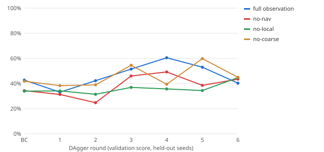

### Fine-tuning on its own flights

The DAgger policy only ever learned to copy its teacher. Here it learns from its own flights with PPO, starting from the DAgger weights. Three changes made PPO work where the anchored fine-tune above did not:

- **Scale and a privileged critic.** Rollouts run on every core, 32 environments at about 11,000 steps a second, in the same episodes the policy is evaluated in (2400 steps, 16-collision limit, a quarter of them in the dark). A 400-update run is 3.3 million steps and takes about 45 minutes on four CPU cores. The critic is a separate network that also sees what the policy cannot: true coverage so far, the true distance to the nearest unflown voxel, the teacher's action, the collision budget used and the voxels left. It only shapes the advantages and never ships.
- **Little exploration noise.** The policy's action noise is cut to a standard deviation of 0.1 (pre-tanh). At 0.2 the sampled flights crash into the 16-collision limit, and PPO learns from wrecks.
- **A small imitation term on a replay, or none.** The teacher labels every state the policy reaches, and a BC term on a reservoir of those labels (weight 0.05) keeps the policy near the teacher where PPO has no signal. Imitating only the current batch, or imitating without PPO at all, wrecks the policy within 20 updates: on its own states the teacher's labels pull toward walls the student cannot see the way the teacher does.

Every number below is on buildings that played no part in training or in picking the checkpoint (picked on the tuning block 66001–66299). Each cell is coverage, the paired change against the DAgger checkpoint in points, and collisions per episode. The last row pools every hard flight with a bootstrap 95% interval on the paired change. From `scripts/study/rl-finetune.ts` at `820e541`.

| Set, buildings, light (flights) | dagger | ppo | ppoSeed2 | ppo260 | gru260 | ppo800 |
| --- | --- | --- | --- | --- | --- | --- |
| Eval protocol, easy, day (4) | 95.1% · 0.0 | 95.1% · 4.0 | 95.1% · 0.0 | 95.1% · 1.3 | 95.1% · 0.0 | 95.1% · 0.0 |
| Eval protocol, hard, day (3) | 67.3% · 8.7 | 78.6% (+11.4) · 0.0 | 81.8% (+14.6) · 0.3 | 71.5% (+4.2) · 1.7 | 80.3% (+13.0) · 1.3 | 86.1% (+18.8) · 0.7 |
| Coverage study, hard, day (30) | 60.7% · 6.4 | 75.2% (+14.5) · 2.1 | 75.1% (+14.3) · 2.6 | 72.5% (+11.8) · 2.5 | 71.5% (+10.7) · 2.9 | 80.0% (+19.2) · 3.4 |
| Eval protocol, easy, night (4) | 95.1% · 1.8 | 95.1% · 2.5 | 95.1% · 0.0 | 95.1% · 0.0 | 95.1% · 0.0 | 95.1% · 0.0 |
| Eval protocol, hard, night (3) | 67.4% · 0.3 | 81.2% (+13.9) · 0.3 | 80.1% (+12.7) · 1.7 | 81.2% (+13.8) · 6.3 | 79.1% (+11.8) · 0.3 | 87.7% (+20.4) · 1.0 |
| Coverage study, hard, night (30) | 59.6% · 5.6 | 74.1% (+14.5) · 2.8 | 74.1% (+14.5) · 2.6 | 71.2% (+11.6) · 2.8 | 71.3% (+11.6) · 1.5 | 80.0% (+20.3) · 2.9 |
| Coverage study, easy, day (30) | 94.0% · 0.1 | 94.3% · 2.9 | 95.1% · 0.0 | 94.7% · 0.8 | 95.1% · 0.0 | 95.1% · 0.0 |
| Report block, hard, day (32) | 62.7% · 4.3 | 75.0% (+12.2) · 2.2 | 75.1% (+12.4) · 2.8 | 72.5% (+9.8) · 2.9 | 71.8% (+9.1) · 1.7 | 80.8% (+18.0) · 3.5 |
| Report block, hard, night (8) | 55.7% · 8.6 | 76.2% (+20.6) · 3.9 | 74.6% (+18.9) · 4.9 | 72.9% (+17.2) · 3.4 | 73.8% (+18.2) · 3.0 | 82.0% (+26.3) · 5.9 |
| Report block, easy, day (6) | 95.1% · 0.0 | 95.1% · 2.8 | 95.1% · 0.0 | 95.1% · 0.5 | 95.1% · 0.0 | 95.1% · 0.0 |
| Report block, easy, night (2) | 95.1% · 0.0 | 95.1% · 3.0 | 95.1% · 0.0 | 95.1% · 0.0 | 95.1% · 0.0 | 95.1% · 0.0 |
| **All hard flights (106)** | **61.0%** · 5.6 | **75.2%** (+12.1 to +16.5) · 2.3 | **75.1%** (+12.0 to +16.4) · 2.8 | **72.4%** (+9.2 to +13.9) · 2.9 | **72.2%** (+9.0 to +13.3) · 2.0 | **80.8%** (+17.7 to +21.9) · 3.3 |

The fine-tuned policy covers 80.8% of the hard buildings against 61.0% for the DAgger checkpoint it started from, a paired change of +19.7 points (95% interval +17.7 to +21.9) over 106 flights, and collides 3.3 times per episode instead of 5.6. On the coverage study's hard buildings it covers 80.0% against 60.7% by day and 80.0% against 59.6% at night, more than the oracle teacher it imitated. The teacher is a greedy nearest-frontier rule and PPO optimizes coverage over the whole episode; this report does not measure where the extra coverage comes from.

### Retraining under the crash rule

The checkpoint above learned when contacts were free. Under the crash rule it crashed on 19 of the 30 fresh hard buildings, and on every quadrotor flight. It was fine-tuned again with the same PPO learner, now in episodes that end at a crash, in three sweeps of six, six and four configurations on GitHub's runners (`.github/workflows/train.yml`, 600 to 1200 updates each). Every checkpoint was picked on the tuning block (66001+), and the final one on 128 hard tuning buildings plus 16 quadrotor ones; the fresh block 69001+ was flown once, only to report.

- **A bigger crash penalty alone does little.** The plain recipe, and the same with an extra 30-point crash penalty and a penalty per m/s of contact speed, both stayed at 40–55% crashes on the tuning buildings within 600 updates. The crashes are sideways moves while turning toward a wall, at 0.4 to 1.4 m/s.
- **Learning the guard's braking works.** The imitation labels become the policy's own action passed through the lidar guard, horizontal velocity only (copying the guard's fixed height hold as well wrecked the policy in 10 updates). With that term at weight 0.5, the crash and contact-speed penalties doubled, and a learning rate of 2·10⁻⁵, crashes on the tuning buildings fell to about 25%. Labels from the teacher's guarded action collapsed instead.
- **Half the flights on the quadrotor.** Continuing from that checkpoint with half of the rollouts on quadrotor dynamics (full domain randomization) and more action noise (standard deviation 0.14) gave the shipped checkpoint, update 750 of that run.

On the 48 fresh report-only buildings (69001+), the retrained policy alone crashes on 6 of 48 hard flights against 25 of 48 for the checkpoint trained before the rule, and covers 78.8% of the hard buildings against 63.1%. On 16 fresh quadrotor flights it covers 20.0% against 3.2%, and 12 still crash against 16. In the coverage study (above) it covers 67.5% of the 30 fresh hard buildings by day with 7 of 30 crashes. The cost is slow contacts: alone it touches walls about four times per flight, below the crash speed, where the old checkpoint touched about once before crashing. Under the lidar guard the two checkpoints cover about the same. Real apartments are the exception. Their 1 m doors and passages are narrower than anything in training, and there the retrained policy alone crashes on 170 of 180 flights and covers 36.1%; with the guard it covers 67.0% ([REAL_PLANS.md](REAL_PLANS.md)). On FrontierBench, which leaves contacts free, its apartment score fell from 72.8% to 68.8% alone and from 79.4% to 72.4% guarded, so the retrain cost a few points on real layouts while it gained on generated ones.

Reproduce: `npm run train:ppo -- --init <sweep-1 checkpoint> --labels guard-self --bc 0.5 --crash-penalty -60 --impact-penalty 20 --lr 2e-5 --quad 0.5 --log-std -2.0 --seed 53`, after a first 450 updates from the pre-rule checkpoint with the same flags but no `--quad` and the default noise; `npm run train:ppo -- --validate-only public/checkpoints/pretrained.bin --set fresh --eval-quad` for the fresh numbers.

The runs behind it, with hard coverage on the tuning block (66001–66299, the only seeds used to pick checkpoints):

| Run | Recipe (on top of the defaults) | Hard coverage at the end | Best checkpoint (tuning block) |
| --- | --- | --- | --- |
| Noise 0.2, BC 1→0.1 on the fresh batch (stopped) | `--log-std -1.6 --bc 1:0.1 --lr 3e-5 --steps-per-env 256 --replay 0` | 54.3% at 40 | 60.1% at 0 |
| Imitation only: BC replay, no PPO | `--ppo 0 --bc 1 --updates 60` | 49.3% at 60 | 60.1% at 0 |
| PPO without the BC term | `--bc 0 --updates 60` | 63.5% at 60 | 63.5% at 60 |
| PPO + BC replay (default recipe) | `(defaults)` | 71.3% at 400 | 72.5% at 380 |
| Default recipe, second seed | `--seed 31` | 72.5% at 400 | 73.6% at 380 |
| Default recipe + GRU memory (stopped at 260) | `--mem 64` | 68.5% at 260 | 68.6% at 200 |
| 400 more updates (shipped) | `--init <default recipe's best> --seed 47` | 75.0% at 800 | 78.1% at 760 |

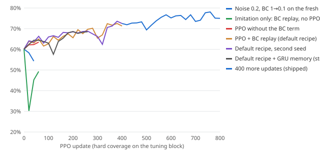

**Memory did not help.** The same recipe with a small recurrent memory (a 64-unit GRU feeding the second layer, starting from zero so it changes nothing at first) reaches 72.2% on the held-out hard flights after 260 updates, against 72.4% for the feed-forward run at the same point, with fewer collisions (2.0 against 2.9 per flight). It trains about three times slower, so the shipped policy has no memory. Both runs are in the table above.

Every bench in this report that flies the policy was re-run once with the new weights: the coverage study, the speed study, the mission bench, the real-floor-plan bench and the camera bench. The ablation runs above and the FrontierBench baseline in [BENCHMARKS.md](BENCHMARKS.md) keep the DAgger policy they were measured with.

## Outdoor search for a lost person

Before this work the drone searched outdoors with a boustrophedon lawnmower: parallel lanes over the whole area at a fixed spacing, then every building it had found. That is the right plan when nothing is known about where the person is. A lost-person search almost always knows something: where they were last seen, and how lost people tend to move. This section replaces the lanes with a search that flies where the person is most likely to be, and measures it against the lanes on worlds it was never tuned on.

### Method

**Probability of area (POA).** The search area is a 2 m grid (`src/mission/autonomy/sar`). Each cell holds the probability that the person is there. Each building holds one number for its whole interior, and a *rest of world* term holds what the drone cannot reach: ground beyond the geofence, and ground hidden under dense tree cores or inside no-fly zones.

**Lost-person prior.** The prior is a mixture of five reorientation strategies of the kind catalogued in the lost-person behavior literature (Syrotuck 1977; Hill 1998; Koester 2008): staying put, following a trail, wandering, climbing for a view, and heading for shelter. Each strategy is a log-normal distance ring around the last known point, shaped by the map: the trail strategy is drawn to trail corridors, the view strategy to higher ground, the shelter strategy to the buildings (60% of its mass goes inside them). The weights and ring sizes are set by hand to be plausible for a short, local loss; they are not taken from the published tables. Every prior also gives each building the mass of its floor area, so a person can always be inside one.

**Probability of detection (POD).** For each camera frame, the model predicts the chance that the detector reports a person in each cell inside the gimbal camera's footprint, from range, viewing angle, light, motion blur and the sensor (RGB by day, thermal at night). A precomputed sky-view map gives, for every cell and 32 bearings, the elevation angles at which tree crowns and roofs block the sightline, so the model does not count looks through foliage.

**Belief update.** After every frame each cell's mass is multiplied by one minus its POD: Bayesian search with negative information (Stone, *Theory of Optimal Search*, 1975). The cumulative probability of success (POS) is the mass removed. A building's mass is cleared by the probability that its interior search would have found the person.

**Planner.** A receding-horizon beam search over 6 m legs in 12 headings, five legs deep, scores each path by the discounted mass it would remove, with a pull toward the richest remaining block so the drone does not strand itself. It flies two legs and replans. A building is visited when its mass per second of travel and search beats what the open ground offers. The search ends when 99% of the reachable mass is gone or the budget runs out.

**Confirmation outdoors.** The gimbal camera sees a person on the ground from 12–14 m, beyond the 9 m the confirmation tracker used to count, so outdoor views never counted toward confirmation. Outdoor tracks now count views to the gimbal's real range, and the drone drops to 7 m or 9.5 m above the person for its confirming looks when the air is clear. This applies to every outdoor search mode, the lanes included.

### Benchmark

Each scene is a seeded world, a last known point 8–20 m from the command post, and a person placed by simulating one of the five strategies as an agent that walks the map (the planner never sees which). In the *uniform* condition the person is instead placed uniformly over open ground and building floors, so the behavior prior is wrong by construction. At night the drone flies a thermal camera. Six methods fly every scene:

| Method | What it is |
| --- | --- |
| Lane sweep (shipped) | The lawnmower the drone flew before, lanes at its default 20% footprint overlap, buildings as found |
| Lane sweep, sweep-width spacing | The same lanes spaced at the sweep width computed from the POD model (23.2 m), buildings last: the strongest no-information baseline |
| Probability search | The method above |
| One-leg greedy | The same belief, flying the best single leg each time |
| Distance ring only | The prior with no map features |
| Flat prior | A uniform prior: the planner and belief with no lost-person knowledge |

Each condition flies the same seeded worlds (seeds 7600+, 100 by day, 60 with a uniformly placed person, 60 at night) with every method, from `src/eval/sar.ts` at `0944176`. The mission is a find-person search with a 900 s and 80% battery budget, entry on auto and an operator who approves every ask. A flight counts as found when the person is confirmed from three bearings at 0.8 mean confidence. Times to find are censored at the budget: the restricted mean counts a miss as the full budget, and the median is blank when half or more were missed. Found intervals are Wilson 95%.

### Results

| Condition | Method | Found (95% CI) | Found within 300 s | Median time to find | Restricted mean time | Battery used | False alarms |
| --- | --- | --- | --- | --- | --- | --- | --- |
| **Day, behavior-model person** (100 worlds) | Lane sweep (shipped) | 87% (79–92%) | 58% | 136 s | 277 s | 25.3% | 0 |
|  | Lane sweep, sweep-width spacing, buildings last | 97% (92–99%) | 95% | 26 s | 74 s | 7.8% | 0 |
|  | Probability search | 99% (95–100%) | 95% | 25 s | 62 s | 8.3% | 0 |
|  | Probability search, one-leg greedy | 99% (95–100%) | 96% | 25 s | 62 s | 9.1% | 0 |
|  | Probability search, distance ring only | 99% (95–100%) | 96% | 25 s | 58 s | 8.0% | 0 |
|  | Probability search, flat prior | 97% (92–99%) | 96% | 25 s | 74 s | 8.8% | 0 |
| **Day, person placed uniformly at random** (60 worlds) | Lane sweep (shipped) | 68% (56–79%) | 25% | 350 s | 491 s | 39.0% | 0 |
|  | Lane sweep, sweep-width spacing, buildings last | 92% (82–96%) | 83% | 57 s | 178 s | 12.9% | 0 |
|  | Probability search | 78% (66–87%) | 65% | 57 s | 307 s | 26.4% | 0 |
|  | Probability search, one-leg greedy | 83% (72–91%) | 47% | 330 s | 355 s | 33.6% | 0 |
|  | Probability search, distance ring only | 92% (82–96%) | 77% | 53 s | 200 s | 20.9% | 0 |
|  | Probability search, flat prior | 93% (84–97%) | 87% | 50 s | 147 s | 16.7% | 0 |
| **Night (thermal), behavior-model person** (60 worlds) | Lane sweep (shipped) | 83% (72–91%) | 62% | 31 s | 261 s | 22.9% | 0 |
|  | Lane sweep, sweep-width spacing, buildings last | 98% (91–100%) | 97% | 28 s | 62 s | 7.4% | 0 |
|  | Probability search | 100% (94–100%) | 98% | 28 s | 52 s | 7.9% | 0 |
|  | Probability search, one-leg greedy | 98% (91–100%) | 98% | 27 s | 59 s | 8.6% | 0 |
|  | Probability search, distance ring only | 100% (94–100%) | 98% | 27 s | 44 s | 6.7% | 0 |
|  | Probability search, flat prior | 100% (94–100%) | 98% | 28 s | 55 s | 7.7% | 0 |

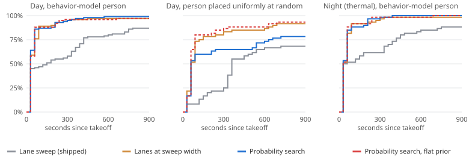

Paired over the same scenes (bootstrap 95% intervals; negative times are faster than the baseline):

| Condition | Comparison | Restricted mean time, difference (95% CI) | Found, difference (95% CI) |
| --- | --- | --- | --- |
| Day, behavior-model person | Lane sweep, sweep-width spacing, buildings last vs lanes (shipped) | -203 s (-266 to -142) | +10 pts (+3 to +18) |
| Day, behavior-model person | Probability search vs lanes (shipped) | -215 s (-278 to -156) | +12 pts (+5 to +19) |
| Day, behavior-model person | Probability search, one-leg greedy vs lanes (shipped) | -216 s (-279 to -158) | +12 pts (+5 to +19) |
| Day, behavior-model person | Probability search, distance ring only vs lanes (shipped) | -219 s (-282 to -158) | +12 pts (+5 to +19) |
| Day, behavior-model person | Probability search, flat prior vs lanes (shipped) | -204 s (-268 to -142) | +10 pts (+3 to +18) |
| Day, behavior-model person | Probability search vs lane sweep, sweep-width spacing, buildings last | -12 s (-33 to +5) | +2 pts (0 to +5) |
| Day, person placed uniformly at random | Lane sweep, sweep-width spacing, buildings last vs lanes (shipped) | -313 s (-401 to -222) | +23 pts (+12 to +35) |
| Day, person placed uniformly at random | Probability search vs lanes (shipped) | -184 s (-294 to -76) | +10 pts (-3 to +25) |
| Day, person placed uniformly at random | Probability search, one-leg greedy vs lanes (shipped) | -136 s (-235 to -41) | +15 pts (0 to +30) |
| Day, person placed uniformly at random | Probability search, distance ring only vs lanes (shipped) | -291 s (-390 to -196) | +23 pts (+12 to +37) |
| Day, person placed uniformly at random | Probability search, flat prior vs lanes (shipped) | -344 s (-434 to -260) | +25 pts (+13 to +38) |
| Day, person placed uniformly at random | Probability search vs lane sweep, sweep-width spacing, buildings last | +129 s (+29 to +230) | -13 pts (-25 to -2) |
| Night (thermal), behavior-model person | Lane sweep, sweep-width spacing, buildings last vs lanes (shipped) | -199 s (-287 to -119) | +15 pts (+5 to +25) |
| Night (thermal), behavior-model person | Probability search vs lanes (shipped) | -210 s (-295 to -136) | +17 pts (+8 to +27) |
| Night (thermal), behavior-model person | Probability search, one-leg greedy vs lanes (shipped) | -202 s (-288 to -127) | +15 pts (+7 to +25) |
| Night (thermal), behavior-model person | Probability search, distance ring only vs lanes (shipped) | -217 s (-305 to -140) | +17 pts (+8 to +27) |
| Night (thermal), behavior-model person | Probability search, flat prior vs lanes (shipped) | -206 s (-294 to -130) | +17 pts (+8 to +27) |
| Night (thermal), behavior-model person | Probability search vs lane sweep, sweep-width spacing, buildings last | -11 s (-37 to +9) | +2 pts (0 to +5) |

**What the numbers say.** Against the shipped lanes the probability search is faster in every condition (by day, -215 s (95% CI -278 to -156 s)). The honest baseline is the sweep-width lanes, and against it the difference is -12 s (95% CI -33 to +5 s) by day and -11 s (95% CI -37 to +9 s) at night: within noise. Two changes explain most of the gain over the shipped lanes, and both are classical search theory rather than the prior: spacing lanes at the sweep width instead of a 20% image overlap, and leaving buildings until the open ground is done. The ablations agree. With the distance ring alone the probability search averages 58 s, and with a flat prior 74 s, against 62 s for the full prior. In these scenes most people stay within a sweep width or two of the last known point, so any search that starts there and spirals out finds them in the first minute; the map features would need larger areas or longer walks to matter, and the benchmark does not show that they do.

Where the prior is wrong it hurts. With the person placed uniformly the full prior is +129 s (95% CI +29 to +230 s) slower than the sweep-width lanes, most likely because it spends its first minutes where it believes the person is, near the last known point. The one place it helps is buildings: in the uniform condition it searches every building interior that holds the person (100% found against 73% for the sweep-width lanes), because every building carries prior mass and is visited when that mass is worth the trip.

By how the person moved (daytime scenes; found / median time to find):

| How the person moved | Worlds | Lanes (shipped) | Lanes, sweep width | Probability search | Flat prior |
| --- | --- | --- | --- | --- | --- |
| shelter | 15 | 100% / 156 s | 87% / 199 s | 100% / 187 s | 93% / 205 s |
| trail | 33 | 97% / 14 s | 100% / 14 s | 100% / 14 s | 100% / 14 s |
| wander | 31 | 77% / 314 s | 97% / 32 s | 97% / 29 s | 94% / 31 s |
| view | 8 | 75% / 555 s | 100% / 31 s | 100% / 30 s | 100% / 37 s |
| stay put | 13 | 77% / 336 s | 100% / 25 s | 100% / 23 s | 100% / 24 s |


Development world 7102, by day. Shading is probability per square metre of open ground, darker is likelier; buildings brown, the geofence dashed. The person (wander, 15 m from the last known point) was confirmed after 40 s by the probability search and after 786 s by the shipped lane sweep. On the right, the ground the camera has looked at is pale: the frames have searched its probability away.

**Is the model calibrated?** Over 18,000 frames on development worlds the model predicts a mean per-frame POD of 14.9% against 19.2% measured (Brier score 0.127). The belief's own POS is checked against outcomes with blind flights: each scene is flown once more with nobody in it, so the POS curve runs to the end of the budget instead of stopping at a find. By day the model predicts 78% success by 90 s and 79% by 300 s; 87% and 95% of searches had confirmed the person by then. With the person placed uniformly the prior is wrong and the model says so poorly: it predicts 95% success by the end of the budget against 78% found.

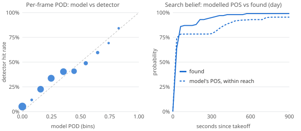

## Drone teams

The single-drone results above say coverage is limited by flight time. The direct answer is more drones. Here two to four copies of the sensor-only planner search one building together (`src/team/`).

### Method

- **Radio.** Every drone and a base radio outside the entry talk over a 2.4 GHz link modelled with the multi-wall model: free-space loss plus a fixed loss for each wall the straight line crosses (drywall 3 dB, glass 2 dB, wood 5 dB, concrete 12 dB, metal 26 dB, a floor slab 15 dB; typical 2.4 GHz values from ITU-R P.2040 and indoor measurements), and 4 dB of log-normal shadowing per packet. The transmitter is deliberately weak (0 dBm, sensitivity −82 dBm) so walls matter inside a 40 m building; the weak setting is −10 dBm. The radio reads the true floor plan, as radio waves do; no drone does.
- **Map sharing.** Each radio keeps the team map as far as it knows it (seen-free and flown voxels) and an append-only log of what it learned. Twice a second it sends every other radio the part of its log that radio has not acknowledged, at most 1,500 voxels per packet; a lost packet is resent next round. What a drone hears it forwards, so maps travel over several hops, through teammates, to the base.
- **Frontier split.** Each drone runs its own planner on its own copy of the team map. A frontier costs more within 6 m of a goal a lower-numbered teammate announced, and more when a teammate it has heard from is closer to it, in the spirit of coordinated multi-robot exploration and RACER's pairwise split. Without the fixed order, strong goal claims let two drones push each other off their goals in turn. The two weights and the order were picked from 25 settings on the tuning buildings (`docs/team-tuning.json`).
- **Relay.** In the relay arms the last drone explores until its mean link margin to the base drops below 6 dB, then flies back along its own track to the deepest point with 3 dB to spare and hovers there.
- **Separation.** Drones are not physics bodies in the simulator, so they cannot hit each other. Each drone instead cuts the part of its velocity that closes on a teammate within 1.5 m, as its lidar filter does for walls, and the bench counts steps where two drone centres come within 0.35 m.
- **Buildings and metrics.** *Hard* is the coverage study's 20 m stage-3 building and two-minute budget. *Large* tiles four hard floor plans 2 × 2 with doorways between them (the stage-3 generator itself stops at eight rooms, so a 40 m request gives halls wider than the lidar's range) and allows four minutes. Drones launch one second apart from the same entry. Coverage is the union of voxels flown. *Base knows* is the share whose report reached the base radio, the picture an operator could act on; the *awareness gap* is coverage minus base-known, averaged over the run and at its worst.

### Results

Commit `87c16f8`. 30 fresh buildings per condition (hard 70001+, large 71001+); the claim weights were tuned on 66001–66016 only. Day light, kinematic airframe, every drone runs the sensor-only planner. Differences are paired by building.

| Building | Team | Searched (95% CI) | vs 1 drone | Median time to 50% | Median time to 80% | Points per drone-minute | Overlap | Base knows at end | Packets through | Team battery, Wh | Points per Wh |
| --- | --- | --- | --- | --- | --- | --- | --- | --- | --- | --- | --- |
| Hard 20 m | 1 drone | 63.2% (60.4%–66.1%) | — | 97 s | not reached | 31.6 | 1.00 | 63.2% | 96.1% | 4.1 | 15.3 |
| Hard 20 m | 2 drones | 94.4% (93.9%–94.9%) | +31.2 pts | 50 s | 84 s | 23.6 | 1.06 | 94.2% | 97.2% | 7.0 | 13.6 |
| Hard 20 m | 3 drones | 95.1% (95.1%–95.1%) | +31.8 pts | 34 s | 59 s | 15.8 | 1.12 | 94.8% | 98.0% | 7.3 | 13.2 |
| Hard 20 m | 4 drones | 95.1% (95.1%–95.1%) | +31.9 pts | 27 s | 45 s | 11.9 | 1.16 | 94.7% | 98.3% | 7.6 | 12.8 |
| Large 40 m | 1 drone | 29.5% (28.5%–30.4%) | — | not reached | not reached | 7.4 | 1.00 | 29.4% | 87.2% | 8.3 | 3.6 |
| Large 40 m | 2 drones | 55.9% (54.1%–57.8%) | +26.5 pts | 218 s | not reached | 7.0 | 1.04 | 55.8% | 81.3% | 16.5 | 3.4 |
| Large 40 m | 3 drones | 79.1% (76.9%–81.3%) | +49.6 pts | 147 s | not reached | 6.6 | 1.10 | 79.0% | 80.5% | 24.5 | 3.2 |
| Large 40 m | 4 drones | 93.2% (92.3%–94.2%) | +63.8 pts | 115 s | 188 s | 5.8 | 1.18 | 93.1% | 81.0% | 31.2 | 3.0 |

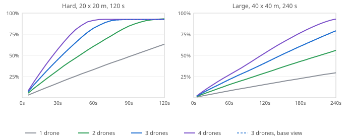

Three drones on large buildings search +49.6 pts (95% CI +48.0 pts to +51.2 pts) more than one. Scaling is close to linear up to three drones: coverage per drone-minute falls only a little as drones are added, and overlap, the flown voxels summed over drones divided by their union, stays near 1.1. On hard buildings two drones already reach the 95% stop, so more drones show up as time to clear rather than coverage.

Ablations, three drones:

| Building | Three drones | Searched | vs 3 drones, full system | Median time to 80% | Base knows at end | Awareness gap, mean / worst | Collisions per episode |
| --- | --- | --- | --- | --- | --- | --- | --- |
| Hard 20 m | 3 drones | 95.1% | — | 59 s | 94.8% | 0.1% / 0.5% | 0.00 |
| Hard 20 m | 3 drones, no radio (each flies alone) | 65.0% | −30.1 pts (95% CI −34.0 pts to −26.0 pts) | not reached | 0.0% | 33.7% / 65.0% | 0.27 |
| Hard 20 m | 3 drones, shared maps, no frontier split | 95.1% | +0.0 pts (95% CI −0.0 pts to +0.0 pts) | 61 s | 94.8% | 0.1% / 0.5% | 0.03 |
| Hard 20 m | 3 drones, perfect radio | 95.1% | +0.0 pts (95% CI +0.0 pts to +0.0 pts) | 59 s | 94.8% | 0.1% / 0.4% | 0.00 |
| Hard 20 m | 2 explorers + 1 relay | 95.0% | −0.1 pts (95% CI −0.2 pts to +0.0 pts) | 66 s | 94.8% | 0.1% / 0.4% | 0.00 |
| Large 40 m | 3 drones | 79.1% | — | not reached | 79.0% | 0.1% / 1.0% | 0.00 |
| Large 40 m | 3 drones, no radio (each flies alone) | 32.8% | −46.3 pts (95% CI −49.2 pts to −43.1 pts) | not reached | 0.0% | 16.6% / 32.8% | 0.20 |
| Large 40 m | 3 drones, shared maps, no frontier split | 75.9% | −3.3 pts (95% CI −4.6 pts to −1.8 pts) | not reached | 75.7% | 0.1% / 1.1% | 0.00 |
| Large 40 m | 3 drones, perfect radio | 79.1% | −0.0 pts (95% CI −0.0 pts to +0.0 pts) | not reached | 79.1% | 0.0% / 0.1% | 0.00 |
| Large 40 m | 2 explorers + 1 relay | 58.4% | −20.7 pts (95% CI −21.9 pts to −19.2 pts) | not reached | 58.4% | 0.0% / 0.3% | 0.00 |
| Large 40 m | 3 drones, weak radio (-10 dBm) | 79.1% | +0.0 pts (95% CI −0.3 pts to +0.4 pts) | not reached | 76.7% | 1.1% / 7.5% | 0.00 |
| Large 40 m | 2 explorers + 1 relay, weak radio (-10 dBm) | 56.5% | −22.6 pts (95% CI −24.1 pts to −21.1 pts) | not reached | 55.9% | 0.2% / 2.1% | 0.00 |

- **Sharing maps is most of the gain.** Without the radio each drone explores alone and covers what the others already did: −46.3 pts (95% CI −49.2 pts to −43.1 pts) against the full team on large buildings, and overlap near 2.7.
- **Splitting frontiers adds a few points and keeps drones apart.** Without claims the drones share maps but chase the same frontiers: −3.3 pts (95% CI −4.6 pts to −1.8 pts), and they spend many more steps within 0.35 m of each other.
- **The radio limits what the base knows, not how much gets searched.** A perfect radio changes coverage by −0.0 pts (95% CI −0.0 pts to +0.0 pts). With the 0 dBm radio the base trails the truth by 0.1% / 1.0% (mean / worst); with the −10 dBm radio by 1.1% / 7.5%.
- **Energy follows drone count, and no pack runs low.** The battery column integrates the power model from the speed study (`DEFAULT_BATTERY`, the airframe's 35.7 Wh pack) over each drone's flight. A 240 s search never uses more than 27.5% of any drone's usable pack, so endurance does not bind at this budget; time does. Searched points per team Wh fall slowly with team size on large buildings (3.6 for one drone, 3.0 for four), because extra drones spend some of their flight on ground a teammate already covered. Without the radio, each searched point costs more than twice the energy.
- **A dedicated relay is not worth a drone here.** On the weak radio it changes the worst awareness gap by −5.4 pts (95% CI −7.3 pts to −3.8 pts) (0.2% / 2.1% against 1.1% / 7.5%) and coverage by −22.6 pts (95% CI −24.1 pts to −21.1 pts). Three explorers already chain the link back to the base most of the time. A relay should pay where the building is deeper than the team can chain, or where an operator needs a live picture more than a fast one.

The live page (`team.html`) runs this code in the browser: the truth beside what the base sees, with the radio links drawn.

## Search by sight

Every mission above detects with an *analytic* camera: a recall curve over distance, light and blur, and a dice roll, with no pixels (`src/perception/detector.ts`). This section replaces it with a camera and a learned detector and flies the same missions again.

### Method

**Camera** (`src/vision/scene.ts`). A software rasterizer draws the drone's view at 160×120 from the same world the missions fly: walls with door and window cut-outs, floors, furniture, terrain, trees, people and objects. Shading has the sun, room lights and the drone's flashlight cone; a sensor model sets exposure from the scene, adds read noise that grows with gain, and quantizes to 8 bits, so night frames are dark and grainy. The renderer also writes a depth image and an instance image. The instance image is used only for labels and for scoring; the drone never reads it. It runs in Node and in the browser at about 4 ms a frame.

**People** are the CC0 KayKit mannequin ([CREDITS.md](../CREDITS.md)) baked into ten poses (standing, sitting, lying, hiding and six walking frames) by `scripts/vision/bake-humanoid.mjs`. The pose, shirt colour and turn match the 3D view. Decoys look different from what they imitate: the mannequin is plain grey plastic, and the real backpack and toolbox have a flap, straps or a handle that their look-alikes lack. The same details are in the 3D view.

**Detector** (`src/vision/detector.ts`). A CenterNet-style convolutional network with about 180k parameters reads the 160×120 frame and outputs, on a 20×15 grid, a heatmap for each of nine classes (person and eight objects) and a box size and offset. Decoys are trained as background. It is trained in TF.js with focal loss on 32,000 frames (80 per world), rendered from worlds 66001–66400 with random surface colours, shirt colours and light levels on three worlds in four. The checkpoint is the epoch with the lowest loss on practice frames from worlds 66501–66560. Confidences are calibrated on the same practice frames with a two-parameter logistic fit.

**From box to contact** (`src/vision/source.ts`). Each detection above a calibrated confidence of 0.3 becomes a contact. Its position is the ray through the box centre at the range of the nearest surface the depth image sees inside the box, plus 15 cm to the body centre and 3% noise. The camera is assumed to be RGB-D. Everything after that is unchanged: the same tracker, the same three-bearing confirmation at the same threshold, and the same re-view flights. Which space counts as looked at is still estimated geometrically, as before.

### Detector on fresh frames

On 2,400 frames (1520 day, 880 night) from fresh worlds 67001–67060 the detector scores a mean AP of 0.61 at IoU 0.5, 0.77 for people. Calibration brings the expected calibration error from 0.088 to 0.008. It fires on empty background 0.003 times a frame and called a mannequin a person 0 of 387 times it saw one; it called the decoy pack a backpack 1 of 45 times. It takes 1.9 ms a frame on the CPU with TF.js's native backend.

| Class | AP at IoU 0.5 | Labelled boxes |
| --- | --- | --- |
| Person | 0.77 | 658 |
| Backpack | 0.50 | 60 |
| Phone | 0.00 | 16 |
| Toolbox | 0.85 | 60 |
| Medkit | 0.62 | 41 |
| Bottle | 0.99 | 18 |
| Radio | 0.47 | 14 |
| Helmet | 0.71 | 46 |
| Blanket | 0.62 | 60 |

Recall at a calibrated confidence of 0.5, by distance (labelled boxes in brackets):

| Distance | Person, day | Person, night | Objects, day | Objects, night |
| --- | --- | --- | --- | --- |
| 0–2 m | 80% (101) | 88% (40) | 64% (53) | 50% (18) |
| 2–4 m | 83% (166) | 87% (55) | 55% (122) | 74% (46) |
| 4–6 m | 62% (111) | 67% (30) | 53% (36) | 53% (17) |
| 6–8 m | 64% (28) | 56% (18) | 43% (7) | 0% (3) |
| 8–10 m | 78% (9) | 70% (10) | 20% (5) | 0% (1) |
| 10–14 m | 59% (17) | 50% (10) | 0% (3) | — |

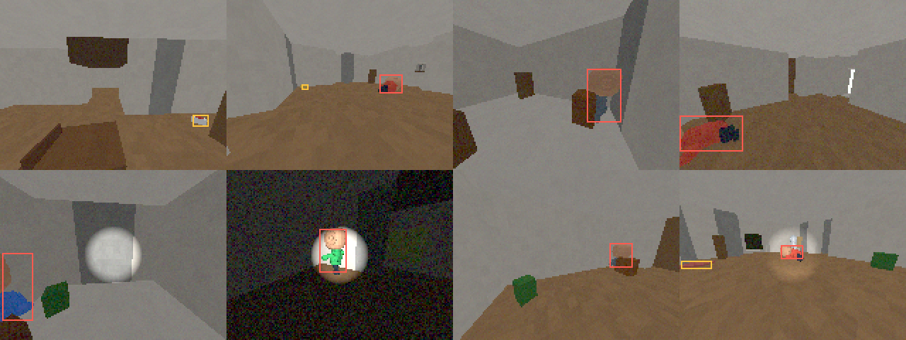

### Missions with the camera

Each scenario is flown on 30 fresh worlds (67201–67230) with both indoor explorers, once with the analytic detector and once with the camera, 180 camera flights in all. Contact gating was set on practice worlds 66601–66616 and not changed after.

Since missions stopped reading ground truth, a building is clear only when no contact is still open there. A one-frame false detection the camera placed in a building's wall had no free point around it to be looked at again from, so it stayed open and the building could never be declared clear: on the first reported block (67101–67130), re-flown after that change, the camera met the expected outcome on only 61.7% of compound sweeps. The last look before leaving a building now re-views such a contact from the nearest free point, and rejects it when nothing in the drone's own map can see it. Found on the practice worlds only, it is reported on this fresh block. On the same 180 paired flights, the code before the fix scores 65.0% on camera compound sweeps and 82.8% on all camera flights, with no false clear either way.

| Scenario | Detector | Expected outcome (95% CI) | Mean time to first find | Mean flight | False alarms | False clears |
| --- | --- | --- | --- | --- | --- | --- |
| **Cabin search, day** | Analytic detector | 100.0% (94–100%) | 140 s | 187 s | 0 | 0 |
|  | Camera + learned detector | 100.0% (94–100%) | 135 s | 179 s | 0 | 0 |
| **Two-building safety sweep** | Analytic detector | 96.7% (89–99%) | — | 1011 s | 0 | 0 |
|  | Camera + learned detector | 88.3% (78–94%) | — | 935 s | 0 | 0 |
| **Backpack search, night** | Analytic detector | 100.0% (94–100%) | 162 s | 206 s | 0 | 0 |
|  | Camera + learned detector | 98.3% (91–100%) | 196 s | 247 s | 1 | 0 |

**What the numbers say.** Over all 180 paired flights the camera meets the expected outcome in 95.6% against 98.9% for the analytic detector. 6 paired flights succeed only with the analytic detector and 0 only with the camera, so the camera never rescues a flight the analytic model loses.

The two are within noise of each other in every scenario; the night backpack is 98.3% against 100.0%. Under the flashlight alone the detector often scores the backpack around 0.4 to 0.6, below the 0.8 mean the three-bearing confirmation asks for, so the drone spends its re-views on it. The confirmation threshold was left where the analytic missions set it. An earlier run of this bench showed a much larger night gap; most of it was targets the placer had put inside tables and shelves, hidden from the camera but not from the analytic detector, which has no furniture occlusion. Targets are now never placed inside furniture.

Camera flights confirmed a decoy or declared a building clear with a target inside only rarely (1 false alarm, 0 false clears in 180 flights). A camera flight renders and reads about 2,267 frames and takes 35 s of wall time on one CPU core, against 4 s with the analytic detector.

## Failure atlas

The mission bench flies a few fixed scenarios, so it can only find the failures someone thought to stage. The failure atlas asks instead how often the shipped autopilot (`policyQuad`: the policy indoors with the sensor-only planner as backup, on the quadrotor, with the operator approving every entry) fails over a declared distribution of 16 mission dimensions: the mission kind, the number of buildings, the person's pose, objects and decoys, interior lights, time of day, wind and gusts, and a sensor or airframe fault on 40% of flights with its onset and severity. The full method, the conditional rates and every failing flight are in [ATLAS.md](ATLAS.md) and on the [atlas page](https://alexnieves-cs.github.io/frontier-fly/atlas.html), where each one replays in the browser.

**Method.** A cross-entropy search (6,800 flights) learns a proposal distribution that makes each failure common, scored by how close a flight came to it. Fresh flights drawn from a mixture of that proposal and the nominal distribution then give an importance-sampled rate, and plain Monte Carlo on its own seeds checks it. No seed block used here is used by any other study, and nothing was tuned on them. The rates below are a re-run of the two importance-sampled estimates and the Monte Carlo check on fresh seeds (255001–267000) with the current code: unresolved contacts ([below](#unresolved-contacts)), the one airframe and the policy retrained under the crash rule. The proposal is still the one the search learned at v1.0.0.

| Event | Importance sampling (95% CI) | Plain Monte Carlo (95% CI) |
| --- | --- | --- |
| False clear | 0.25% (0.16% to 0.35%), 2,000 flights | 0.20% (0.11% to 0.35%), 12 of 6,000 |
| Collision | 1.15% (0.77% to 1.72%) | 1.22% (0.97% to 1.53%) |

**Where the false clears are.** All of them are on sweeps of an occupied site, where the drone's job is to confirm clear and a person is inside: 0.8% (0.5% to 1.4%) of those flights. On every mission with someone or something to find the rate is 0.3%. Find-a-person and find-an-object missions had none. The person's pose decides it: across all flights a walking person is falsely cleared on 0.1% and a hiding one on 0.9%, against 0.0% for a person standing, sitting or lying (12 of 12 false clears had a moving or hiding person). In the cases traced the detector does see the person, with confidences around 0.7 to 0.9 on single views, but the confirmation rule averages repeated views and the average never reaches the confirm bar, so the contact is rejected and the building is called clear. The earlier mission bench reported 1 false clear in 360 flights because its occupied sweep only ever placed a person lying still.

**Collisions** have no single driver. The worst slices, a sagging battery and a silent lidar, are about twice the mean, and most contacts happen while the drone leaves or explores a building.

### Unresolved contacts

The first atlas run measured the code at v1.0.0, where 3.55% of flights (importance-sampled) were false clears. Its false clears came from the confirmation rule: a person track that ran out of re-views short of the bar was rejected, and nothing then stood in the way of a clear. Two changes followed (`src/mission/autonomy/planner/confirm.ts`, `phases/search.ts`):

- **Unresolved, not rejected.** A track that runs out of re-views closes as *rejected* only when its views score no better than a lookalike does. Otherwise it is *unresolved*: it stays live (a later view can still confirm it), it blocks a clear of the building it is in, and the mission report lists it for a person to check. The floor is 0.70 mean confidence, set on a dev block (240001-240240) where decoy tracks closed at 0.48 to 0.68 and the real people the drone failed to confirm at 0.62 to 0.80. It belongs to this simulated detector, as the confirm threshold does; a different detector needs its own.
- **Tracks that follow a walker.** A person track's estimate leans on its newest contacts, its association gate grows at walking speed while it is unseen (up to 4 m), and two tracks of one walker that were never seen in the same frame are merged. People are re-viewed from 3.2 m first instead of 2.2 m: motion blur in the detector model falls with distance, so a walker scores higher a little farther away.

Both versions flew the same 2,000 fresh flights (seeds 250001-252000, plain Monte Carlo from the atlas's nominal distribution, flown once after tuning; the new code at `f609dc8`, the control at `d881b47`).

| | Before | After |
| --- | --- | --- |
| False clear, per flight | 4.05% (3.27% to 5.01%), 81 flights | 0.30% (0.14% to 0.65%), 6 flights |
| False clear, sweeps of an occupied site | 15.3% | 1.1% |
| Mission ends as expected | 44.4% | 45.1% |
| Walking person found (find and sweep missions) | 27 of 251 | 63 of 251 |
| Hiding person found | 91 of 230 | 79 of 230 |
| Empty sweep cleared | 179 of 380 | 176 of 380 |
| Collision, per flight | 2.55% | 2.35% |

What it costs: a sweep with an unresolved person ends *incomplete* rather than *found*, so most of the former false clears became incomplete sweeps, not finds. Hiding people are found less often than before, and a few empty sweeps no longer clear. Every remaining false clear has a hiding person whose views averaged 0.66 to 0.69, inside the band decoys also reach: this detector cannot tell them from a mannequin, and only a better detector or more views would.

## Doors, glass and smoke

Until now every interior door stood open and door leaves were only drawn. Three hazards now change what the drone can fly through and what its sensors return, each with its own seed block, pass condition and bench row (`src/gen/hazards.ts`, applied after generation and seeded by the building):

- **Doors.** A share of interior doorways is shut: the leaf becomes a wall cell with a door surface, and a shut door is never opened. A shut door that leaves less than half the building reachable is opened again. Most of the others get a thin leaf standing ajar at 30–75°, a collidable obstacle in the doorway. Coverage counts only what is reachable with the doors as they are.
- **Glass and mirrors.** The inner walls of some rooms turn to glass, where a lidar beam drops out 35% of the time and reads as max range, and a few interior wall faces become mirrors that return the reflected path, so the wall reads further away than it is.
- **Smoke.** Some rooms fill with smoke of visibility 1.5–4 m. A horizontal lidar beam crossing smoke can come back early, and the camera detector's recall falls with the smoke's transmittance along the line of sight.

The explorers know hazards exist but not where. With hazard awareness on, a mission logs every shut door it sees whose far side it has not searched and will not call a building clear while one is left; it tells the operator a ground team is needed. It skips smoke-filled voxels when it scores a look, and it never rejects a contact seen in smoke: the contact is left unresolved, which blocks the clear. The unaware control flies the same code with all three switched off.

**Coverage.** The hard-building coverage study flies each hazard on fresh stage-3 buildings 86001–86030 (day), paired with the same buildings without hazards. The pass condition, fixed before the run: the sensor-only planner and the guarded policy each keep at least 90% of their own no-hazard coverage and crash on at most 2 of 30 flights, in every hazard (crash = contact at 0.5 m/s or more). Cells give mean coverage, then crashes of 30 in brackets, then the ratio to the pilot's own control.

| Pilot | No hazards | Doors | Glass and mirrors | Smoke |
| --- | --- | --- | --- | --- |
| Oracle teacher (reads the true map) | 61.8% (0) | 52.4% (10), ×0.85 | 61.8% (0), ×1.00 | 61.8% (0), ×1.00 |
| Sensor-only planner | 64.0% (0) | 66.3% (0), ×1.04 | 64.5% (0), ×1.01 | 47.5% (0), ×0.74 |
| Policy alone | 78.5% (1) | 44.3% (23), ×0.56 | 72.0% (9), ×0.92 | 73.1% (7), ×0.93 |
| Policy + lidar guard | 71.7% (1) | 66.4% (6), ×0.93 | 76.2% (0), ×1.06 | 58.4% (2), ×0.81 |

| Pilot | Hazard | Coverage vs its own control | Crashes of 30 | Pass |
| --- | --- | --- | --- | --- |
| Sensor-only planner | doors | ×1.04 (≥ 0.9) | 0 (≤ 2) | ✅ meets |
| Sensor-only planner | glass | ×1.01 (≥ 0.9) | 0 (≤ 2) | ✅ meets |
| Sensor-only planner | smoke | ×0.74 (≥ 0.9) | 0 (≤ 2) | ❌ misses |
| Policy + lidar guard | doors | ×0.93 (≥ 0.9) | 6 (≤ 2) | ❌ misses |
| Policy + lidar guard | glass | ×1.06 (≥ 0.9) | 0 (≤ 2) | ✅ meets |
| Policy + lidar guard | smoke | ×0.81 (≥ 0.9) | 2 (≤ 2) | ❌ misses |

**Missions.** Sweeps of an occupied compound with shut and ajar doors, the same with smoke, and the injured-hiker cabin with smoke or with glass rooms and mirrors, each flown on the first 30 seeds of a fresh block from 86501. The door and glass scenarios keep only seeds whose first building has an interior doorway, a rule fixed before the run (`doors-occupied`: 86501–86630 (30 seeds); `smoke-occupied`: 86501–86530 (30 seeds); `smoke-cabin`: 86501–86530 (30 seeds); `glass-cabin`: 86501–86630 (30 seeds)). The pass condition, fixed before the run: with awareness on, no false clear in any flight, and the hiker found in at least 80% of the cabin flights.

| Scenario | Explorer | Person found (95% CI) | Ends as expected | Flights with a false clear (95% CI) | Shut door left unsearched | Flights with a collision |
| --- | --- | --- | --- | --- | --- | --- |
| Sweep with someone inside, shut and ajar doors | Sensor planner, hazard-aware | 27 of 30 (74.4–96.5) | 90.0% | 0 (0.0–11.4) | 1 | 0 |
| Sweep with someone inside, shut and ajar doors | Policy, hazard-aware | 27 of 30 (74.4–96.5) | 90.0% | 0 (0.0–11.4) | 1 | 0 |
| Sweep with someone inside, shut and ajar doors | Sensor planner, unaware (control) | 27 of 30 (74.4–96.5) | 90.0% | 0 (0.0–11.4) | 0 | 0 |
| Sweep with someone inside, smoke | Sensor planner, hazard-aware | 11 of 30 (21.9–54.5) | 36.7% | 0 (0.0–11.4) | 0 | 5 |
| Sweep with someone inside, smoke | Policy, hazard-aware | 14 of 30 (30.2–63.9) | 46.7% | 0 (0.0–11.4) | 0 | 3 |
| Sweep with someone inside, smoke | Sensor planner, unaware (control) | 12 of 30 (24.6–57.7) | 40.0% | 1 (0.6–16.7) | 0 | 4 |
| Injured hiker in a smoky cabin | Sensor planner, hazard-aware | 14 of 30 (30.2–63.9) | 46.7% | 0 (0.0–11.4) | 0 | 0 |
| Injured hiker in a smoky cabin | Policy, hazard-aware | 14 of 30 (30.2–63.9) | 46.7% | 0 (0.0–11.4) | 0 | 0 |
| Injured hiker in a smoky cabin | Sensor planner, unaware (control) | 14 of 30 (30.2–63.9) | 46.7% | 0 (0.0–11.4) | 0 | 0 |
| Injured hiker, glass rooms and mirrors | Sensor planner, hazard-aware | 27 of 30 (74.4–96.5) | 90.0% | 0 (0.0–11.4) | 0 | 5 |
| Injured hiker, glass rooms and mirrors | Policy, hazard-aware | 26 of 30 (70.3–94.7) | 86.7% | 0 (0.0–11.4) | 0 | 7 |
| Injured hiker, glass rooms and mirrors | Sensor planner, unaware (control) | 27 of 30 (74.4–96.5) | 90.0% | 0 (0.0–11.4) | 0 | 5 |

| Condition | Measured | Target | Pass |
| --- | --- | --- | --- |
| No false clear with hazard awareness on | 0 | 0 | ✅ meets |
| Person found: Injured hiker in a smoky cabin, Sensor planner, hazard-aware | 46.7% | ≥ 80.0% | ❌ misses |
| Person found: Injured hiker in a smoky cabin, Policy, hazard-aware | 46.7% | ≥ 80.0% | ❌ misses |
| Person found: Injured hiker, glass rooms and mirrors, Sensor planner, hazard-aware | 90.0% | ≥ 80.0% | ✅ meets |
| Person found: Injured hiker, glass rooms and mirrors, Policy, hazard-aware | 86.7% | ≥ 80.0% | ✅ meets |

- **No false clear in 360 flights, but the control had 1.**  Aware flights stopped short of a clear because of a shut door they could not search behind in 2 flights. Every room of a mission shell also has its own outside opening, so a shut interior door slows the search but cannot hide anyone from a drone that goes round; a person truly sealed behind a door needs a building the generator does not make yet.
- **Smoke is the gap.** The hiker in a smoky cabin is found on 14 of 30 flights by every explorer, aware or not, and occupied sweeps in smoke end incomplete on 16–19 of 30: the camera loses the person and the lidar's early returns shrink the free space the drone will fly into. Awareness keeps those flights honest (incomplete, not clear) but does not find the person; that needs a sensor that sees through smoke, such as thermal, which the drone does not carry.
- **The crash bar was set below the guarded policy's own control.** It crashes on 1 of 30 of these buildings with no hazards at all, so its hazard misses on crashes say more about the bar than about the hazards; its coverage stays within 81.5% of the control. The bar is kept as it was set.
- **Thin ajar leaves catch the oracle teacher.** It reads the true map and crashes on 10 of 30 door buildings against 0 without hazards; the ajar leaves are the only new obstacle there. The sensor-only planner, which sees them with its lidar, does not crash.

## Failure gallery

Top-down views of chosen coverage episodes: walls dark, shafts orange, furniture grey, flown voxels light blue, the track blue, the start green, collisions red. The episodes are picked by rule from the coverage study (`scripts/study/gallery.ts`).

### Policy alone, most collisions on a hard building

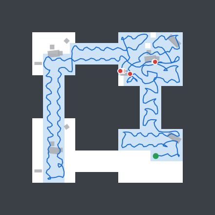

hard building, seed 30023, day: 65.5% coverage, 17 collisions. The policy imitates a teacher that never collides and was never trained on the states just before a contact, so it brushes furniture and door jambs.

### Same building, policy under the lidar guard

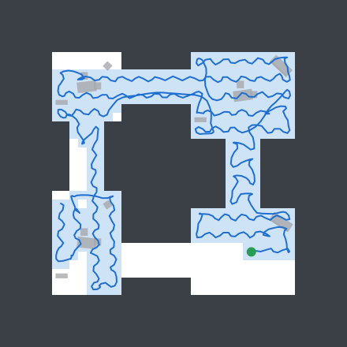

hard building, seed 30023, day: 73.9% coverage, 0 collisions. The guard filters the same actions through the lidar ring and holds 1.15 m above the floor, between the furniture heights.

### Sensor-only planner, lowest coverage on a hard building

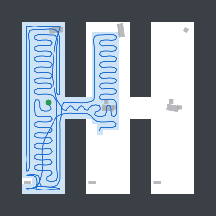

hard building, seed 30020, day: 45.5% coverage, 0 collisions. The planner only routes through voxels its lidar has seen free. Rooms behind a doorway it never looked straight through stay unknown until the episode budget runs out.

### Sensor-only planner on quadrotor dynamics, most collisions

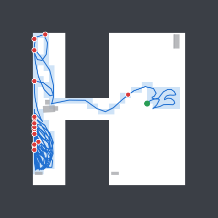

quad building, seed 50011, day: 20.4% coverage, 17 collisions. Motor lag, latency and overshoot make the kinematic braking distance wrong; the filter that is collision-free on the kinematic model is not on the quad.

### Oracle teacher on a two-floor building, ground floor only

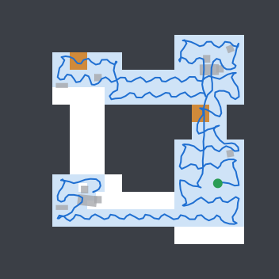

floors building, seed 40012, day: 22.9% coverage, 0 collisions. No pilot in the coverage env climbs: the teacher, the policy and the planner all chase ground-floor frontiers. Only the mission explorer uses shafts.

## Negative results and limitations

- **The drone falsely clears moving and hiding people.** About one in eight sweeps of an occupied site ends with the building declared clear, almost always with a walking or hiding person the detector did see. The fix is in the confirmation rule (a moving contact should be re-acquired, not averaged), not in the detector, and it is not attempted here.
- **Imitation alone is bounded by its teacher.** The DAgger policy imitates an oracle that sees the floor plan, yet on fresh hard buildings it did not beat a planner that sees only lidar. Only PPO on its own flights took it past both, and it still collides where the planner does not.
- **The policy alone still crashes more than under its guard.** Retraining under the crash rule cut its crashes on the 30 fresh hard buildings from 19 to 7 of 30 by day, but it now bumps walls slowly far more often than before, and the lidar guard still removes most of the remaining crashes. The guard stays on in missions and on the homepage.
- **Only the planner climbs.** The teacher and the policy still chase ground-floor frontiers on multi-floor buildings. The planner's floor share is a fixed rule, not a plan over the whole building.
- **The policy barely flies the quadrotor.** It is now trained with half of its flights on randomized quadrotor dynamics, which lifts its quad coverage from 4% to about 20%, but most of its quad flights still end in a crash, where the quad-aware planner has none. A velocity command that assumes the airframe stops at once is the wrong interface for a drone that brakes by tilting; a policy that outputs attitude, or one trained with the braking filter in the loop, is not attempted.
- **The planner is not the best explorer by every measure.** It ties a textbook boustrophedon sweep on the bench score. By the footprint, the way exploration papers count coverage, a 2016 next-best-view planner (NBVP) sees more of the building and sees it sooner ([Against published exploration methods](#against-published-exploration-methods)). The bench score rewards flying through voxels, which the planner and the policy were built for. A search that only needs the camera within 3 m would be better served by a next-best-view goal.
- **The braking model is fitted, not derived.** Its two constants come from simulated stopping tests on the randomized airframes. A heavier airframe, a stronger wind or a slower controller needs them measured again.
- **Night confirmation is near the detector's ceiling.** Under the flashlight alone the per-frame confidence barely clears the 0.8 threshold, so confirmation needs several clean bearings. A target boxed in by furniture can leave too few.
- **Entry is conservative by design.** When no opening is safe enough, the drone does not enter and the sweep stays incomplete. That costs success rate and never a false clear.
- **The lost-person prior is not what makes the outdoor search fast.** Sweep-width lanes, a distance ring and a flat prior all do about as well by day. The strategy weights and ring sizes are hand-set, not fitted to incident data, and the simulated walker that places the person was written alongside the prior, so even this agreement is optimistic.
- **The search belief is miscalibrated.** It credits a building interior only once the drone leaves it, so by day it trails the outcomes early (78% predicted by 90 s against 87% found). It also trusts its prior: with the person placed uniformly it predicts 95% success and 78% of searches succeed.
- **Teams fly a simple world.** Drones in a team cannot collide physically (they keep apart with a velocity filter, and the bench counts close passes: 2164 steps within 0.35 m over every team episode, mostly around the shared entry). They share a radio channel with no contention, all fly the kinematic airframe by day. The bench reports battery energy. A drone turns back along its own track once its energy used plus 1.5 times its estimated way home would empty the pack (`packWh` in `src/team/run.ts`), but none comes close in 240 s, so the bench never exercises it; a unit test does, with a 1.2 Wh pack.
- **The quadrotor can't use a faster cruise.** The planner steers with pure pursuit and a velocity command, which suits a drone that changes velocity almost instantly. A simple corner-speed tracker didn't help, and the evidence points to the airframe's acceleration (about 3 m/s² at the controller's tilt limit) rather than the planner. A full minimum-time trajectory planner, or a stiffer airframe, is untested.
- **The camera is a renderer, not a photograph.** People are one low-poly mannequin in ten poses with a coloured shirt, objects are boxes with a few details, and the detector trains and tests on the same renderer. Its scores say nothing about real images. Range comes from a perfect depth image plus 3% noise, and which space counts as looked at is still estimated geometrically, not from the detector.
- **Phones are not found.** The detector's AP for phones is near zero; at 160×120 a phone is a few pixels. No mission asks for one.
- **Some sensor models are simple.** The opening sensor and the aperture tracker are error models of a depth camera and a visual tracker, not image processing, and GNSS is RTK-grade with no multipath near walls. A rougher sensor would cost entries before it cost false clears: confirm-clear rests on the drone's own maps, not on these.
- **Confirm-clear is only as good as the look estimate.** A building is declared clear when at least 95% of the free voxels the drone mapped and can reach on each floor were looked at by its camera estimate, so up to 5% of a floor can go unlooked. Space the lidar never mapped (behind furniture taller than the ring, or under a table) is not counted, and the detector can still miss a person in looked-at space. The occupied sweep measures the result, on one target pose per world.
- **The estimate is less safe on the quadrotor.** In the closed-loop table above, the quadrotor flying on the estimate touches something in more flights than any other arm and than the same explorer on the true pose, mostly in the compound sweeps; the cause has not been traced, and the kinematic arms on the estimate are not affected.
- **The coverage study's policy and planner never fly on the estimate.** Only the mission bench does; the coverage numbers above are on the true pose.
- **The localization sensors are idealized in places.** Each lidar sweep is instantaneous (no motion distortion), the flow sensor's errors are white plus a per-flight scale error, walls are perfectly flat and axis-aligned (which the Manhattan heading fix relies on), and nothing in the building moves. The drone's estimator has no loop closure in flight: drift that enters the map stays in it. The loop closer was tried behind it offline, on 24 of the drone's own flights in the estimator's tuning buildings (`scripts/study/loc-loop.ts`), and made the pose worse: 15 cm from the drone's own map against 5 cm for the filter alone, with no setting tried closing the gap. These buildings are a few rooms across and the filter's single map already stays consistent in them, and a 90-beam ring gives the graph's keyframe matches less to hold on to than the Intel robot's 180 beams at 1°. So missions do not use it.
- **The footprint is an idealized sensor.** It is a 360° ring of perfect rays in the lidar plane: no field-of-view limit, no lighting, no motion blur, and nothing above or below the drone's altitude. A forward camera with a narrow field of view would score lower and would reward pilots that turn to look. It measures what came into view, not whether a target there would have been recognized.
- **One simulator, one real log.** Everything here is measured in this repository's simulator; nothing has flown on hardware. The one real data the code has seen is the Intel Research Lab laser log, which only the pose estimator replays (above), and on it the filter alone drifts metres over the 45-minute run while the loop closer matches published graph SLAM.

## Seeds and protocol

| Use | Seeds |
| --- | --- |
| Training | Curriculum seeds drawn by the world pool, excluding every seed below |
| Checkpoint selection | 9001–9166 (coverage validation buildings) |
| Picking the PPO fine-tune | 66001–66299 (stage 3 and 0, day and night) |
| PPO fine-tune comparison (reported) | 68001–68299, with the protocol seeds and coverage study buildings |
| Tuning the sensor planner and guard | Coverage buildings 9101–9108 |
| Tuning the mission explorer and re-views | Mission worlds 9101–9116 and the three showcase seeds |
| Coverage study (reported) | 20001+, 30001+, 40001+, 50001+ (30 each) |
| Speed study (reported) | 30001+ and 50001+, the coverage study's hard and quadrotor buildings |
| Tuning sensor-only missions (confirm-clear, openings, aperture tracking) | Mission worlds 79001–79016 |
| Mission bench (reported), and its control on the code before | 79201–79230 (runs 1–5: 79101–79130; the control of run 4 and earlier: 9600–9629) |
| Tuning the outdoor search, its prior and POD model | 7100–7139 |
| Outdoor search bench (reported) | 7600–7699 (day), 7600–7659 (uniform person, night) |
| Tuning the team's frontier split | 66001–66016 (hard and large) |
| Drone-team bench (reported) | 70001–70030 (hard), 71001–71030 (large) |
| Training and checking the camera detector | Frames from worlds 66001–66400 (training), 66501–66560 (checkpoint and calibration), 67001–67060 (reported) |
| Tuning camera contacts | Mission worlds 66601–66616 |
| Camera mission bench (reported) | 67201–67230 (before the wall-contact fix: 67101–67130) |
| Tuning the pose estimator | Coverage buildings 7001–7012 (stage 3), mission worlds 9101–9116 for the closed-loop fixes |
| Localization study (reported) | 60001+ (hard) and 62001+ (easy), 30 each |
| Real floor plans ([REAL_PLANS.md](REAL_PLANS.md)) | 20 dev and 60 eval apartments; env seeds 74001+ and 75001+ (dev), 72001+ (reported) and 73001+ (matched generated controls) |
| FrontierBench ([LEADERBOARD.md](LEADERBOARD.md)) | 81001+ (dev) and 82001+ (test); team track 83001+ and 83101+; apartments task 84001+ and 84101+ |
| Real-data check (Intel Research Lab log) | Parameters picked on sweeps 0–2999 only; reported on the whole log and on the relations after sweep 2999 |
| Tuning indoor hazards | Coverage buildings and mission worlds 81901–81999 |
| Indoor hazards (reported) | Coverage 86001–86030 (stage 3, day); missions 86501+ (first 30 seeds per scenario) |
| Fixed eval protocol ([BENCHMARKS.md](BENCHMARKS.md)) | 101, 202, 303, 404 and 4242, 5150, 6160 |

## Reproduce

```bash
npm ci
npm run study:coverage   # docs/study.json: every pilot, 30 fresh buildings per condition, flown and footprint coverage
npm run study:missions   # docs/mission-bench.json: each indoor explorer, airframe and pose source, 30 fresh worlds per scenario
npm run study:team       # docs/team-bench.json and docs/report/team-curves.svg: 1 to 4 drones and the team ablations
npm run study:sar        # docs/sar-bench.json and docs/report/sar-belief.svg: six outdoor search methods
npm run train:ppo -- --init public/checkpoints/pretrained.bin --out ppo.bin   # PPO fine-tune (see scripts/train-ppo.ts for the shipped recipe)
vite-node scripts/study/rl-finetune.ts -- dagger=old.bin ppo=ppo.bin   # docs/rl-finetune.json
npm run study:speed      # docs/speed-study.json: coverage and energy at speed caps of 2 to 5 m/s
npm run study:plans      # docs/plans-bench.json: real apartments against same-size generated buildings
npm run bench:board      # bench/results/*.json: every FrontierBench baseline on the test split
npm run bench:team -- --board   # bench/results/team/*.json: the baseline drone teams
npm install --no-save @tensorflow/tfjs-node@4.22.0   # native TF.js for the camera scripts
npm run study:vision     # docs/vision-bench.json: missions with the camera and the learned detector
# Camera detector: scripts/vision/make-dataset.ts, train-detector.ts and eval-detector.ts (see their headers)
npm run study:loc        # docs/localization.json: pose estimator arms over 120 fresh flights
npm run study:intel      # docs/intel-lab.json: the same estimator on the real Intel Research Lab log (data/intel-lab/)
vite-node scripts/study/gallery.ts          # docs/report/*.svg
# Ablations: one train:indoor run per arm, then scripts/study/ablations.ts (see its header)
npm run docs             # re-render this page, BENCHMARKS.md and the README
```
